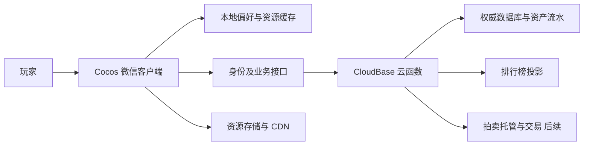

> 2026-10-19：Q24–Q119核心机制已确认，当前规则见[汇总](wayfinder/core-rules-v2/SUMMARY.md)，旧路线/技术描述的冲突以该基线为准。先同步规格与[实现差异](implementation-gaps-2026-10-19.md)，再制定数值/内容方案；已有本地后台核心尚未全部迁移，CloudBase未创建/部署。

# 308世界 — 技术架构与资源边界

状态：Cocos动作原型已完成H5集成回归及微信预览，用户已试玩；10分钟性能专项仍待验证。挑战生命周期玩法已确认，数据/API与事务边界已形成[首版工程规格](backend/README.md)，目标环境验证与部署参数待定；已建立本地后台核心与内存事务测试，未接云端或部署。

更新：2026-10-17。玩法来源为[整体规格](spec.md)与[挑战流程规格](challenge-flow.md)。

## 1. 现有项目证据与复用判断

已检查的旧工作区为 `/Users/zhanbohan/IdeaProjects/Poker_414`，不能证明其与最初提到的 Windows 路径完全一致。该仓库包含：

| 部分 | 实际技术与用途 | 新游戏处理 |
| --- | --- | --- |
| client | React 19、TypeScript、Vite 7 的 H5 客户端 | 普通页面经验可参考，动作渲染重新建设 |
| minigame、minigame-414 | 原生 JavaScript/Canvas 微信棋牌小游戏 | 参考平台接入，不迁移牌局或大型绘制逻辑 |
| server | Node、Express 5、Socket.IO/ws 实时牌局 | 可参考 Node 工程规范，不复用实时牌局服务 |
| shared | TypeScript 棋牌规则及协议 | 可参考共享类型组织方式 |
| 构建/部署 | Vite、tsc、微信开发者工具、Docker、PM2、现有 ECS 流程 | 新仓库另行设计，不套用原有主分支自动部署 |

旧项目已有不同小游戏 AppID 和共享 CloudBase 云托管连接配置，但未发现 RPG 永久资产、交易、排行榜数据库实现。会话和部分去重信息在内存中，不能用作永久身份及资产账本。连接配置存在不等于生产连接已经验证；旧项目真机通信问题也不能被继承为已解决。

本次不复制任何密钥、证书、实际云标识或管理员凭证。

## 2. 客户端方案

选择独立 **Cocos Creator + TypeScript** 工程。动作原型固定 **3.8.8**，已安装并建立 `client/` 样板。H5集成回归及微信预览已完成，用户已试玩。见[动作原型规格](action-prototype.md)及[微信构建验收](reviews/wechat-build-review-v1.md)。持续性能专项和更多设备覆盖仍待验证。

| 方案 | 收益 | 成本 |
| --- | --- | --- |
| 延续原生 Canvas | 少量平台接入经验可复用，直接控制绘制 | 需自建动画、编辑工具、碰撞、资源和动作调试设施 |
| 独立 Cocos 工程（已选择） | 场景、Prefab、动画和资源流程更适合动作内容 | 学习引擎、重建客户端、适配微信能力和验证真机资源加载 |

客户端处理输入、角色运动、碰撞、AI、即时战斗表现和 UI；通过独立在线适配层调用后端。数据库写入权限不进入战斗脚本。纯逻辑数值规则可与后端共享定义，但公开的客户端规则不构成可信证明。

客户端第一切片位于 `client/`。后端 `backend/` 与公开协议 `shared/` 已建立，先运行纯TypeScript本地核心与内存事务测试；尚未接CloudBase，不安装额外依赖。

## 3. 系统形态与模块边界

2026-10-19设计补充：[掉落策略与动态配置](design/drop-strategy-proposal-v1.md)按用户要求将测试补缺与正式掉落策略分离，服务端按不可变版本加载/选择算法及参数。新挑战生效、旧挑战保留版本为建议实施口径；已生成奖励不重抽。当前尚未实现配置发布/动态加载，也未创建云资源。

服务端初期采用 TypeScript/Node 云函数 + CloudBase 文档数据库。资产请求是短业务操作，不为每场单人战斗建立实时房间。持续计算或更强战斗验证确有需要时，再评估云托管；不预设一定需要常驻服务器。

业务模块可划分为角色/职业、战斗/技能、怪物、副本/奖励、装备/成长、道具/背包、数值、体力、身份/资产/存档、排行榜、拍卖和预留社交。它们是代码与规则边界，不是十二个微服务。

## 4. 数据权威与身份

| 数据 | 权威位置 |
| --- | --- |
| 音量、操作偏好、资源和展示缓存 | 本地 |
| 输入、动画、即时碰撞和战斗表现 | 客户端运行；不直接证明奖励合法 |
| 角色等级/经验、装备实例、背包、金库、钱包 | 服务端 |
| 体力、解锁、挑战、奖励、去重结果与流水 | 服务端 |
| 排行榜、挂牌、托管和成交 | 服务端 |

微信登录凭证交由后端验证并映射稳定内部账号。不能接受客户端自报 OpenID、账号或角色归属；session_key 等平台秘密不能回传或持久化到客户端可读区域。

每个资产入口都根据已认证账号检查目标角色及物品权限。账号只保留一个有效游玩会话；新设备接管使旧会话无法操作资产。正式多 AppID 身份共享不在首版，不能假设不同 AppID 的 OpenID 相同。

存档不是客户端整份 JSON 上传覆盖数据库。采用服务端认可的业务操作与版本推进；本地缓存可刷新，不能覆盖金币、装备或进度。

## 5. 候选数据域（不是最终表设计）

| 数据域 | 归属与职责 |
| --- | --- |
| 账号与会话 | 登录映射、会话代次、账号共享解锁 |
| 角色 | 等级、经验、职业、体力窗口与穿戴 |
| 钱包 | 账号金币/点券余额与版本 |
| 物品实例/堆叠 | 唯一归属、位置、绑定、数量与属性 |
| 容器 | 角色背包、账号金库容量与占用 |
| 挑战/房间 | 入口锁定等级、进度、房间付费和结算状态 |
| 奖励与待领 | 来源、原角色、状态和交付结果 |
| 请求结果/资产流水 | 持久去重、来源追踪和恢复依据 |
| 排行榜 | 当前装备评分的可重建读取视图 |
| 挂牌/交易（后续） | 托管、状态、结算和手续费 |

首个在线切片的集合、已知ID访问、索引候选及事务范围见[数据模型](backend/data-model.md)与[一致性协议](backend/consistency.md)。长期清理策略和实际数据库预算仍须验证。避免一个文档承载无限流水或不断增长的整份账号存档。

## 6. 挑战、奖励与断网

挑战由服务端分配记录并锁定角色、怪物等级、配置版本；同账号最多一个未完成挑战。死亡/复活、升级、间接击杀奖励及无时限在线拾取见[挑战流程与模块交接](challenge-flow.md)。进房先检查条件和体力，持久化房间已支付状态，再开始该房间。

客户端处理即时战斗，向后端报告需要确认的进度与收益；服务端检查状态、入口装备快照、时间、怪物/奖励配置和请求身份，并生成物品、随机奖励与唯一实例。请求不能携带任意装备属性、金币增量或可自由选择的掉落结果。

**上述检查仍不能证明客户端真实完成战斗。**内测将这点作为已知限制，正式经济开放前需要额外验证。

断网时暂停本地战斗并等待，恢复后先查询挑战与请求结果。断线或后台恢复窗口为10秒，死亡选择窗口也为10秒，独立计时且重连不重置。关闭/重启不续关，未完成挑战结束回城；已通关只结束拾取场景，不回滚成功。对丢失响应的请求必须区分「服务端已完成」与「没有完成」，不能简单重新发奖，也不能把未确认收益一律宣告丢失。

通关金币、经验和装备生成需在可恢复的一致性边界内完成。背包满时装备归属原角色待领取区；领出与标记已领取原子完成。橙装交付绑定原奖励角色。地面未拾取物品不进入待领取区。

## 7. 体力与固定刷新

权威时间为 UTC 时间换算的北京时间固定四小时窗口。可在登录或消耗时比较已处理窗口，按需要补满；是否配合后台任务仅为实现选择，不要求为每位玩家设置定时任务。

刷新不重置挑战内房间的付费记录。房间扣费请求有稳定业务标识；重复请求返回原操作结果，再读取当前状态，不能因为跨刷新窗口再次扣费。

实现前需明确刷新与扣费并发时的顺序，按权威时间和事务处理，不接受客户端修改时间。

## 8. 原子性与持久幂等

- 金库存取、装备绑定/穿戴、强化消耗与结果、商店购买、兑换、奖励领取等，检查和资产变更置于服务端一致性边界。
- 请求标识作用域包含账号、操作类型与业务对象。相同标识搭配不同参数应拒绝，不能把别人的请求结果作为自己的结果。
- 随机结果只生成一次并持久化；重试不能重新抽取奖励或强化成功率。
- 去重结果与对应资产变更必须共同持久化，不能依赖进程内存 Map。
- 事务回调可能重试，不应在回调中产生不可回滚的外部发货或重复通知。
- 事务额度、文档访问方式与索引需按实际 CloudBase 环境验证；操作尽量有界，不假设事务可以跨任意服务。

## 9. 排行榜

服务端读取角色当前穿戴并计算评分。客户端不直接提交最终分数；合法装备变更驱动重新计算，具体同步或异步方式待设计。

排行榜是权威资产的读取投影，不是资产真相源。若异步更新，旧版本更新不能覆盖新版本，失败可重建。提供总榜及职业榜，读取只返回展示所需信息，不暴露钱包、金库或完整私人资产。

排名范围、翻页、同分顺序、名称显示与刷新频率未定。服务端评分防止直接伪造榜分，但非法来源装备依然可抬高评分，需要来源校验。

## 10. 拍卖行（后续架构）

候选状态流为出售中 → 已成交/已撤回/已到期。终态不能再次销售或撤单。

上架时原子检查物品归属与交易资格，并转入托管，卖方不能继续装备、出售、存金库或再次上架同件物品。

购买时在同一事务中检查挂牌仍出售、买方余额及身份限制，扣买方金币，确认新归属，结算卖方金币和手续费，记录成交与幂等结果。两个买家竞购、购买与撤单并发必须只有一个成功终态。

交付建议使用角色待领区或交易交付区，避免容量造成半笔交易；哪一个区、堆叠数量、绑定时机、账号内自购限制、上架费、到期及下架恢复在拍卖模块决定。

库存、金币和挂牌不能拆成独立、无恢复协议的写入。若未来必须跨服务，另行设计持久补偿协议，不将多次普通数据库写入称为原子交易。

## 11. 安全等级

| 阶段 | 防护目标 | 限制/出口条件 |
| --- | --- | --- |
| 小规模清档内测 | 真实身份、权限、权威资产、边界校验、幂等、限流、异常日志 | 客户端击杀/通关可能伪造；不开放拍卖 |
| 正式运营准备 | 挑战时序、收益预算、配置/装备快照与更多战斗来源校验 | 通过专项评估后再发布 |
| 拍卖开放前 | 可追溯物品来源、并发交易、恢复和攻击场景验证 | 更强记录验证/重算是否必要，按威胁和成本决定 |

数据库规则默认拒绝客户端直接修改权威资产；后端管理员权限不能替代账号业务授权。规则、函数权限和配置需在目标环境验证，不仅凭代码判断。

## 12. 项目与云资源边界

- 独立 Git 工程已存在；用户提供的独立小游戏 AppID `wxa68f1165ec1284fa` 已配置并用于微信预览。后台本地核心已创建，CloudBase环境尚未创建。
- 开发/内测与正式环境隔离；可隔离数据、权限、资源版本和故障影响，增加少量配置及维护成本。
- 不与旧棋牌项目共享钱包、账号映射、数据集合或云托管运行实例。
- 可借鉴旧项目的平台接入与工程经验，不能直接继承 AppID、凭证、发布钩子或牌局业务逻辑。
- 客户端配置只携带平台需要的公开标识，不含服务端凭证。未来开发时通过明确环境配置注入，不在文档阶段编造值。

## 13. 内容与资源工作流

动作原型先用横屏 480×270 基础战斗画布、本体高约 32–40 源像素的小人物样板和统一脚底锚点，细节见[动作原型规格](action-prototype.md)。先验证一个战士、一种怪及单怪/三怪对抗，再扩充生产资源；完整帧框、调色板与挂点等生产规格仍待确定。

角色动作按用户指定参考 Codex 宠物的待机、移动、转向、跑跳与状态切换表现；规范见动作原型规格第 4.3 节。输入、运动/战斗状态与动画表现分离。宠物代码、skill 和素材是否可直接复用尚未检查，不能视为现成 Cocos 依赖；跑跳参考不自动增加真实跳跃玩法。

Cocos 本地/分包/远程资源按实际样板包体选择。首次加载、缓存淘汰、失败重试与版本兼容必须真机验证。具体微信包体限制属于会变化的外部规则，实施时核对官方文档，不把早期蓝图数字写成永久约束。

现有战士概念图是早期双持视觉探索；本轮已选择双刀视觉和动作，但该图仍不等于生产动画。双刀如何映射武器装备实例另行设计，不自动增加装备槽。

## 14. 实施前仍需决定

动作原型及微信预览已试玩，持续性能仍待专项验收。挑战状态与10秒恢复/死亡规则已落档；最小在线API、候选集合/索引、并发协议和配置绑定已见[后台规格](backend/README.md)；SDK、身份适配、数据库预算及实际环境仍需验证。相应规格与授权齐备后再建立后端工程、接入正式资源和部署。

## 参考

以下支持技术能力判断，不代表云资源已验证或已部署：

- [Cocos 微信小游戏发布](https://docs.cocos.com/creator/3.8/manual/zh/editor/publish/publish-wechatgame.html)
- [Cocos Asset Bundle](https://docs.cocos.com/creator/3.8/manual/zh/asset/bundle.html)
- [微信小游戏登录](https://developers.weixin.qq.com/minigame/dev/guide/open-ability/login.html)
- [CloudBase 服务端事务](https://docs.cloudbase.net/database/transaction)
- [CloudBase 数据库安全规则](https://docs.cloudbase.net/database/security-rules)
- [CloudBase 云函数](https://docs.cloudbase.net/cloud-function/how-use)
