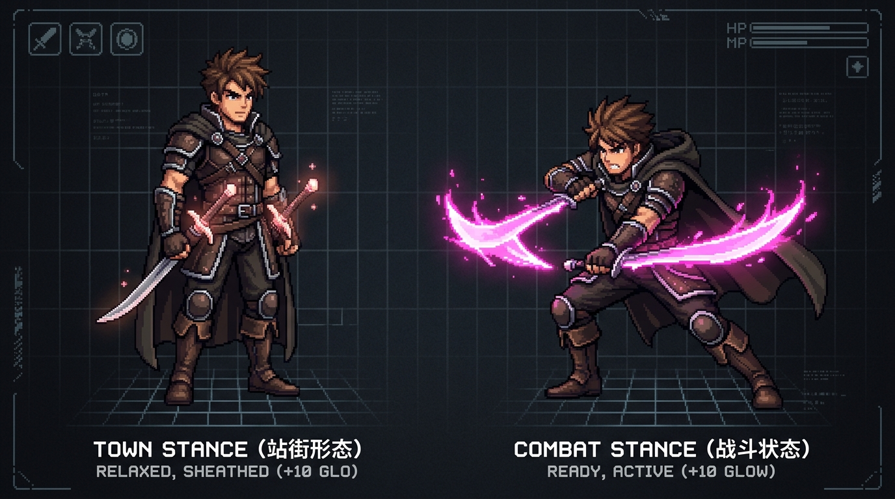
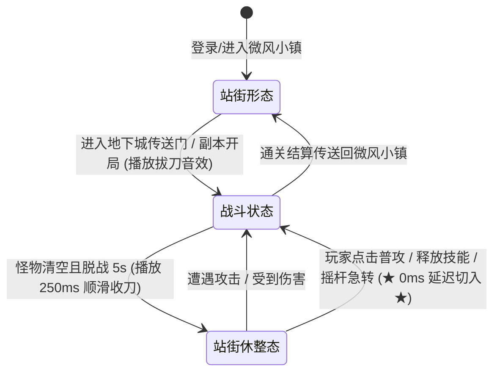

# 308世界 — 双刀战士双形态美术与交互规格说明书 (v1)

更新日期：2026-10-21。关联：[UI视觉布局与交互规格说明书 v1](../design/ui-layout-specification-v1.md)、[动作设计 v1](motion-studies/warrior/DESIGN.md)、[技能命中反馈 v2](motion-studies/warrior/skill-hit-feedback.md)。

---

## 1. 确认与背景澄清

### 1.1 前期设计状态追溯确认
用户提出关键审阅意见：“我理解还需要补充角色的站街形态和战斗状态，之前设计的应该战斗状态吧？”
**经客户端动作管线全量溯源确认：此判断完全准确。**
- 原有动作切片（24帧三段普攻、拔刀斩、十字斩、崩山击、大崩）以及 `WarriorSpriteSheetView.ts#showReady()` 中的待机帧 0，**均为身体前倾压低重心、双手出鞘持刃的【战斗状态 (Combat Stance)】**；
- 原有系统在城镇场景下直接复用了出鞘持刃待机，导致城镇内视觉体验紧绷、缺乏从容身姿展现与时装穿搭细节展示；
- **本规范正式确立【站街形态 (Town Stance)】与【战斗状态 (Combat Stance)】双形态架构**，并完成对应高精 2D 像素原画、UI 纸娃娃双形态切换及全场景渲染规则。

---

## 2. 双形态视觉母版与资产索引

### 2.1 核心资产文件一览
| 资产分类 | 相对工程路径 | 尺寸规格 | 视觉表现与用途 |
| :--- | :--- | :--- | :--- |
| **双形态对比全景大图** | `docs/art/warrior-stances-comparison-v1.png` | 1376 × 768 px | 站街与战斗双姿态并排对比设计画册、设计评审主基准 |
| **站街形态原画切片** | `docs/art/warrior-stance-town.png` `client/assets/resources/warrior-stance-town.png` | 468 × 592 px | 挺拔从容站立、双刀入鞘、腰佩疾风徽章，用于 C 键纸娃娃与城镇 HUD |
| **战斗状态原画切片** | `docs/art/warrior-stance-combat.png` `client/assets/resources/warrior-stance-combat.png` | 633 × 530 px | 压低重心微蹲、双刀出鞘炽粉流光迸发，用于副本实战 HUD 与 C 键战斗态预览 |
| **Mockup 画册第 14 联** | `docs/design/ui-mockups/14-character-stances-town-vs-combat.png` | 960 × 540 px | 微信小游戏基准分辨率下的双形态规格落地检视界面 |

---

## 3. 站街形态 vs 战斗状态多维特征矩阵

| 评估维度 | 站街形态 (Town Stance) | 战斗状态 (Combat Stance) |
| :--- | :--- | :--- |
| **主摄场景** | 城镇微风小镇安全区、NPC 交互界面、个人信息 (C 键) 时装检视 | 地下城副本探索、首领挑战房间、木桩实测演练场 |
| **武器佩戴方式** | **双刀收鞘 (Sheathed)**：双刃收纳于腰间两侧专用皮质刀鞘（双手自然下垂或一手轻抚刀柄） | **双刀出鞘 (Unsheathed)**：双手分别紧握主副手冷钢双刃，刃锋前指护住中线 |
| **躯干与重心姿态** | 站姿自然笔直挺拔，双肩下沉放松，充分展现人物修长比例与装备/时装外观细节 | 身体微屈前倾，双膝微弓压低重心，背阔肌紧绷，处于随时蓄力爆发位移的戒备态 |
| **待机待命微动画** | **舒缓深呼吸起伏**（6 帧，1.4s 平滑循环）：胸廓轻微起伏，发带与披风随微风轻柔飘动 | **紧绷短促警戒**（4 帧，0.8s 呼吸循环）：刀尖微幅震颤，身体小幅度重心前后微调 |
| **移动步态表现** | **城镇漫步/自然慢跑 (Town Walk/Jog)**：上身挺直平稳，武器随脚步轻晃 | **战术冲刺/低空滑步 (Tactical Dash)**：身位贴地贴近地面冲刺，双刃拖曳身后随时挥击 |
| **强化动态光芒** | +10 质变粉光以 $1.4\text{s}$ 温和周期在刀鞘剑柄处脉冲微闪，同屏玩家清晰可见，但无攻击性剑气 | 整个刀身全域炽粉电光/月芒流溢，普攻连斩留下炽粉月牙拖尾，四大技能继承对应色系粒子 |

---

## 4. 状态机流转与手感红线 (State Machine Rules)

### 4.1 核心手感红线：0 毫秒瞬发战斗切入 (Zero-Latency Engagement)
- **手感致命禁忌**：严禁在玩家按下攻击或技能时强行插入“慢动作拔刀前摇”（会导致动作手感僵硬笨重）；
- **0ms 切入规则**：当角色处于收刀站街或警戒休整态时，只要玩家产生战斗输入（点击普攻、释放十字斩/崩山击/拔刀斩/大崩、或使用快捷栏药水）：
  1. 系统在 **0 毫秒** 内将状态切换为【战斗状态】；
  2. **直接执行该攻击/技能动作的第一帧命中判定与刀光绘制**，拔刀自然融合在首段斩击起始位中；
  3. 彻底杜绝任何按键输入迟滞感。

### 4.2 场景进出与脱战收鞘
1. **城镇安全区锁定**：微风小镇全域禁止拔刀盲挥，角色常驻优雅【站街形态】；
2. **副本脱战自动归鞘**：当房间内所有怪物被清空，或连续 5 秒未造成伤害且未受到攻击，战士会自动播放 250ms 单手挽刀收鞘动作，进入休整待机态。

---

## 5. UI 与可视化工具集成现状

1. **原型交互工具 [town-ui-preview.html](../../client/tools/town-ui-preview.html)**：
   - 个人信息界面（C 键）提供交互式 `[ 站街形态 / 战斗状态 ]` 切换按钮，可实时预览站街收鞘立绘与战斗持刃立绘；
   - 城镇安全区 HUD（Town HUD）嵌入高精站街形态与手持 +10 武器 1.4s 呼吸光晕；
   - 副本战斗 HUD（Combat HUD）嵌入战斗姿态双刀立绘与暴击爆裂光火；
   - 新增第 12 项专属画册页签 `角色双形态对比 (站街 vs 战斗)`，完整呈现原画对比与设计规则。
2. **离线渲染画册 [render-mockups.cjs](../../client/tools/render-mockups.cjs)**：
   - 生成全新第 14 张高清设计效果图 `14-character-stances-town-vs-combat.png`；
   - 更新 Mockup 01、Mockup 10、Mockup 11 移除所有临时 Emoji 占位，全面采用真实 2D 像素原画！
