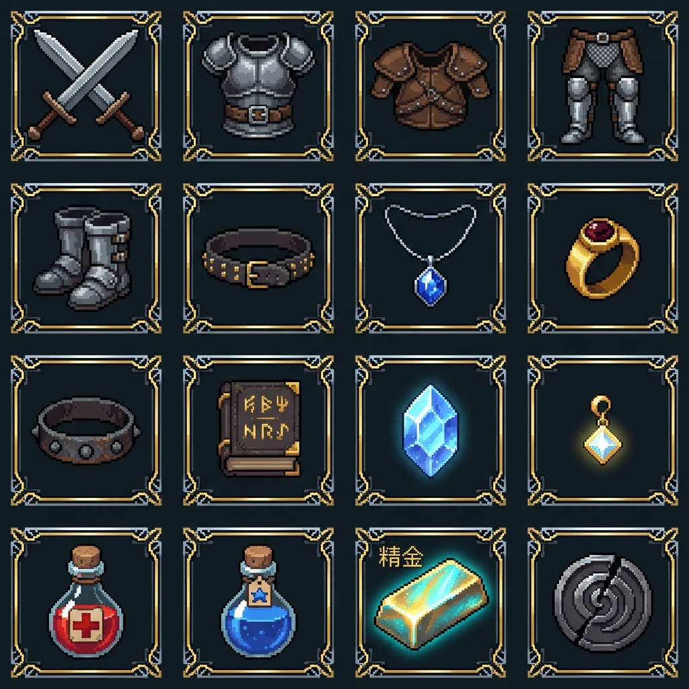

# 308世界 — 物品与装备像素图标规范说明书 (v1)

更新日期：2026-10-21。关联：[UI视觉布局与交互规格说明书 v1](../design/ui-layout-specification-v1.md)、[UI与美术风格标准化 v1](../design/ui-art-style-standardization-v1.md)、[装备方案 v1](../design/equipment-proposal-v1.md)。

---

## 1. 资产概述与规格基准

在角色个人信息（C键）、背包换装（B键）、铁匠修理/强化、杂货商人、银行金库及战斗快捷栏中，所有装备与道具必须采用**高品质 2D 点阵像素风图标（Pixel Art Icons）**呈现，严禁使用纯文字缩写。

- **母版分辨率**：**256 × 256 px**（高精原始设计母版，用于图鉴画册与高分辨率展示）；
- **运行时多规格独立导出（严禁运行时非整数缩放）**：
  - **标准槽位图集**：**48 × 48 px**（离线独立导出，适配 56×56 背包/金库标准格子，预留 4px 内边距）；
  - **详情与检视大图**：**64 × 64 px**（离线独立导出，用于装备详情弹出大卡片、结算大图）；
  - **纸娃娃紧凑槽位**：**34 × 34 px**（离线独立导出）；
  - **采样模式**：严格采用最近邻点阵采样（Nearest-Neighbor / Point Sampling，保留清晰像素边缘与网格对齐，禁用双三次模糊平滑，`image-rendering: pixelated`）；严禁在运行时用 64×64 按 0.75× 强行非整数倍缩放，避免点阵线条粗细不均；
- **透明底纯净切片原则 (Transparent Subject Decoupling)**：所有图标切片必须为**纯透明背景 PNG (Alpha=0)**，仅包含物品主体（武器刀刃、铠甲、宝石、药水瓶），**严禁在图标文件内固化暗岩底衬或品质外框**；底衬（`Layer 0`）与品质外框（`Layer 2`）统一由 UI 槽位组件分层渲染，彻底消除一格双底板、双边框的重复渲染与视觉冲突，并使同一图标可在背包、详情大卡片、纸娃娃、通关奖励中通用；
- **整合图集母版**：[item-icons-sheet-v1.png](item-icons-sheet-v1.png)（1024 × 1024，4×4 网格）。

以下尺寸与命名为候选目标，尚非现有资源齐备的声明。现有目录含原图及部分 `_64` 文件；48、34 版本、透明主体与品质框拆分须逐项核查并离线导出，检查透明边缘及轮廓，必要时人工修整。离线非整数缩小也可能造成点阵不均；保留原稿及各尺寸审阅结果，小样通过后再批量制作。

---

## 2. 16 枚核心物品图标图集索引 (4×4 Grid)

| 网格坐标 (Row, Col) | 计划资产命名 (48×48 槽位 / 64×64 大卡片) | 物品类型 / 部位 | 视觉特征描述 | 代表性装备 / 物品 |
| :--- | :--- | :--- | :--- | :--- |
| **(0, 0)** | `weapon_dual_blades_48.png` / `_64.png` | 武器 (Weapon) | 交叉冷钢双刃，青钢护手与皮革柄卷 | 狂暴残虐双刀、精炼白铁双刀 |
| **(0, 1)** | `armor_chest_48.png` / `_64.png` | 上衣 (Chest) | 锻造精钢重板甲/硬皮轻甲，配腹部皮带扣 | 幽暗轻甲、野性兽皮胸甲 |
| **(0, 2)** | `armor_shoulders_48.png` / `_64.png` | 护肩 (Shoulders) | 铆钉皮革护肩甲，双层防护结构 | 幽暗护肩、旅者护肩 |
| **(0, 3)** | `armor_pants_48.png` / `_64.png` | 下衣 (Pants) | 战术链甲战裙与合金护胫长裤 | 幽暗长裤、粗糙布裤 |
| **(1, 0)** | `armor_boots_48.png` / `_64.png` | 鞋子 (Boots) | 金属包头锁扣长筒重战靴 | 幽暗战靴、轻便皮靴 |
| **(1, 1)** | `armor_belt_48.png` / `_64.png` | 腰带 (Belt) | 镶嵌铆钉硬质皮革战术腰带与黄铜搭扣 | 兽皮腰带、精钢锁扣带 |
| **(1, 2)** | `jewelry_necklace_48.png` / `_64.png` | 项链 (Necklace) | 秘银细链坠挂深蓝晶莹宝石吊坠 | 秘银项链、蓝晶吊坠 |
| **(1, 3)** | `jewelry_ring_48.png` / `_64.png` | 戒指 (Ring) | 纯金雕花戒圈镶嵌椭圆血红宝石 | 勇者之戒、狂暴之戒 |
| **(2, 0)** | `jewelry_bracelet_48.png` / `_64.png` | 手镯 (Bracelet) | 暗铁铆钉锻造战术护腕手镯 | 守护手镯、铁铸手镯 |
| **(2, 1)** | `special_book_48.png` / `_64.png` | 辅助装备 (Auxiliary) | 古代符文皮革装订战术法典/图腾秘卷 | 力量之书、战神图腾 |
| **(2, 2)** | `special_stone_48.png` / `_64.png` | 魔法石 (Magic Stone) | 散发蔚蓝冰芒的六棱柱天然魔法水晶 | 灵风魔石、元素魔石 |
| **(2, 3)** | `special_earring_48.png` / `_64.png` | 耳环 (Earring) | 黄金耳钩吊坠白金四芒星辉光宝石 | 聚能耳环 (可强化) |
| **(3, 0)** | `consumable_hp_potion_48.png` / `_64.png` | 消耗品 (Consumable) | 软木塞烧瓶盛装炽红生命药水，附十字标签 | 初级生命药水 (恢复300HP) |
| **(3, 1)** | `consumable_mp_potion_48.png` / `_64.png` | 消耗品 (Consumable) | 软木塞烧瓶盛装蔚蓝法力药水，附星徽标签 | 初级法力药水 (恢复60MP) |
| **(3, 2)** | `material_adamantite_48.png` / `_64.png` | 强化材料 (Material) | 散发金青色金属冷光质感的【精金】合金锭 | 游戏专属强化材料【精金】 |
| **(3, 3)** | `material_souvenir_48.png` / `_64.png` | 损毁纪念品 (Material) | 带有同心裂纹的深灰陨铁破碎战功纹章 | +13及以上强化损毁纪念品 |

---

## 3. UI 格子与角标装配规范

### 3.1 格子层叠渲染架构 (Z-Index Hierarchy)
1. **Layer 0 (底衬层)**：暗岩色网格背景 `#10181e`（由 UI 组件通过 `panel_well_inner` 9-Patch 切片统一渲染，图标素材自身不含底衬）；
2. **Layer 1 (图标层)**：居中放置 48×48px（56×56 背包/金库标准格子）或 34×34px（纸娃娃紧凑槽位）的**纯透明底**点阵 PNG 图标；
3. **Layer 2 (品质外框层)**：由 UI 组件按装备品质动态挂载 2px 边框与内发光 Sprite（粗糙白灰、优秀草绿、精良蔚蓝、稀有暗紫、传说金橙、史诗炽红；图标素材自身不带边框）；
4. **Layer 3 (强化角标层)**：右上角或右下角浮动强化等级（如黄色 `+10`，+10以上带粉色呼吸光芒）；
5. **Layer 4 (耐久指示条)**：槽位底边 3px 纯三色进度条（绿 $>50\%$、黄 $\le50\%$、红 $=0$ 失效）；
6. **Layer 5 (堆叠数量徽标)**：右下角常驻黑色半透明底衬数量标牌（如 `x5`、`x20`，单堆上限严格遵守系统规约 `MAX_STACK = 20`，不可堆叠物品不显示）。
