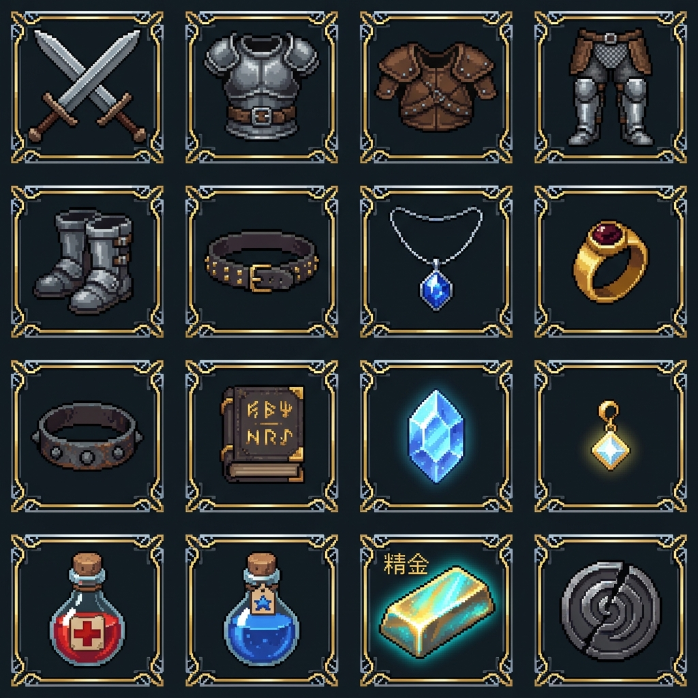

# 308世界 — 物品与装备像素图标规范说明书 (v1)

更新日期：2026-10-21。关联：[UI视觉布局与交互规格说明书 v1](../design/ui-layout-specification-v1.md)、[装备方案 v1](../design/equipment-proposal-v1.md)。

---

## 1. 资产概述与规格基准

在角色个人信息（C键）、背包换装（B键）、铁匠修理/强化、杂货商人、银行金库及战斗快捷栏中，所有装备与道具必须采用**高品质 2D 点阵像素风图标（Pixel Art Icons）**呈现，严禁使用纯文字缩写。

- **母版分辨率**：**256 × 256 px**（高精原始母版，用于图鉴画册与高分辨率展示）；
- **运行时游戏内尺寸**：**64 × 64 px**（预缩放点阵位图，针对 `48×48px` ~ `56×56px` UI 格子 1:1 或高质量双三次像素对齐采样，`image-rendering: pixelated`）；
- **底板设计规范**：每个图标均包含内嵌暗岩色底衬与四角古典金属包角边框（按品质色染色）；
- **整合图集母版**：[item-icons-sheet-v1.png](item-icons-sheet-v1.png)（1024 × 1024，4×4 网格）。

---

## 2. 16 枚核心物品图标图集索引 (4×4 Grid)

| 网格坐标 (Row, Col) | 文件名 (64×64 运行时) | 物品类型 / 部位 | 视觉特征描述 | 代表性装备 / 物品 |
| :--- | :--- | :--- | :--- | :--- |
| **(0, 0)** | `weapon_dual_blades_64.png` | 武器 (Weapon) | 交叉冷钢双刃，青钢护手与皮革柄卷 | 狂暴残虐双刀、精炼白铁双刀 |
| **(0, 1)** | `armor_chest_64.png` | 上衣 (Chest) | 锻造精钢重板甲/硬皮轻甲，配腹部皮带扣 | 幽暗轻甲、野性兽皮胸甲 |
| **(0, 2)** | `armor_shoulders_64.png` | 护肩 (Shoulders) | 铆钉皮革护肩甲，双层防护结构 | 幽暗护肩、旅者护肩 |
| **(0, 3)** | `armor_pants_64.png` | 下衣 (Pants) | 战术链甲战裙与合金护胫长裤 | 幽暗长裤、粗糙布裤 |
| **(1, 0)** | `armor_boots_64.png` | 鞋子 (Boots) | 金属包头锁扣长筒重战靴 | 幽暗战靴、轻便皮靴 |
| **(1, 1)** | `armor_belt_64.png` | 腰带 (Belt) | 镶嵌铆钉硬质皮革战术腰带与黄铜搭扣 | 兽皮腰带、精钢锁扣带 |
| **(1, 2)** | `jewelry_necklace_64.png` | 项链 (Necklace) | 秘银细链坠挂深蓝晶莹宝石吊坠 | 秘银项链、蓝晶吊坠 |
| **(1, 3)** | `jewelry_ring_64.png` | 戒指 (Ring) | 纯金雕花戒圈镶嵌椭圆血红宝石 | 勇者之戒、狂暴之戒 |
| **(2, 0)** | `jewelry_bracelet_64.png` | 手镯 (Bracelet) | 暗铁铆钉锻造战术护腕手镯 | 守护手镯、铁铸手镯 |
| **(2, 1)** | `special_book_64.png` | 辅助装备 (Auxiliary) | 古代符文皮革装订战术法典/图腾秘卷 | 力量之书、战神图腾 |
| **(2, 2)** | `special_stone_64.png` | 魔法石 (Magic Stone) | 散发蔚蓝冰芒的六棱柱天然魔法水晶 | 灵风魔石、元素魔石 |
| **(2, 3)** | `special_earring_64.png` | 耳环 (Earring) | 黄金耳钩吊坠白金四芒星辉光宝石 | 聚能耳环 (可强化) |
| **(3, 0)** | `consumable_hp_potion_64.png` | 消耗品 (Consumable) | 软木塞烧瓶盛装炽红生命药水，附十字标签 | 初级生命药水 (恢复300HP) |
| **(3, 1)** | `consumable_mp_potion_64.png` | 消耗品 (Consumable) | 软木塞烧瓶盛装蔚蓝法力药水，附星徽标签 | 初级法力药水 (恢复60MP) |
| **(3, 2)** | `material_adamantite_64.png` | 强化材料 (Material) | 散发金青色金属冷光质感的【精金】合金锭 | 游戏专属强化材料【精金】 |
| **(3, 3)** | `material_souvenir_64.png` | 损毁纪念品 (Material) | 带有同心裂纹的深灰陨铁破碎战功纹章 | +13及以上强化损毁纪念品 |

---

## 3. UI 格子与角标装配规范

### 3.1 格子层叠渲染架构 (Z-Index Hierarchy)
1. **Layer 0 (底层)**：暗岩色网格背景 `#10181e`，4px 圆角；
2. **Layer 1 (图标层)**：居中放置 34×34px（纸娃娃槽位）或 40×40px（背包格子）的像素 PNG 图标；
3. **Layer 2 (品质外框层)**：按装备品质施加 2px 边框与内发光（粗糙白灰、优秀草绿、精良蔚蓝、稀有暗紫、传说金橙）；
4. **Layer 3 (强化角标层)**：右上角或右下角浮动强化等级（如黄色 `+10`，+10以上带粉色呼吸光芒）；
5. **Layer 4 (耐久指示条)**：槽位底边 3px 纯三色进度条（绿 $>50\%$、黄 $\le50\%$、红 $=0$ 失效）；
6. **Layer 5 (堆叠数量徽标)**：右下角常驻黑色半透明底衬数量标牌（如 `x15`、`x50`）。
