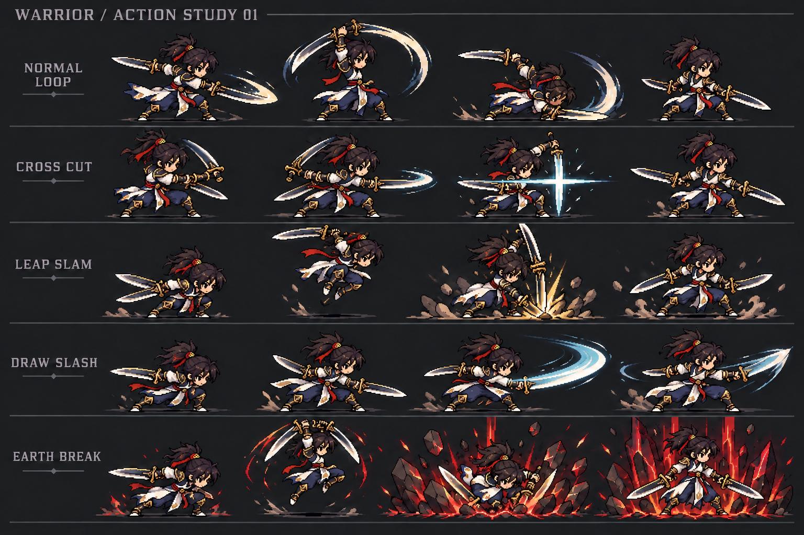

> 实现进度（2026-10-16）：三段普攻连续动画草稿 v2 已接入并完成桌面浏览器运行检查，见 [资源归档](basic-attack/light-sword/animation-v2/README.md)。四技能仍为旧程序动画；本设计其余目标不视为已实现。

# 双刀战士动作设计 v1

日期：2026-10-16。状态：**可供关键姿势样片制作的设计初稿；未实现、未试玩验收。**

用户已确认光剑里鬼普攻与十字斩、崩山击、拔刀斩、崩山裂地斩四技能的参考方向，并授权开始设计。本稿负责把观察转为本游戏的动作方案。下列时间、关键姿势数、取消规则和效果组织是本轮设计提案，不冒充用户逐项确认或原作精确参数。

草图按普攻、十字斩、崩山击、拔刀斩、大崩从上到下排列，每行四格仅示意主要姿势。由内置 image_gen 依据本项目角色概念生成并修订，已修正首稿的部分朝向与拔刀刀光问题；仍不是连续帧、精准刀尖轨迹或可直接导入的动画图集。完整分镜优先于草图格数，制作前还需逐姿势检查持握连续性与脚底锚点。见[生成提示词与修订记录](poseboard-generation.md)。

## 1. 阅读入口与版本关系

| 动作 | 设计与分镜 | 视频证据 |
| --- | --- | --- |
| 三段普攻循环 | [普攻设计](basic-attack/light-sword/design.md) | [光剑里鬼观察](basic-attack/light-sword/README.md) |
| 十字斩 | [技能 1 设计](skills/gore-cross/design.md) | [十字斩观察](skills/gore-cross/README.md) |
| 崩山击 | [技能 2 设计](skills/mountain-crash/design.md) | [崩山击观察](skills/mountain-crash/README.md) |
| 拔刀斩 | [技能 3 设计](skills/draw-slash/design.md) | [拔刀斩观察](skills/draw-slash/README.md) |
| 崩山裂地斩 | [技能 4 设计](skills/outrage-break/design.md) | [大崩观察](skills/outrage-break/README.md) |

`README.md` 记录看到的事实与局限；`design.md` 记录本游戏如何制作。旧六帧图集与四阶段代码仍是当前运行版本，不是新设计已完成。本文作为新动作制作入口；正式成长、经济和服务器规则仍以整体玩法规格为准。

## 2. 战斗辨识与初稿参数

总体形象：原创像素双刀战士，以脚步支撑、腰肩扭转、手臂带刀发力；攻击时身体重心有明显变化。不能只旋转刀或放大特效。

所有时间单位为 ms，起点为本动作实际开始。角色动作时长不等于屏幕上全部效果的寿命。

| 动作 | 角色占用时长 | 伤害标记 | 首轮允许移动/接其他动作 | 可辨认的差异 |
| --- | ---: | ---: | ---: | --- |
| 普攻 A | 200 | 80 | 170 | 胸腰高度的交错斩 |
| 普攻 B | 220 | 100 | 190 | 扭身向上交错，接高举 |
| 普攻 C | 360 | 140 | 310 | 高举下落，低重心收势 |
| 十字斩 | 560 | 290 | 460 | 先横后竖，十字留痕 |
| 崩山击 | 880 | 580（落地） | 780 | 短跃前移，局部落击 |
| 拔刀斩 | 760 | 440 | 660 | 明显收身，瞬间宽斩 |
| 大崩 | 1320 | 880（落地） | 1320 | 高举重落，地裂后延迟喷发 |

普攻按住连打时 A→B→C→A 不插入额外停顿，一轮 780 ms。大崩效果持续到约 2400 ms，但角色不被残留效果持续锁定。以上是原型起调值，全部集中配置；不能据参考录像锁死最终帧数。

## 3. 双刀、空间与判定

- 画面左右镜像复用，按面向定义前后。主手负责主要轮廓，副手有独立刀路和回收位置，不能两把刀同角度同步摆动。双手动作不能把刀尖无意刺进躯干。
- 普攻 A/B 分别完成交错与上引，C 承接高举下落。十字斩由主手横斩、副手竖斩完成；崩山击和大崩让两刀聚拢形成重落轮廓，不临时把双刀换成一把巨剑。
- 拔刀斩采用侧腰收刀的双刀变体：主手主横斩，副手略滞后贴身扫回，不新增伤害。姿势表达收势蓄力，不要求每次攻击前凭空出现刀鞘。
- `groundX/groundY` 是运动、碰撞、阴影和 Y 排序依据；空中高度 `lift` 只影响身体展示，不能拿屏幕上的头部/刀尖位置作落地判定。
- 首轮沿用当前原型的普攻与技能几何配置作对照，在调试视图显示地面范围。拔刀斩仍只打前方；十字斩不建立独立远程伤害投射物；大崩仍按落地结算一次。范围在视觉对齐后再调，不能把旧圆形判定画成无纵深限制的大地面区域。
- 单次动作对同一目标只结算一次：以动作实例与伤害标记去重。每段普攻独立生成实例；碰到已僵直目标不应因此漏掉下一次合法攻击，接入时修正现有“stunned 即跳过”的筛选。

## 4. 输入、衔接与打断

| 当前状态 | 输入/事件 | v1 设计结果 |
| --- | --- | --- |
| 待机/移动 | 普攻按下 | 启动 A；单击只打一段 |
| 普攻动作中 | 持续按住 | 当前段结束后自动接下一段，C 后回 A |
| 普攻末段 120 ms | 再次点击普攻 | 最多缓冲下一段一次，不累计多套动作 |
| 普攻已结束 | 300 ms 内点击 | 继续下一段；超时重开 A，计时不包含正在播放的动作 |
| 普攻动作中 | 有效技能输入 | 进入该普攻段可取消时点后释放；先排入一个缓冲项，最长等待 180 ms，过期丢弃 |
| 技能动作中 | 技能/普攻输入 | 尾段 180 ms 可缓冲一项；到可接动作时再检查蓝量/冷却；有效技能优先于持续普攻 |
| 任意动作 | 普攻松开、触摸取消 | 停止生成按住请求，清除该触点尚未执行的普攻缓冲；当前已经开始的段正常完成 |
| 技能无法释放 | 缺蓝/冷却/被禁止状态 | 提示原因，不扣资源、不重置普攻，不把按钮点击当作实际释放 |
| 技能实际开始 | 检查通过 | 重置普攻序列到 A，锁定出招朝向，并开始技能资源/冷却处理 |
| 可移动时点到达 | 摇杆有输入 | 恢复地面移动，可结束剩余回正姿势；独立效果继续 |

初稿不允许在前摇/有效打击中随意翻身改变攻击方向；出招开始锁定朝向。后摇开放移动后才可转向。普攻与职业技能均不新增无敌或霸体；普通受击可打断。被打断时清除动作缓冲，玩家继续主动按住可在受击结束后重新请求 A，但不能因遗留触点卡键自动攻击。

崩山击/大崩在落地前被打断：取消尚未发生的落地标记与地面效果，清零视觉高度，阴影回到当前地面位置。在落地后被打断：已结算伤害不撤销，已生成的无伤害残留可继续；不会再次触发命中。死亡/重置/离开房间时全部清理。

## 5. 资源与伤害边界

本轮设计动作与时序，不确定正式伤害公式、解锁等级或长期资源平衡。首次接入暂保留现有原型的法力/CD/伤害用于比较，并明确调试标记：

| 技能 | 现有法力 | 现有 CD（秒） | 现有固定伤害 |
| --- | ---: | ---: | ---: |
| 十字斩 | 8 | 1.1 | 1 |
| 崩山击 | 18 | 3.4 | 2 |
| 拔刀斩 | 16 | 2.4 | 2 |
| 大崩 | 40 | 8.0 | 3 |

这些数字来自 `WarriorSkillsModel.ts`，不是新设计的正式数值表。资源只在动作真正启动时消耗一次，CD 同时开始；被打断不返还。排队、无效输入与资源不足均不消耗。

普攻每段一次伤害；十字斩在竖斩完成处一次伤害；两种崩山在落地处一次伤害；拔刀斩在横扫有效时一次伤害。大崩后续喷发首轮仅表现，不再伤害；若试玩认为应有第二个伤害阶段，另行调整事件与提示，不能悄悄重复结算。

## 6. 素材与动画交付

- 先画各动作分镜指定的关键姿势并做粗动画；动作轮廓与接缝通过后才补过渡、衣摆和精修，不直接批量生产整套图集。
- 待机、三个普攻段、四技能、受击、走跑分别命名。角色身体、近身刀光、地面特效分轨；每组独立帧序和非均匀帧时长，不能统一“每帧一样长”。
- 保留现有 480×270 战斗构图与角色显示占比作手机对照。首轮角色姿势使用一致的像素密度、脚底锚点和比例；刀光可扩出本体，不靠缩小整个人物容纳大范围效果。
- 帧框先用全部关键姿势的联合包围盒加留白确定，不把旧 512×512 生成图格当作生产原生像素规格。导出透明 PNG 序列/图集与可编辑源文件，记录帧框、脚底坐标、双手/刀尖挂点与素材来源。
- 身体与效果的轨道均需有事件标记；角色事件包括伤害、落地、可移动、可接动作。效果寿命可以超过动作寿命，但不能自行生成额外伤害。
- 每套必须提供 1× 与 0.25× 两种预览、单次出招与循环/接普攻演示。保留左右朝向及实际手机显示尺寸对照，不以放大截图替代验收。

## 7. 接入顺序与现有代码差距

1. 先制作三段普攻粗动画，核对 C→A 接缝；`CombatModel` 迁移到配置长度为 3 的循环，移除 `% 4`、第四段分支与旧状态文案，保留缓冲/松手/受击语义。
2. 动画播放器接收动作 ID、阶段与 elapsed，不再仅以 `showAttack(progress)` 反复播放相同六帧。四技能不能一直显示待机帧盖住姿势演示。
3. 十字斩按横/竖两个视觉标记与一个伤害标记接入；崩山击按高度、地面前移与落地标记对齐。
4. 拔刀斩实现短准备—快横斩—收势，而非现有的直线条带；默认不接入进化分支。
5. 大崩创建独立的地裂/延迟喷发效果实例，冻结落地位置与朝向。现有 `drawSkillEffect` 随 `activeId` 清空的结构不足以支持收招后残留；取消/重置必须明确清理不同阶段。
6. 联调单怪、三怪、空挥、错开纵深、贴脸、边界、打断与连续按键，然后重新构建 H5，进行手机复评。

当前没有执行上述迁移。阶段动画不能以代码已编译或截图好看作为“与参考一致”的结论。

## 8. 设计验收与待调项

| 检查 | 合格表现 |
| --- | --- |
| 不看按钮区分动作 | 三段普攻、十字横竖、小崩落击、拔刀快横斩和大崩延迟喷发各自可辨 |
| 连续普攻 10 轮 | A/B/C 有独立姿势，C→A 无闪回或脚底跳动；松手不产生后续请求 |
| 有效命中 | 刀路/落点与调试范围可理解，无范围外飞行残影误导；同目标不因重复帧多次扣血 |
| 技能衔接 | 缓冲不会排队放多招；技能实际启动才重置连段与消耗蓝量 |
| 大崩落地后走开 | 地裂和喷发留在原落点，角色可在指定时点恢复；残留不新增伤害 |
| 落地前受击/房间重置 | 不出现幽灵落地、悬空、跨房间喷发或重复命中 |
| 手机实际尺寸 | 起势、落刀、横竖刀路与受击仍清楚；大招不能长时间完全遮住敌人预警和角色 |

待试玩调整：各动作时长、三段普攻比例、双刀轨迹、取消点与缓冲长度、前后/纵深范围、十字留痕推进距离、大崩地裂到喷发的延迟和遮挡。若要改为十字远程伤害、拔刀身后判定、拔刀进化分支或大崩喷发第二段伤害，需作为明确设计变更记录，不由特效自行决定。
