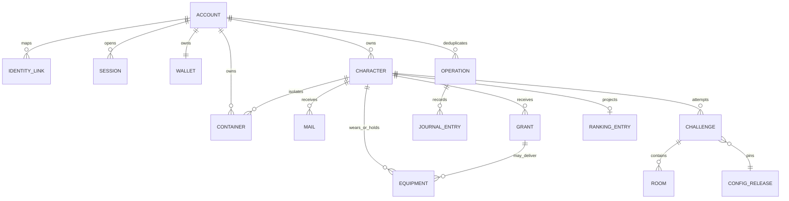

# 数据字典与实体关系 v2

更新：2026-10-20。状态：E02工程设计提案，待方案收敛与eng-review，未建集合、修改代码或运行数据库验证。依据：[规格](../spec.md)、[挑战流程](../challenge-flow.md)、[核心契约v2](core-contract-v2.md)、[模块依赖](logical-architecture-v2.md)。

本文给出MVP逻辑实体、字段与约束，不将一个逻辑实体强制等同一个物理集合。表名是候选；物理编码、索引、最坏事务读写和字节预算在E03细化后才能冻结。没有确定的玩法参数明确引用配置或标为待定，不通过字段默认值新增规则。

## 1. 类型、通用字段与唯一性

### 类型约定

| 类型记号 | 含义与校验 |
| --- | --- |
| Id | 非空、有长度上限的服务端标识；具体编码在适配器定义，不使用含分隔符歧义的拼接 |
| Int | 有界安全整数，禁止NaN/无穷/溢出；金额/数量另有业务上下限 |
| Time | 服务端UTC毫秒安全整数；可选时间未发生时缺省，不用0混淆 |
| Version | 非负单调递增整数，不能回退；schemaVersion与业务version分别维护 |
| Ref | 配置实体ID与不可变版本/内容摘要的组合，不能只存指向可变最新表的ID |
| StatValue | 配置声明精度/单位的有限数值；固定点尺度、取整阶段需随P01–P03收敛，不在本稿固定伤害精度 |
| BoundedList/Map | 有schema上限；发布校验数量和序列化字节，不能无限追加历史 |

可变权威实体统一含`id:Id`、`schemaVersion:Int`、`version:Version`、`createdAt:Time`、`updatedAt:Time`。创建时version=0，首次schema版本由迁移清单指定，不把文档v2机械等同所有集合schema=2。追加不可变记录用创建时间及schema，不强加updatedAt/可变业务版本。

下面“必填/初值”列中“引用”表示创建时来自已验证配置，不是任意空值；“可选”必须与状态条件匹配。默认拒绝客户端直接读写，所有主键读取仍须校验归属，哈希ID不构成权限。

`H(tuple)`表示规范化元组编码后的确定性键，物理ID是否哈希及冲突校验由适配器承担。唯一性依靠确定ID、占位指针与事务，不假定数据库支持未验证的唯一索引。

## 2. 逻辑实体关系

图中历史会话/挑战是一对多，不表示允许多个有效会话/未完成挑战。角色有背包和个人金库两个容器，账号另有一个共享金库；装备可以在容器、穿戴或待领等互斥位置。GRANT可含非装备，因此图中交付关系不是强制每个GRANT创建装备。

配置发布包含职业、技能、装备/物品、副本、怪物、行为、经济、初始化、掉落策略等子配置。实例均保留来源；详细物品位置与来源模型见第6/7节。

## 3. 身份、账号、会话、钱包

### identityLinks／H(platform, appId, subject)

| 字段 | 类型／必填或初值 | 约束 |
| --- | --- | --- |
| platform/appId/subject | 非空字符串，必填 | 仅可信平台适配获得，外部身份按AppID隔离；subject不回传UI |
| accountId | Id，必填 | 引用唯一账号；并发首次登录共同占位此键 |

生命周期：映射不能在账号仍有效时因清理会话被删；不保存session_key或登录临时凭证在公开字段。

### accounts／accountId

| 字段 | 类型／必填或初值 | 约束 |
| --- | --- | --- |
| currentSessionId/sessionEpoch | Id/Int，当前会话建立时赋值 | 旧epoch无写权；只读历史查询也经当前身份授权 |
| writeRevision | Version，0 | 所有会话/资产/挑战写共同更新，防止只读旧会话后仍写成功 |
| characterIdsByClass | Map<classId,Id>，空 | 仅当前支持warrior/hunter，各最多1；与创角事务占位一致 |
| selectedCharacterId | Id，可选 | 必须属本账号；未选角色不构造假旅店场景 |
| activeChallengeId | Id，可选 | 最多一个未完成挑战；只清除指向正在结束的同一挑战 |
| openSceneChallengeId | Id，可选 | 通关仍拾取可保留；场景关闭后清除，不能借清active忽略拾取场景 |
| walletId/accountVaultId | Id，必填 | 由账号确定键定位，不随创角重置 |
| dungeonUnlocks | BoundedMap，初始化配置 | 账号共享，按副本记录已通难度/解锁进度，不能用评分当门槛 |

`dungeonUnlocks`随副本/难度schema限定大小；不把无限历史挑战列表存账号。账号删除、角色删除玩法未确认，不自行增加删除入口或级联策略。

### sessions／sessionId

| 字段 | 类型／必填或初值 | 约束 |
| --- | --- | --- |
| accountId/epoch | Id/Int，必填 | 与账号当前会话匹配才可写 |
| launchIdHash | 字符串，必填 | 对应当前进程启动标识；不是微信密钥；同open来源可重放 |
| status | active/revoked，active | 接管撤销旧会话，不允许旧launch重试抢回 |
| openedAt/revokedAt | Time／可选Time | revoked时需撤销时间；恢复窗口另属挑战lease |

会话open幂等键需单独覆盖普通operation建立前的首次登录，可采用H(identityKey,launchId,operationId)确定记录；最终物理放置由E03核定，不遗漏首次登录响应丢失场景。旧会话来源未安全归档前不随意TTL删除。

### wallets／accountId

| 字段 | 类型／必填或初值 | 约束 |
| --- | --- | --- |
| accountId | Id，必填 | 全账号角色共享 |
| gold/points | 非负Int，0/0 | 不溢出、不接受客户端余额；10000金币⇄1点券规则独立于商品定价 |

双币解锁只扣所选币种；第二角色创建不重置钱包。禁止用浮点金额和负余额暂存半笔交易。

## 4. 角色与位置

### characters／characterId

| 字段 | 类型／必填或初值 | 约束 |
| --- | --- | --- |
| accountId/classId | Id/warrior或hunter，必填 | 对应账号职业占位；未来法师只预留不自动开放 |
| level/xp | Int，1/0 | level1–30；xp定义为按版本成长表累计的有效经验，满级不额外积累；具体阈值待数值设计 |
| progressionConfigRef | Ref，必填 | 成长/技能规则版本，升级迁移不得重复发节点邮件 |
| statsVersion/equipmentVersion | Version，0 | 属性/装备相关变化推进，不把HP变化每帧写此处 |
| equipped | BoundedMap<slotId,itemId>，初始白武器 | 13槽；同实例不穿戴两处，绑定/职业/等级/耐久效果一致 |
| backpackId/personalVaultId | Id，必填 | 指向本角色容器，账号金库另由account持有 |
| stamina | {value:Int,refillWindow:Int}，308/当前窗口 | 城镇有效余额；挑战期间以快照为准，不从这里中途补满 |
| staminaReservation | challengeId，可选 | 有未结算本局时关联；结束一次结算后移除，防止旧挑战覆盖后续消耗 |
| quickSlots | 长度3的(templateId或空)列表，初始空 | 只绑主动消耗品，耗尽保留模板；不绑定某格子、纹章或饰品 |
| location | Location联合类型，初始inn | 下表定义；不把客户端坐标当服务资格的可信证明 |

Location候选：`inn{characterId}`、`town{mapId,anchorId,originChallengeId?}`、`challenge{challengeId}`。当前角色旅店隔离；上线落旅店、在线出场落副本门口，短暂重连不重建location。城镇坐标与入口锚点归地图配置；当前位置/服务许可的安全校验方式由E04/E07补齐，不仅收客户端`nearBank=true`。

权威字段与派生字段区分：职业主属性、技能等级由职业/角色等级/配置推导；如缓存完整属性需附依赖版本，不能同时维护两份无版本真相。技能CD/HP/MP/临时buff属挑战镜像，不放进永久角色表伪装离线战斗存档。

## 5. 容器与堆叠

### containers／H(accountId, kind, characterId或空)

| 字段 | 类型／必填或初值 | 约束 |
| --- | --- | --- |
| accountId/characterId | Id／可选Id | backpack/personalVault必须有当前角色，accountVault禁止冒用角色归属 |
| kind | backpack/personalVault/accountVault | 三种明确区分，不能只写vault |
| capacity/unlockStage | Int，按kind初始化 | 背包与个人20/0，stage0–4且capacity=20+20×stage；账号100且stage不适用 |
| slots | BoundedMap<slotIndex,Slot>，空 | 只允许0≤index<capacity，最多100；空格缺省，不用假物品占锁格 |
| unlockConfigRef | Ref，背包/个人必填 | 当前阶段价格来源；历史支付流水保留原引用，账号库无解锁价格 |

Slot为判别联合：`equipment{itemId}`或`stack{stackId,templateRef,quantity,binding,originRefs}`。quantity为1–20，同模板不同绑定/归属不合堆。stackId是容器内可寻址单位，拆分/合并可产生新ID，来源账本守恒，不能当作永不变化的模板ID。

originRefs不得随多次合堆无限增长：详细来源拆分记流水/独立来源记录，槽内只保存有界追踪标识或摘要；E03需明确压缩与可回溯方案，不在100格容器中塞无限逐件来源数组。耐久/强化等装备实例字段不复制进槽成为另一份真相。

存取只在银行，角色绑定可入本角色个人金库但不能入账号金库；移动不改绑定。双容器转移一次提交，selected quantity空间不足整笔拒绝。目标具体格/自动填格与整理玩法由交互契约收敛，不凭字段额外增加跨库交换或自动出售。

## 6. 装备实例与统一交付描述

### ItemPayload（用于来源、邮件附件、掉落，不是独立权威副本）

`kind`区分equipment或stack；装备描述包含templateRef、quality、itemLevel、rolledAffixes、setRef?、initialEnhancement及durability初始化配置引用；堆叠描述包含templateRef、quantity及binding。描述一旦随机结果提交即固定，客户端不得提交自报词条。

Binding联合：`none`、`account{accountId}`、`character{accountId,characterId}`。accountId永远不表示角色绑定归属；物品所有者与绑定限制分开，未绑定物也有当前持有账号，不能无主取用。橙装地面成功拾取才角色绑定，待领橙装交付归原奖励角色；邮件赠品按来源指定绑定，不照普通品质规则重算。

### equipment／itemId

| 字段 | 类型／必填或初值 | 约束 |
| --- | --- | --- |
| accountId/holderCharacterId | Id／可选Id | holderCharacterId在穿戴/角色容器时必须一致，账号金库时可空；不是bindingCharacterId |
| sourceGrantId/sourceOrdinal | Id/Int，必填 | 确定生成来源，不能重试创建第二实例 |
| templateRef/itemLevel/quality | Ref/Int/五品质，必填 | 装等10/15/20/25/30及最低等级/品质上限按模板；初始武器用合法模板，不造装等1/5 |
| rolledAffixes/setRef | BoundedList／可选Ref | 绿1副/蓝2副、逐层叠加，攻强副属性仅武器/耳环；合法词条池由配置验证 |
| binding | Binding，来源决定 | 穿紫绑定、拾橙绑定、赠品例外；不能存取洗绑定 |
| enhancementLevel | Int，0 | 武器/耳环0–20，其他槽不得有非0强化；强化增量按配置推导 |
| durability | {current,max,policyRef}，或缺省 | 仅武器/5防具/耳环有此对象，0≤current≤max；其他槽缺省，不标0耐久 |
| location | EquipmentLocation，必填 | 与槽/穿戴/交付记录一致，互斥 |
| lifecycle | active/destroyed/sold/expired，active | 不因售出/损毁物理删实例而丢来源和去重依据，非active不可再装备/转移 |

EquipmentLocation候选：container{containerId,slotIndex}、equipped{characterId,slotId}、pending{grantId}、retired{reason,operationId或sourceId}。邮件装备在附件描述中固定随机结果，领取时以确定itemId物化；永久待领装备沿已有模型可先创建实例且location=pending，grant只引用该itemId，不再保存可变副本。若物理实现改为延迟物化，须同时调整整个来源契约，不能两种方式混用重复造物。

双刀是一把武器实例，不新增副手槽；饰品是装备实例但其使用与职业技能/药品冷却分开。实例快照用于挑战属性，不代替永久实例状态。

## 7. 交付来源、邮件与永久待领

### rewardGrants／H(sourceType,sourceTuple,ordinal)

本稿将grant作为统一交付来源凭据；UI“永久待领”只查询符合pending渠道的grant，不把所有未领取邮件都混入待领。

| 字段 | 类型／必填或初值 | 约束 |
| --- | --- | --- |
| accountId/characterId | Id/Id，必填 | 原奖励角色不可改，账号绑定也不意味着可以改此交付目标 |
| sourceType/sourceTuple | 枚举/规范化元组，必填 | 初始、等级节点、怪物、通关、强化纪念品等；确定唯一来源 |
| payload | 固定ItemPayload或equipmentItemId | 随机已定、引用不可变，不接受UI重抽 |
| route | initialEquip/ground/mail/pending/backpack | 标明交付渠道，不把route=pending等同邮件 |
| deliveryState | planned/available/delivered/expired | planned仅用于受控编排，未完成来源不可出现在可领取视图 |
| relatedId | Id，可选 | 按route引用mail/room/容器，须与route匹配 |
| deliveredAt/expiredAt | 可选Time | 状态匹配；pending不因30天到期转expired |
| configRef/decisionRef | Ref/有界标识，必填 | 追溯生成及交付规则，非重抽指令 |

一次来源只能进入一条有效交付路径。金币/经验即时账本与掉落描述关联来源，但不为UI制造可重复领取金币附件。物理是否为每个怪物每条drop各建grant须经E03预算选择，可用房间内确定来源条目承载；逻辑幂等不能省略。

### mails／mailId=H(characterId,mailSource)

| 字段 | 类型／必填或初值 | 约束 |
| --- | --- | --- |
| accountId/characterId/sourceKey | Id/Id/确定键，必填 | 新手每角色一次；等级5/10/15/20/25/30各一次；换operationId不重复发 |
| titleKey/bodyKey/parameters | 文案引用/有界参数 | 不承载可执行脚本或未裁剪用户内容 |
| expiresAt | Time，createdAt+30天 | 精确到期按now≥expiresAt，UI剩余天数不是权威 |
| status | active/deleted/expired，active | 有未领附件不能手删；删除/过期不重发 |
| attachments | 有界附件列表 | attachmentId、grantRef或固定payload引用、quantityGranted/quantityClaimed、state |
| readAt | 可选Time | 只用于新邮件提醒，不决定奖励是否可领 |

附件同一mail内稳定ID，领取沿其来源原子变更和入包。quantityGranted≥quantityClaimed≥0；已确认堆叠附件可领取背包能装下的数量、余量保留，装备整件领取；quantityClaimed仅增加本次实际交付量。部分交付不能将附件直接标为全部delivered；相同旧操作只回原交付量，新意图重验附件版本及剩余数量。只要附件尚未全领，手删拒绝。

过期内容可逻辑删除再物理清理，但mailSource/grant已处理凭据必须安全保留，不能删后再次触发同节点邮件。永久待领不设置自动到期、不设导致拒奖/禁止开本的数量硬上限，以分页控制单次访问。

## 8. 挑战、体力与房间

### challenges／challengeId

| 字段 | 类型／必填或初值 | 约束 |
| --- | --- | --- |
| accountId/characterId/sessionId | Id，必填 | 同有效会话，同账号唯一active；新设备不续关 |
| dungeonId/difficultyId/configRef | Id/Id/Ref，必填 | 服务端授权选择并绑定配置，不收客户端随机种子 |
| lockedMonsterLevel | Int，创建锁定 | 区间1–15/15–30/30，途中角色升级不改 |
| entryEquipment/entryStatsRef | 有界快照/依赖版本，必填 | 保留实例及配置来源，后续升级/耐久变更用修订事实，不能永远只用初始属性 |
| result/lifeState/sceneState | active/alive/combat初始 | result=active/completed/failed；lifeState=alive/dead；scene=combat/looting/closed，合法组合按状态表 |
| currentRoomNo/roomCount | Int，-1/配置房间数 | 字段统一0基，UI第1房=roomNo0；只合法顺序推进 |
| staminaSnapshot | 见下表，必填 | 体力至少1开本，房间扣快照而非角色最新余额 |
| staminaSettlement | 见下表，unsettled | 直到真正结束场景回城一次加载；通关仍拾取不提前结算 |
| purpleEncounter | {roomNo,spawnId,templateRef}，适用首本时必填 | 创建时确定额外1只R1–R6，对应roomNo0–5；重连不重抽，权重/模板仍待配置 |
| deathIndex/deathDeadline | Int0／可选Time | 每次死亡递增，dead且active需截止；死亡10秒不因重连延长 |
| paidRevives/protectionUntil | Int0／可选Time | 特殊各3次；保护参数按既定2秒，合法免费复活不加paidRevives |
| lastEventSeq/lastAcceptedBatch | Int0／可选有界摘要 | 连续序号、payloadHash，不能无限保存全历史事件数组 |
| controlSeq/lease | Int0/见下表 | 心跳/恢复独立版本，不让无关心跳使业务expected失配 |
| battleMirror/restoreRevision | 有界确认状态/Version | 生命状态、已确认升级/复活指令、模拟游标；不等于可信实时战斗存档 |
| actionRestriction | 可选{kind,source,revision} | 可表达weaponBroken等，不把暂停直接写为dead/failed；时钟细节未决 |
| exitAnchorRef/closedAt/endReason | Ref／可选Time/枚举 | 对应门口；closed需记录原因，旧结算不可改新location |

体力对象：

| 子对象 | 字段、初值与约束 |
| --- | --- |
| staminaSnapshot | entryValue=入场城镇有效余额(1–308)、remaining=entryValue、entryRefillWindow=当时窗口、entryAt、revision0；0≤remaining≤entryValue |
| staminaSettlement | state=unsettled/settled；settled时记录settledAt、loadedRefillWindow、loadedValue、sourceChallengeId；加载值是历史结果，不可重放覆盖当前余额 |
| lease | mode=connected/recovery、leaseUntil、lastHeartbeatAt/Seq、recoveryUntil?、revision；恢复期限10秒，不能与死亡截止或模拟时钟混用 |

回城结算：同入场窗口取remaining；跨窗口按固定补满加载308；已结算先返回原结果，角色在之后有新挑战时旧结束事件不能再覆盖。角色staminaReservation、挑战结算标记和城镇位置同事务更新，接管/重登也必须先处理旧归属。心跳不能刷新本局体力。

battleMirror只保存协议已确认的必要游标/指令，不为了“断线恢复”暗中引入跨进程续关。技能CD、DOT预算等在客户端正常内存继续；需要服务端判定的道具消耗与技能/饰品换装限制应在E04明确其最小可验证字段/事件，尚未定义的字段不能当成已完成作弊防护。

### challengeRooms／H(challengeId,roomNo)

| 字段 | 类型／必填或初值 | 约束 |
| --- | --- | --- |
| accountId/characterId/challengeId/roomNo | Id/Int，必填 | 已知键与挑战归属匹配 |
| paymentState/nominalCost/paidCost/paidAt | processed/Int/Int/Time，事务内赋值 | nominalCost普通1特殊3；paidCost=min(本局余额,nominalCost)，0也为processed |
| manifest | BoundedList<Spawn>，配置生成 | 房内全部怪同时出现，紫名也一起；禁止分波延迟刷新当默认规则 |
| roomToken/sceneEpoch | Id/Int，必填 | 防旧房间/旧场景报文，不代替会话认证 |
| kills | BoundedMap<spawnId,KillReceipt>，空 | 每spawn最多一份有效击杀来源，direct/dot/lingering/indirect不重奖 |
| drops | BoundedList<Drop>，空 | 见下文；生成后固定，出场关闭逻辑失效 |
| cleared/clearedAt | false／可选Time | manifest全部结算才清场；最终首领间接击杀同房剩怪规则例外按既定终局事务实现 |
| wearReceipt | 可选{sourceKey,equipmentDeltas} | 清房耐久−1去重；死亡额外−5按deathIndex独立来源，不只存一个通用已扣标志 |
| simulationCursor | 有界{tick,acceptedSeq} | 模拟tick不能推翻服务端到期/终态 |

Spawn含spawnId、monsterTemplateRef、typeRef、combatRole、skillSetRef、behaviorRef、resistanceOverridesRef、level、xpMultiplier、spawnAnchor、finalBoss。类型/身份/技能/策略独立；紫名用奖励标识且xpMultiplier=2，不由紫色名字推断紫装。具体HP/伤害取版本配置，不能把客户端自报血量当权威奖励依据。

KillReceipt含事件seq、sourceId/sourceKind、xpGranted、goldGranted、rewardDecisionRef、acceptedAt；Drop含dropId、sourceId、固定payload、state=ground/collected/expired、collectedAt?和itemId?。地面装备成功拾取才物化，先随机描述；通关装备沿grant路径，满包不能把普通地面物自动转待领。

单房数据必须有配置级数量/字节上界，当前普通首本最多7只怪是该内容峰值，不是所有副本通用存储限额。Boss阶段、吼叫伤害/推离、AI动作是战斗模型配置/状态，不逐帧写入manifest或数据库；是否增加服务端验证字段由威胁方案评审。

## 9. 操作、报价与资产流水

### operations／H(accountId,operationId)

| 字段 | 类型／必填 | 约束 |
| --- | --- | --- |
| accountId/operationId/sessionEpoch | Id/Id/Int | 身份授权后查询，同账号唯一意图键 |
| command/protocolVersion/payloadHash | 枚举/Int/摘要 | 摘要包括原命令、输入、expected和会话上下文；同键异参拒绝 |
| outcome | committed或rejected | 持久记录已决定结果；unknown是传输不确定，不是假装已决定的业务拒绝 |
| result/resultVersions/decidedAt | 有界DTO/有界版本Map/Time | 原结果不是全量存档，不含secret；旧回包不能回退新资产视图 |
| sourceRefs/configRefs | BoundedList | 关联副本、grant、报价/随机决策，便于恢复与追溯 |

不需要先持久写processing再靠超时猜结果；若实现增加处理中状态，必须给出接管/恢复协议。operations无未经评审的自动TTL；删去重结果后仍允许旧请求重放将重复消费/发奖，禁止这样清理。

报价可作为有签名/摘要校验的有界视图，不必每次单独建集合。字段候选quoteId、serviceKind、targetId/versions、priceConfigRef、goldCost/pointsCost、materialCosts、displayChanges、failureConsequences、expiresAt?；报价有效期是否需要及数值在E04/E07定。执行重验对象/价格版本，报价变化拒绝后重新确认，不静默按更贵价扣款。强化概率不进入公开报价。

### assetJournals／H(accountId,operationId或systemSourceId,entryNo)

不可变：accountId、characterId?、sourceId、operationId?、assetKind、objectId、beforeVersion、afterVersion、deltaOrMove、configRefs、occurredAt。钱包delta可正负但余额非负；物品move含from/to，拆并堆叠保留来源关系。系统到期/间接击杀等也需稳定来源，不强行伪造玩家点击operationId。

日志与账本不同：调试日志可按策略清理，账本保留/归档需追溯要求和去重方案；不能删日志顺带删除权威余额或未领物。

## 10. 配置与评分投影

### configReleases／releaseId及configPointers／H(environment,profileId)

发布记录：schemaVersion、releaseId、manifestHash、visibility(public/private)、environmentScope、state(draft/published/retired)、createdAt、publishedAt?、bounded childRefs。发布后内容不可变；retired阻止新选择但不删除已有挑战/物品引用。

子配置按种类分块、摘要引用，包含职业成长、技能/变体、物品/词条/套装、耐久/强化、地图/出生点、副本/怪物/抗性、金币/经验、商品/服务价格、初始化、掉落策略；不把完整内容库塞进一个文档。private权重/策略注册及随机秘密不随public配置下发。

指针记录environment、profileId、activeReleaseId、version、updatedAt；测试策略授权与正式选择分开。2026-10-20用户确认新挑战采用最新激活的合法配置，进行中挑战保留入场版本；已生成奖励不重抽，回退不撤销已得合法资产。

### rankingEntries／characterId

accountId私有归属、characterId、classId、公开展示资料引用、score:StatValue、scoreConfigRef、equipmentVersion、scoreReachedAt:Time、projectionVersion、updatedAt。只按当前穿戴计算，不计背包/金库/临时buff；已确认scoreReachedAt表示最近一次达到当前分数的实际变化时间；升降后回到旧分数重新计时，换装但分数未变保留。排行榜懒加载，不把打开榜单/查询或投影更新时间当达到分数时间；具体缓存/刷新策略待工程方案。

投影可重建且不得反写资产；异步采用时需要持久任务/游标及版本检查，不能只靠进程内事件。投影任务逻辑字段candidate为sourceKey、characterId、equipmentVersion、status、attempts、nextAttemptAt，物理是否单独集合在E03核定。显示名/头像敏感内容来源及审核在平台设计明确，不默认新增可自由改名玩法。

## 11. 生命周期与一致性总表

| 对象 | 结束/清理规则 | 不可丢的凭据 |
| --- | --- | --- |
| 邮件 | 30天逻辑过期，可后续物理清理正文 | mailSource、附件交付/过期记录，避免重发 |
| 永久待领 | 不自动到期、不因数量硬限丢弃 | grant原角色/来源、已交付状态 |
| 地面物/房间 | 场景关闭用sceneEpoch立即失效，物理清理后置 | 已结算击杀、领取、耐久与体力来源 |
| 角色/账号/容器 | 无已确认删除玩法，未设计前不开放删除 | 所有权、绑定、解锁与余额 |
| 装备售出/损毁 | 非active且脱离所有可用位置 | 原itemId、来源、终止原因及operation |
| 会话/operations/流水 | 归档期限未定，不盲目TTL | 旧会话撤销、请求与业务来源去重 |
| 配置 | 新版替代不改旧内容 | 活跃/历史挑战与资产可解释引用 |
| 排行 | 可重建读取投影 | 权威装备版本及排序时间语义 |

结构不变量：一个实例一个有效位置；角色绑定归属不跨角色；每阶段解锁最多一次；每房实际/零扣费一次；每来源奖励一次；completed不变failed；旧体力结算不覆盖新挑战；账号栅栏使接管与写冲突；邮件过期不误删永久待领。

## 12. 迁移输入与待定项

生命周期、旧schema转换和回退的细化提案见[E06](configuration-and-migration-v1.md)，平台权限/备份/恢复与待决证据见[E07](platform-security-operations-v1.md)；相关字段与策略仍待联合收敛。

E03已补[访问路径、索引与事务v2](access-and-transactions-v2.md)提案，给出确定键读取、候选复合索引、每用例对象集合及预算方法；来源压缩、完整最坏配置和SDK实际限额仍待联调，不代表本字典已冻结。

当前model.ts仅有部分接口：Equipment位置backpack/pending与none/character绑定、10格创角、角色体力逐房刷新等均不能直接满足本字典。迁移至少补三容器、完整Binding/Location、正式初始化来源、mail、challenge快照/结算、零扣费状态和销毁凭据；每步需旧→新实例与幂等重放用例，不假定清档。

尚未冻结：数值精度/上界与取整；具体价格/内容模板；部分附件拆领边界；角色服务访问/道具CD校验记录；武器0暂停时钟；来源追溯压缩方案、物理集合数与事务预算；配置切换/归档和排行榜细节。已定容量/绑定/体力规则不重开；这些未决需E03/E04/E06/E07或产品清单明确，不以“字段可扩展”宣称全部设计完成。

E02交付为本字典与关系图，状态为草案待收敛/待评审。下一步E03逐用例制定访问路径、索引候选和最坏事务预算，再反向调整有界模型。完整方案收敛→eng-review→关闭问题→coding门禁不变。

## 角色名唯一占位（2026-10-20补充，工程候选）

用户确认：仅角色名搜索，角色名不重复，创建时检查并防并发。建议角色保存characterName（展示原文）与nameKey（统一规范化比较键）；规范化及唯一范围具体编码待冻结，同一游戏环境内需跨账号、职业防同名，测试与正式环境隔离。

新增逻辑名称占位nameClaims／H(命名空间,nameKey)，记录nameKey与characterId；哈希时校验原键以避免冲突误认。通过事务内同一确定键的仅不存在才创建保证并发争用，不能使用可覆盖的set/upsert抢占他人名称。占位与角色及初始化交付同事务成功或失败；原请求结果按操作ID查询。已有实体的version乐观校验保留，但不能替代名称唯一占位。若选定数据库提供已验证唯一约束可使用等价实现，不假设当前CloudBase已验证此能力；E07需验证同键并发创建和整体回滚。历史角色名称迁移、规范化冲突及删除/改名名称保留规则未定，不能直接生成占位后上线。