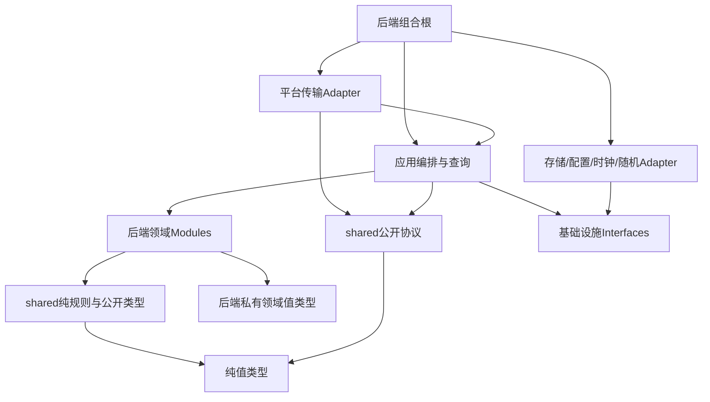

# 逻辑架构与模块依赖 v2

更新：2026-10-20。状态：工程设计提案，待收敛及eng-review；未修改代码、目录、数据库或云资源。来源：[完整性审计E01](../reviews/design-completeness-audit-2026-10-20.md)、[规格](../spec.md)、[核心契约](core-contract-v2.md)。客户端详细设计见[客户端模块](../design/client-logical-architecture-v1.md)。

## 1. 部署形态与设计原则

首版保持一个TypeScript/Node后端工程和短请求入口，内部模块化，不按玩法模块拆微服务。CloudBase是既定候选适配方向，实际SDK、事务和预算尚未验证，不假定每个逻辑模块各自部署云函数。

Module（模块）以清楚的Interface承载规则，不等于一个类或数据库集合；Interface包括输入/输出、前置条件、版本、失败和成本约束。Implementation隐藏绑定、容量、来源去重等细节，不向每个调用者重复暴露。Adapter仅在确实变化的Seam出现：现有MemoryStore与未来持久适配、受控/真实时钟、可信平台身份、随机源。普通业务模块不为形式统一各建一套抽象工厂。

模块不能各开一次事务再称跨模块操作原子；应用编排持有一笔事务。服务端资产权威不意味着实时战斗都在服务端模拟，当前客户端战斗真实性限制仍保留。

## 2. 单向引入关系

箭头表示静态引入/依赖，不表示远程调用或独立部署。



- 后端领域不引入应用、数据库SDK、微信SDK或Cocos；领域返回决定/变更计划，不直接提交存储。
- 应用依赖领域与端口Interface，Adapter依赖端口实现；只有组合根选择具体Adapter。
- shared公开协议和纯规则相互不依赖，只可共同依赖底层值类型。战斗规则不接收网络Command信封。
- 后端私有奖励权重、随机源、凭证和身份映射不进入shared或客户端资源；共享公式不是安全证明。
- 领域模块默认互不直接引入；确实共同需要的不可变值类型才下沉。不得用万能common包或跨模块仓储查询掩盖循环。

## 3. 责任与状态所有者

以下是逻辑职责，不要求立即建立等量目录、仓储或服务类。

| Module | 唯一维护的规则/状态 | Interface候选及调用者需知 | 不负责 |
| --- | --- | --- | --- |
| identity | 平台身份映射、会话代次与撤销、账号职业及挑战指针约束 | 认证解析、会话转换决定；所有资产写需当前身份及账号写栅栏 | 客户端UI身份、微信凭证存入公开结果 |
| character | 职业唯一性、等级/经验、技能等级与升级节点 | 创角计划、经验应用计划；升级输出节点与属性修订，不改变dead | 直接发送邮件或修改钱包 |
| assets | 钱包、三类容器、物品唯一位置、绑定/堆叠、容量/解锁及资产守恒 | 接收类型明确的Transfer/Spend/Grant/Exchange等意图，输出原子变更计划及拒绝；费用/奖励须来自应用可信上下文 | 随机掉落、怪物击杀真伪、私自写他模块状态 |
| equipment | 槽位资格、穿戴、实例属性/强化/耐久与套装计件 | 穿戴决定、属性聚合、磨损/修理/强化结果；用资产持有事实，不自行取库 | 容器挪动/钱包扣费的实际提交 |
| challenge | 挑战/房间推进、生死、租约/截止、终态、场景与事件顺序 | 开局/进房/事件/复活/离开决定；返回来源与收益请求，不直接发奖励 | 钱包结算、重抽掉落、全量实时战斗 |
| stamina | 固定刷新窗口、本局快照、逐房实际/零扣费、返城加载 | enter/chargeRoom/settle等纯决定；输入服务端时刻，禁止中途补满快照 | 自建计时任务、客户端显示时钟 |
| rewards | 经验/金币预算分配、奖励计划、策略选取与随机来源 | 按绑定配置及可信来源生成候选计划；缺件策略接收持有摘要 | 自行扫描金库、发放物品、事务内重抽 |
| delivery | 邮件/附件、永久待领来源、时效、部分领取状态 | 创建来源、领取/删除决定、交付记录；邮件与永久待领独立 | 超越资产容量/绑定、重复造装备 |
| services | 商店/修理/强化/扩容等服务资格与报价语义 | 返回报价及执行前置条件；依赖配置事实，具体规则复用assets/equipment决定 | 各自建立钱包/容器副本、独立提交半笔业务 |
| ranking | 当前穿戴评分投影、同分达到时间与查询 | 接收有版本的已提交评分事实，按配置构建投影 | 资产真相源、将临时buff算入永久评分 |

services是应用侧用例族，不是与领域模块互相引入的服务网。各服务处理器由应用调用assets/equipment等，不由assets回调services。stamina可先是challenge内部的纯规则Module，其Interface和测试职责独立，不为名称强拆部署单元。

## 4. 跨模块协作矩阵

应用中的一个用例协调所有参与者；下表是编排顺序而非模块之间的静态依赖。

| 用例 | 规则决定顺序 | 一致提交范围 |
| --- | --- | --- |
| 创角 | identity职业占位→character初始计划→equipment白武器→assets容器/位置→delivery新手来源 | 账号、角色、初始装备/容器、邮件来源、请求结果/账本；真实预算不满足时先改设计，不静默半创建 |
| 满包穿戴 | assets归属事实→equipment资格/属性/绑定→assets原格交换计划 | 角色穿戴、装备实例、背包位置及版本、结果/账本 |
| 进房 | identity当前会话→challenge顺序/生死→stamina快照扣费→rewards已定房间配置 | 账号栅栏、挑战快照、房间manifest与支付记录、结果 |
| 击杀升级 | challenge合法有序事件→rewards候选→character经验/节点→delivery等级邮件→assets金币/交付 | 当前房间来源、角色/钱包/奖励来源/操作结果；末房另合并通关/间接击杀 |
| 邮件/待领领取 | delivery权限/时效/来源→assets容量/绑定/入包→delivery已交付 | 附件或grant、装备/背包、来源与结果；一键按有界附件编排 |
| 金库存取 | identity角色权限→assets两容器/绑定/数量 | 两容器、物品位置、账号栅栏、结果/账本 |
| 修理/强化 | services报价/位置→equipment目标/效果→assets费用/材料/纪念品交付→equipment状态 | 钱包、背包/实例、必要邮件来源、结果/账本，不凭UI显示价格扣款 |
| 回城/接管 | challenge终态/场景→stamina一次结算→场景落点决定 | 挑战结算标记、角色体力、账号指针、会话（若接管）、结果 |

为避免循环，奖励缺件策略的持有摘要由应用读取与资产同步提交的collectionHoldings后传入，rewards不引入assets仓储。两金库、有效邮件及永久待领已确认纳入；具体有界读取/时效按2026-10-22评审决定3A合同，不再逐次遍历。

升级仅输出“等级节点已达成”，delivery负责节点来源唯一；character不直接调用delivery。装备属性改变输出评分事实，ranking不回写装备。除非存在明确可恢复交付协议，必须与资产同成同败的事情不能靠进程内事件异步实现。

## 5. 事务编排Module的Interface

候选概念为executeIntent、queryView、queryOperationResult；不是允许任意字段更新的万能入口。每个具体意图有白名单结构、权限、版本与失败语义，内部可拆命令处理器；不以一个巨大switch收纳所有领域规则。

执行流程：

1. 传输Adapter取得可信身份、验证信封与大小；准备同调用内稳定ID/随机候选，不在事务重试中请求外部服务。
2. 一次Store事务内检查身份、账号写栅栏及原操作结果；合法重放先返回原结果，不因旧expected重新拒绝。
3. 处理墙钟到期、读取相关状态与配置引用、校验版本，调用领域Modules形成决定。
4. 合并所有变更计划，校验同一对象没有互相矛盾的更新，满足守恒和事务预算后提交状态、来源、流水与原结果。
5. 提交成功才返回可展示结果。提交未知查询原意图；后端进程事件仅用于不改变资产正确性的提示，不当作交付凭据。

到期状态先落实但本命令被拒绝时，要保留到期决定、不提交被拒绝的资产意图；沿现有Buffer思路实现时仍须以完整竞态测试验证，不因复用现有代码宣称正确。

Interface隐藏细节：调用者不需要自行排列扣币/移物/改绑定，不需要逐件算容量，也不控制数据库事务。Interface必须显式表达：版本冲突、业务拒绝、结果未知、原请求查询、配置不可用，以及受影响版本；内部实现不能将未知等同拒绝。

## 6. 只读、投影与日志

查询Module读取经过授权的权威状态并裁剪DTO，不绕开会话检查。排行榜是可重建投影；异步投影如采用，需持久发布凭据/重建游标及版本防倒退，不能只依赖内存事件。邮件未读/待领数量可视图查询，不用缓存计数决定发奖或领取资格。

状态日志含operation/source/challenge等关联标识、版本与拒绝码，不记录平台秘密或无界全量私人物品。物理索引、分页读限和日志保存期限在E02/E03/E07落表；本文不臆定SDK限额。

## 7. 目标代码组织与禁止引入

```text
shared/src/
  values/            # 公开纯值定义
  protocol/          # DTO与版本，无平台身份秘密
  rules/             # 可共享的纯数值/状态规则，无IO
backend/src/
  application/       # 命令、查询、原子编排、投影协调
  domain/            # 上述领域Modules及私有类型
  ports/             # Store/Clock/Id/Random/配置等Seams
  adapters/          # 内存/持久/平台实现，SDK限于此处
  composition/       # 组合根，具体平台启动与注入
```

仅为目标目录建议，未创建。services处理器可以位于application内，schema迁移位于受控应用/适配层；不在数据库Adapter偷偷初始化新手礼包。

禁止关系：domain→application/adapters/Cocos；shared→backend/client/SDK；rewards→容器查询实现；assets→报价UI；ranking→装备写入；客户端UI→数据库/可信Principal构造；Adapter→业务用例反向调用。部署打包如需调整路径，不改变这些引入方向。

## 8. 变化影响与验证

| 变化 | 应主要落点 | 不应连带修改 |
| --- | --- | --- |
| 商品/金库阶段价格 | 内容配置+报价校验 | 动作动画、容器所有权 |
| 新怪物/技能组合 | 配置与动作适配 | 钱包、邮箱、掉落事务核心 |
| 新物理数据库 | Store Adapter及预算/编码适配 | 各领域玩法规则 |
| 背包满包行为 | assets Interface与其验收 | 每个NPC重复写容量算法 |
| UI左右布局 | 客户端展示 | 资产字段所有权/事务语义 |
| 流血/攻速公式 | shared纯规则及测试、配置schema | 平台认证或服务面板 |

后续自动化验证静态引入、共享规则无SDK、应用Interface黑盒行为和现有MemoryStore故障；用可控时钟/随机查竞态，不只测内部小函数。真实持久事务和Cocos导入/打包另验证。现有GameService将逐步提取规则与处理器，不一次重写；重构路径在coding门禁通过后再执行。

## 9. 待收敛与下一步

E02已有[数据字典与实体关系v2](data-dictionary-v2.md)提案：字段/归属/约束、Binding/Location、来源与时效、体力结算及迁移均有初稿；物理集合、索引与预算尚待E03，不能视为数据设计已冻结。

- E01设计交付已产出，未评审通过；领域接口具体字段跟E02/E04进一步对齐，不把本文候选方法名当冻结API。
- E02/E03已有字典、关系与访问提案；下一步核对状态所有者、字段约束、物理集合/索引、生命周期和最坏事务预算的一致性，不重复建立同名架构文档。
- 配置动态生效、正式掉落查重范围、平台身份/预算、暂停时钟等未决仍在审计清单，不以模块划分替代玩法决定。
- 完整方案收敛→eng-review→关闭问题→coding门禁不变。本轮没有新增服务、代码或基础设施。


2026-10-21用户确认：本期在线闭环按服务端可验证行为设计。客户端即时表现，服务端分段验证移动/碰撞、战斗、药品/饰品与NPC地点，不只信任客户端击杀/HP；不引入实时多人或常驻逐帧服务器。输入、检查点及原子提交候选见[可验证动作协议](verified-action-protocol-v1.md)。方向已定，但确定性、时间容差、性能/事务与平台验证未完成，不宣称编码就绪。


正式评审决定3A：[同步持有汇总](collection-holdings-projection-v1.md)由资产应用事务维护，不是rewards自行扫描资产或异步缓存。汇总丢失/无法解释时不把它当缺件，原来源不重抽/补发。
