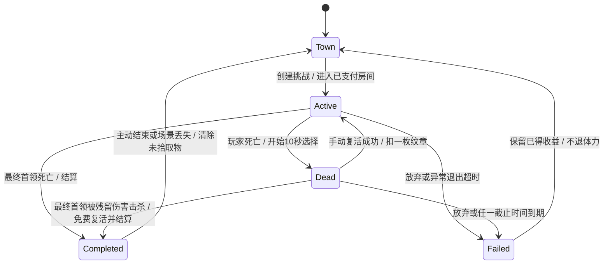

# 挑战生命周期与在线模块交接 v1

状态：玩法基线已确认，2026-10-19按[核心规则补充](wayfinder/core-rules-v2/SUMMARY.md)更新；本地后台核心已存在，尚未按全部新规则迁移或完成云环境验证。来源：[确认记录](wayfinder/challenge-flow/issues/01-lifecycle-decisions.md)。本规格补齐整体规格中挑战、死亡、断线和通关边界；本地原型的立即失败/手动重试不代表这些在线规则已实现。

## 1. 状态模型

分别记录挑战结果、玩家生死、连接状态与拾取场景，避免把断线或死亡直接等同失败。

| 维度 | 状态 | 约束 |
| --- | --- | --- |
| 挑战结果 | active / completed / failed | completed、failed为终态；完成后退出拾取也不能变failed |
| 玩家 | alive / dead | 升级不能让dead变alive；只有有效手动复活或通关免费复活可以 |
| 连接 | connected / recovery | 断线或后台进入recovery，战斗模拟暂停；恢复窗口10秒 |
| 场景 | combat / looting / town | completed可以持续停留looting，不再占未完成挑战名额 |

recovery是独立维度：Active/Dead恢复成功回到原状态，不重置原死亡截止时间；超时才使active挑战失败。completed阶段同样允许短暂恢复，超时仅关闭拾取场景。图中Active包含逐房推进，不代表另有常驻战斗服务器。

## 2. 进入与房间推进

- 同账号最多一个未完成挑战，角色切换须先结束它。账号仅一个有效游玩会话，新会话接管后旧会话无资产操作权；不跨设备恢复挑战。
- 服务端生成挑战标识，记录角色、副本/难度、配置版本、入口怪物等级和装备/属性快照。怪物等级整次锁定，角色升级仍即时生效。
- 体力上限308，按北京时间固定四小时补满；普通房间1点，特殊房间3点。2026-10-20更新：新挑战至少1点即可开始，剩余不足单房费用扣至0，本局耗尽后后续房间仍可继续、不再因体力不足拦截；0点不能新开挑战。同次挑战同房间先持久确认实际扣费/零扣费记录再开战，已处理房间不重复扣，退出/失败不退。挑战入场锁定服务端体力快照，期间跨固定刷新不更新快照或恢复扣费，回城才加载最新数据；短暂重连恢复同一快照及扣费记录，不能借重连刷新。
- 当前挑战中不允许换装；快照模型须容纳后续装备版本/属性变更事件，不能把“永远不可换装”写成系统假设。

## 3. 死亡与复活

死亡开始10秒选择窗口；放弃或到期回城。没有纹章或次数耗尽也不自动扣别的货币。死亡期间怪物失去有效玩家目标，不主动对尸体放技能，随机游荡；已有投射物、场地效果、持续伤害和玩家技能冷却继续。

手动复活检查挑战仍active、玩家dead、未到截止时间、背包纹章及特殊副本次数。成功扣当前角色一枚纹章，增加该挑战付费复活计数，原地满血满蓝；职业技能冷却清零，药品和饰品冷却不重置。普通副本无额外次数上限；特殊副本按配置读取，当前普通/冒险均为每次挑战最多手动复活3次，整次挑战累计，不按房间重置（2026-10-19用户确认）。

复活提供2秒受击保护，可移动、普攻、施法。附近怪物受到向外击飞并倒地的纯控制，不造成伤害，遵循怪物控制免疫；首领免疫不取消玩家保护。具体控制参数待定。

活着升级时即时更新基础属性并满血满蓝。死亡期间可以获得击杀经验并升级，但不得因回血或属性重算清除dead标记，仍须手动复活。只有最终首领死亡触发下节的免费复活例外。

## 4. 通关与奖励

最终首领被玩家直接伤害、流血或有效残留技能击杀时，只要挑战尚active即通关。玩家若已死，自动免费满血满蓝复活，不消耗纹章、不占复活次数，取消死亡失败倒计时，并清零职业技能冷却。

剩余首领房间小怪视为玩家间接击杀，正常获得经验及按正常规则生成的随机金币、材料、装备；不能仅删怪省略收益，也不能再结算一次。同一终局处理应有可恢复的一致性边界，覆盖首领、小怪击杀账目和通关奖励。

通关金币、经验即时结算，通关随机装备立即交付；满包进入原角色待领区，橙装绑定原角色。地面掉落仍需拾取，与通关奖励分开；未拾取物不转入待领区。

在线通关拾取没有倒计时。主动离开或关闭游戏、换设备、恢复超时后回城并清除未拾取掉落；已经完成的挑战、已拾取物品与已结算奖励保留。不能用后台清理期限变相限制持续在线拾取。

## 5. 断线、后台与时钟

- 断线、锁屏或切后台暂停战斗模拟，最长10秒等待恢复；不允许离线刷怪。
- 死亡时世界继续运行和断线时暂停模拟是两条不同规则。死亡中断线后模拟也暂停，但死亡选择截止时间继续流逝。
- 死亡、恢复截止时间独立采用权威时间；重连不延长死亡窗口。例：死亡4秒后断线，再过6秒死亡窗口到期，未完成挑战结束。
- 关闭/重启游戏不续关；未通关回城失败、不退体力。通关后丢失场景只结束拾取，不撤销成功。
- 响应丢失先查持久请求结果和挑战状态，不重新随机、不重复扣费或发奖。已保存收益不回滚；客户端计时/回城展示不能单独修改服务端结果。

## 6. 模块与接口设计交接

以下为下一步工程规格任务，接口名称和数据库结构尚未定稿。

| 模块 | 责任与交接 |
| --- | --- |
| 身份/会话 | 微信凭证验证、角色归属、有效会话代次；拒绝旧会话资产操作；接管关闭旧场景 |
| 挑战 | 唯一未完成挑战、房间推进、入口快照、截止时间、终态；提供状态查询 |
| 体力 | 固定窗口刷新、房间扣费与持久业务去重 |
| 战斗适配 | 本地输入/碰撞/AI；死亡与恢复分别控制模拟时钟；报告可验证的进度事件 |
| 角色/成长 | 经验、升级、属性版本；死亡与生命数值分离，升级不复活 |
| 背包/物品 | 纹章扣除、装备交付、拾取与原角色待领；拒绝客户端自定资产增量 |
| 奖励 | 服务端随机、唯一怪物/掉落来源、间接击杀账目、通关结算与可恢复交付 |
| 配置 | 副本/难度复活次数、控制参数及免疫；明确缺失配置处理，不能暗填正式值 |

付费复活的资格检查、纹章扣除、计数、生死转换与请求结果须一致提交；首领通关结算与复活请求并发时按服务端版本串行化，completed之后不得再收费。具体并发协议、截止边界、请求去重作用域与失败码在接口规格中确定；不据此额外承诺已提交付费复活的退款政策。

击杀与终局结算应使用稳定来源标识防重复，结算失败可继续完成同一结果；掉落不能因重试重新抽样。清理后台任务不得抢先删除未交付账目。在线拾取与结果终态分离，可在没有常驻战斗进程的情况下保存。

客户端战斗仍无法由这些状态检查证明真实；小规模清档内测接受此限制，拍卖或正式经济开放前另做验证方案。CloudBase实际事务能力、集合/索引、限流与权限规则需在实现阶段验证。

## 7. 验收场景

| 场景 | 预期 |
| --- | --- |
| 两角色/两设备同时创建挑战 | 同账号最多一个active，旧会话不能改资产 |
| 进房请求重复或跨体力刷新重试 | 同房扣一次，刷新不抹去已付费记录 |
| 死亡后普通怪被流血击杀并升级 | 获得经验，仍dead，不能免费复活 |
| 死亡窗口内最终首领被残留伤害击杀 | 通关、免费复活、不扣纹章/次数；小怪完整奖励 |
| 复活连点、响应丢失后重试 | 一次有效扣除和复活，查询可得一致结果 |
| 特殊副本复活达上限/无纹章 | 拒绝付费复活，不替用金币或点券 |
| 复活面对控制免疫首领 | 首领免疫，玩家仍有2秒保护，职业CD清零，药品/饰品CD不重置 |
| 死亡4秒后断线6秒 | 死亡窗口到期，失败回城，重连不续命 |
| 活着断线或后台不足10秒恢复 | 状态查询后续战，不额外扣房间体力 |
| 活着断线/后台超过10秒或重启游戏 | 未通关失败，已得收益保留，体力不退 |
| 通关结算重试、间接小怪击杀重报 | 随机结果固定，所有奖励各结算一次 |
| 通关满包 | 通关装备到原角色待领区，未拾取物不进待领区 |
| 通关长期在线停留 | 无强制回城计时，可继续拾取 |
| 通关后退出/切设备/断线超时 | 成功不变，已得奖励保留，未拾取物清除 |

回城时全部技能和道具冷却清零，含主动饰品；重登结束原挑战回城也清零。短暂重连恢复原挑战不清零。

## 8. 待定与实施顺序

特殊副本普通/冒险手动复活上限均3次已确认。待定：击飞参数、成长及奖励具体配置；上述数值不能从原型或建议推定。

下一步先细化身份/会话、挑战、资产操作的数据与接口规格，再实现最小在线闭环：真实登录 → 创建战士 → 进房扣体力 → 死亡/复活或通关 → 奖励/装备 → 重进游戏验证持久化。云环境创建、部署及正式发布不在本轮文档整理范围。

## 9. 后续工程规格

2026-10-17已细化[后台最小在线闭环设计](backend/README.md)，覆盖数据集合、命令契约、账号写入栅栏、租约检测、终局结算、并发与测试出口。它是工程方案，不代表后端已经实现或CloudBase已验证；未定玩法数值仍保留待定。

## 2026-10-19耐久归零交接

2026-10-19最新确认：副本中武器耐久归零不暂停、不强制回城或判败；武器实例保留但不提供属性，按剩余角色属性正常计算伤害，玩家可继续攻击和推进当前挑战，也可主动选择回城。不会额外计死亡或扣纹章。0耐久武器仍不能开启新的挑战，须先修理；防具/耳环归零仍仅失去属性与套装计件。此前暂停方案已撤销，尚未修改业务代码。

最终首领有效击杀先认定通关，再应用末房磨损；归零不取消通关或奖励。非末房归零仍可推进，不重复执行新挑战的入场检查。归零不冻结怪物、世界时钟、残留技能或死亡/重连截止，也不允许已死亡角色借此继续行动；这些仍按原生命周期处理。磨损事件与资产结果分别去重，主动退出按既有规则结算，不新增安全退出奖励承诺。

## 2026-10-19施放与Boss控制交接

2026-10-19用户已确认：每次技能释放时锁定本次暴击率、暴伤和急速；每段/每跳仍独立判定暴击，不继承触发段暴击结果。后续buff结束或武器破损不重排已开始的动作、流血节奏和本次CD，新施放读取新属性。流血伤害预算释放时锁定的既有规则保留；急速上限/具体换算参数仍待数值方案。

2026-10-19用户已确认：【该条旧Boss口径已被2026-10-20同步确认覆盖】2026-10-20本轮同步后用户最终确认：首Boss平时允许受击僵直、小幅击退及累计直接伤害倒地；重槌、践踏、冲撞和吼叫施招期间按已确认特殊设定进入霸体，免疫对应控制但仍承受伤害和流血，收招恢复正常控制。覆盖此前本会话“平时免控、仅虚弱窗口可击倒”的记录，具体技能边界以首副本整合方案为准。机制虚弱时间不因受击反复续期。复活纯击飞仍遵循目标当时抗性，玩家复活保护不受影响。

死亡清除角色临时buff但不追溯修改已释放流血预算或本次快照。残留首领击杀仍按active挑战通关免费复活；断线暂停模拟与死亡继续模拟分别执行，不能利用快照进行离线刷怪。

## 2026-10-20首Boss跨环境最终确认

2026-10-20本轮同步后用户最终确认：首Boss平时允许受击僵直、小幅击退及累计直接伤害倒地；重槌、践踏、冲撞和吼叫施招期间按已确认特殊设定进入霸体，免疫对应控制但仍承受伤害和流血，收招恢复正常控制。覆盖此前本会话“平时免控、仅虚弱窗口可击倒”的记录，具体技能边界以首副本整合方案为准。机制虚弱时间不因受击反复续期。复活纯击飞仍遵循目标当时抗性，玩家复活保护不受影响。

## 恢复体验最新确认（2026-10-21）

用户明确战斗表现不要求强一致，允许秒级回溯；短恢复先查询原请求结果，再以服务端最新确认检查点恢复，未确认移动/攻击表现允许修正。这不放松钱包、消费、发奖与原操作结果的原子性，已确认资产和收益不撤销。

持续无法恢复时显示「网络中断，请重新进入游戏」，停止继续战斗并要求重新进入；沿用既有10秒恢复窗口，不另增宽限或自动续关。未通关超时失败/关闭并保留已保存收益，已通关仅关闭拾取场景、不撤成功；新launch默认旅店，不重启续关。客户端提示不单独改服务端结果，下一请求/清理仍按原持久截止处理。

此前为减少修正提出的持久输入收据不作为本期必需方案；采用原操作结果和权威检查点恢复。秒级是体验尺度，不保证任何弱网都只退1秒；必须限制未确认预测积压，超上界先暂停等待，不允许无限本地刷怪或离线补报。具体积压上界和时间锚点待工程验证。