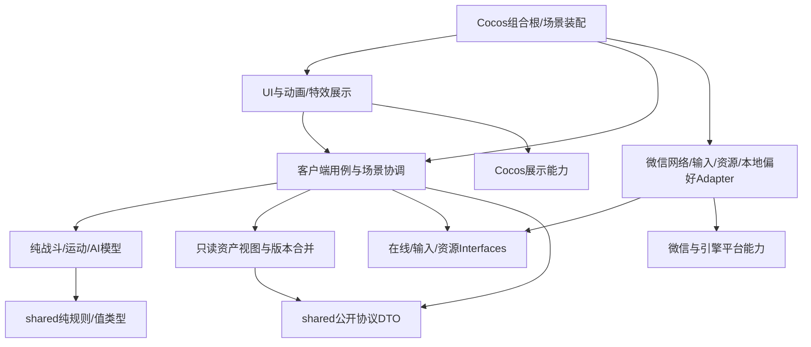

# 客户端逻辑架构与引入关系 v1

更新：2026-10-20。状态：E05设计提案，未实现；工程初审已完成，4A～11A已批准，尚无编码授权。依据：[逻辑架构](../backend/logical-architecture-v2.md)、[D05验收](town-interactions-acceptance-v1.md)、[D04](dungeon-first-proposal-v1.md)。不修改独立会话的UI视觉稿。

## 1. 分层与依赖

箭头表示静态引入。模块之间通过Interface协作，不以互相访问Cocos节点当领域通信。

战斗模型不引入网络、UI节点、资源文件或数据库。UI不能直接向数据库存取；网络Adapter不知道按钮或Prefab。组合根负责注入，不让每个面板创建新的会话/写队列。

## 2. 客户端Modules

| Module | Interface与职责 | Implementation需隐藏/约束 |
| --- | --- | --- |
| Input | 摇杆/按键/触控转规范意图 | X力度走跑、Y定速、触控归属；服务面板开时停移动，不误触战斗动作 |
| CombatSimulation | tick输入→角色/怪物状态与展示事件 | 当前战士普攻合同、技能取消、运动/碰撞、控制/流血、怪物AI；仅本地即时结果，不写永久资产 |
| BattlePresentation | 接收只读状态/事件，播放身体、技能、特效和UI | Cocos节点/图集/动画；伤害节点与动画对齐，不靠某帧贴图决定服务端发奖 |
| ChallengeCoordinator | 场景进入/有序输入提交/权威升级复活/结束 | 与服务端challenge版本、roomToken、输入确认游标同步；原型胜败重开不替代正式终态 |
| TownCoordinator | 场景落点、NPC交互、入口触发、服务打开关闭 | 上线旅店/在线回城门口/短暂重连分开；退出范围才重触发 |
| ServiceUseCases | 银行/商人/修理/强化/领取/换装的用户意图 | 意图ID、待确认状态、拒绝原因；本地不扣最终金币、不生成装备 |
| AssetReadModel | 按服务端对象版本合并公开视图 | 旧回包不覆盖新状态；不是可整包上传的客户端存档 |
| OnlineSession | 可信平台接入、请求/查询、恢复与写队列 | 一个会话单写序列；凭证不进UI日志；心跳/控制与业务版本分离 |
| ResourceLoader | 按资源版本加载/缓存/取消展示引用 | Bundle、图集、远程资源平台差异；加载失败不重复创建资产意图 |
| LocalPreferences | 音量、按键布局等偏好 | 不保存可覆盖权威金币/装备的余额；不把新启动当旧进程续关 |

不是每行都需新类或目录。真正变化的Adapter是键盘/触控输入、测试/微信在线通道、测试时钟等；不为每个NPC建立单独网络栈。

## 3. 两类时钟与事件处理

输入意图、预测表现、权威确认分层：Input产生连续输入序号与场景/时间代次；CombatSimulation只生成本地状态及展示事件，ChallengeCoordinator提交有序输入，不上报权威死亡/击杀/HP。服务端重算后返回acceptedSeq/acceptedTick、checkpointRevision和相关资产版本，按版本合并；旧事件只作诊断，C25新调用拒绝，不能用动画事件作为资产凭据。

战斗模拟时钟控制动作、CD和周期效果；服务端墙钟控制死亡/恢复截止。死亡继续既定合法残留/CD，武器途中归0仅属性失效、不暂停、不拦换房；新挑战入口另检可用武器。正常联网加载的角色计时沿2A，recovery暂停，回复余数跨CP/切房保存。

片段响应丢失先查询原operation，确认前沿恢复后再提交新输入；复活先解析在途原结果与权威生死，不将本地击杀补成收益。恢复/新房完整状态与资源就绪后提交scene.ready才启动活动锚点，沿[批准合同](../reviews/eng-review-approved-contracts-2026-10-22.md)4A，不在分页未齐时进入2秒输入计时。

## 4. UI状态与资产意图

服务状态至少区分loading、ready、submitting、resultUnknown、committed、rejected，不用单个“失败”代替超时。关闭面板仅释放展示/输入占用，未完成资产意图由全局用例层保留和查询；再次打开读取当前状态，不重建第二个请求。

银行页签绑定稳定containerId，切页清选择但不改变在途请求目标；拖动采用临时展示，服务端确认后更新资产视图。点击修理/强化/买卖先引用服务端目标版本和费用配置，不能把UI数值当权威价。邮件/永久待领是两个数据源，虽共面板仍保留各自时间和权限。

D05左右布局分别遵循已确认规则：背包左装备右背包；银行左金库右背包；修理/强化/商店左服务右个人信息或背包。UI会话可选择组件复用，但不能统一颠倒布局或改变点击/拖动方式。

## 5. 场景与资源恢复

- 上线根据服务端当前角色状态进入隔离旅店；短暂重连如原场景内存仍在，恢复原挑战，保持体力快照和冷却；进程重启不恢复旧战斗。
- 在线挑战结束或放弃后使用对应副本入口落点；服务端结果未知时不先重进新副本消耗体力。
- 加载页/资源失败不再提交challenge.start；查已创建挑战及原请求结果，再按既定生命周期处理。具体何时start与加载握手由E04补时序，不把资源重试等同玩法重试。
- 遥测与资源缓存只存公开标识，不缓存平台秘密；跨版本资源兼容及包体目标需真实构建验证，尚无实测声明。

## 6. 与现有原型的迁移及验证

现有Prototype.ts是原型装配/展示入口，不作为未来账号/资产存档中心。先隔离输入与模型调用、读模型和在线用例Interface，再按稳定契约接服务；不在设计阶段拆代码或重写已验收动画。

后续验证：模型无引擎依赖；同输入/时钟可重放；关闭面板仍能恢复未知结果；旧回包不倒退版本；服务面板开关停止/恢复输入；资源重试不重复开局；手机横屏双栏可读可拖。纯模型、模拟在线与微信实机证据分开记录，不以UI稿自称规范等同接入验收。

E05文档已产出，尚待协议字段、平台实际恢复能力和UI状态稿联合审阅。下一步与E02/E04对齐，不开始coding。
