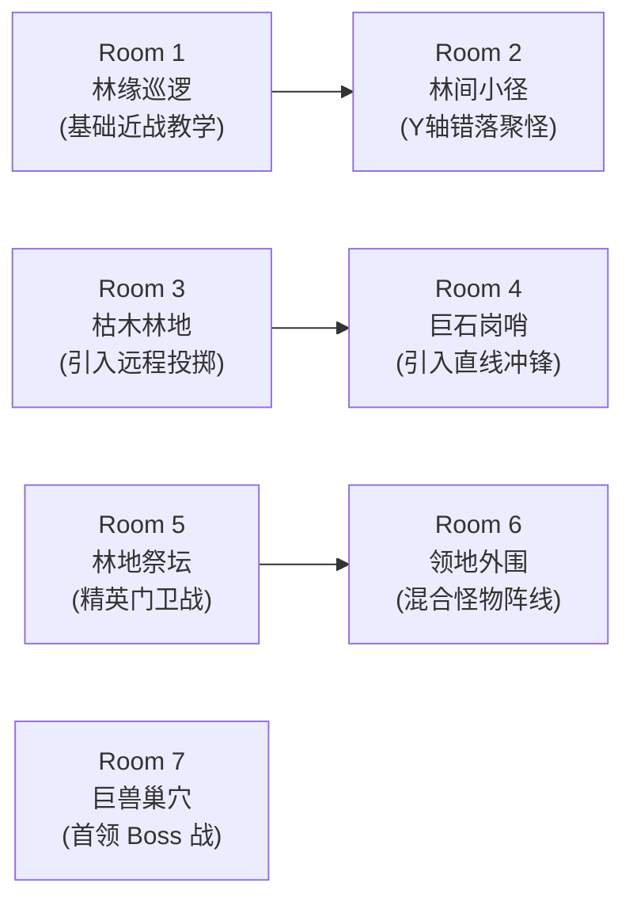

# 首个升级副本（1–15级）地图、怪物与节奏方案 v1（待审阅）

日期：2026-10-19。关联：[D04设计票](../wayfinder/mvp-design/issues/04-dungeons.md)、[模块地图](../wayfinder/mvp-design/map.md)。
状态：首版提案已产出，待专题审阅；数值与时间已与 [D01战斗成长提案](combat-growth-proposal-v1.md)、[D03经济与金币预算](gold-budget-proposal-v1.md) 对齐，未写入正式业务代码。

---

## 1. 副本定位与规则约束

### 1.1 基础属性
- **副本代号**：幽暗密林（Forest of Shadows，暂定代号，原创题材）。
- **目标等级区间**：1–15 级。
- **开放门槛**：角色创建后 1 级默认开放，必须穿戴武器，消耗 **1 点体力**。
- **锁定规则**：怪物等级在挑战开始时由玩家当前等级锁定（如 1 级进入则全图怪锁定 1 级），挑战中途角色升级**不改变**本局怪物等级。
- **难度结构**：共 4 个难度（普通 → 冒险 → 勇士 → 王者），逐级通关一次解锁下一难度，**账号共享解锁进度**。本提案以**普通难度（首次通关基准）**为核心展开，并在末尾给出高难度换算矩阵。

### 1.2 通关与走位原则
- **白装包容性**：初始 1 级角色仅穿初始白双刀（无强化、无饰品），仅靠 1 级解锁的「十字斩」与三段普攻，纯靠 Y 轴走位躲避红色预警，**必定可以通关普通难度**。
- **技能解锁体验**：
  - 1 级：仅有普攻 + 十字斩（打断与直线牵制）；
  - 5 级：解锁崩山击（提供首个主动强击倒与中距离位移）；
  - 10 级：解锁拔刀斩（提供宽范围瞬间清场爆发）；
  - 20 级：大崩尚未在副本一解锁（留至第二副本高阶与特殊副本）。
- **无蓝量惩罚**：小怪与精英均可用普攻或技能自由击杀。正常技能循环（按 CD 施法）在通关过程中自然回蓝与基础蓝量足够支撑，不会产生空蓝挫败感；走位磨怪因战斗时间拉长可能消耗稍多，但不施加任何系统级额外扣蓝。

---

## 2. 房间结构与推进流线（7 房间基准）

副本采用横向 2.5D 有限纵深结构（战斗区域宽度约 960px，上下走位深度约 135px），共设置 **7 个连续房间**。清场后右侧障碍消除，玩家走到最右侧触发切房淡入淡出。

### 2.1 房间明细设计

| 房号 | 场景主题 | 怪物构成 | 战术目标与教学意图 | 预计耗时 (1级白装) |
| --- | --- | --- | --- | --- |
| **Room 1** | 林缘巡逻 | 3 只 **林地哥布林**（普通近战） | 基础三段普攻手感熟悉，体验单怪 3~4 次普攻致死；练习走位对齐 X 轴。 | 10~15 秒 |
| **Room 2** | 林间小径 | 5 只 **林地哥布林**（分两批：前2后3，上下分散） | 练习 Y 轴走位聚怪；施放 1 级「十字斩」体验横向贯穿两只以上怪物的击退。 | 15~20 秒 |
| **Room 3** | 枯木林地 | 3 只 **林地哥布林** + 2 只 **密林掷石者**（远程） | **引入地面红色预警**：掷石者在后排投石，地面出现 1.2 秒延时红圈，教学「避开红圈，优先切入后排」。 | 20~25 秒 |
| **Room 4** | 巨石岗哨 | 2 只 **獠牙野猪**（冲锋怪） + 2 只 **林地哥布林** | **引入强位移冲锋**：野猪头顶亮起感叹号并蓄力红线（1.2 秒），随后高速横冲；躲避后野猪撞地僵直 1.2 秒，供玩家反手输出。 | 20~25 秒 |
| **Room 5** | 林地祭坛 | 1 只 **狂暴牛头守卫**（精英怪） + 2 只 **密林掷石者** | **中场小高潮（精英战）**：精英血量厚、带轻霸体与霸体横扫；练习累计直接伤害触发普通倒地；优先清理远程随从。 | 25~35 秒 |
| **Room 6** | 领地外围 | 3 只近战 + 1 只冲锋 + 2 只远程（混合波次） | 进 Boss 房前的综合实战演练，全怪物技能组合应对；检验玩家在多红框交叉时的走位能力。 | 25~35 秒 |
| **Room 7** | 巨兽巢穴 | 1 只 **蛮荒牛头巨兽**（关底 Boss） | **关底首领战**：两阶段 Boss 机制（常规踩地 + 狂暴冲撞），带狂暴后虚弱硬直窗口，爆发倾泻击杀。 | 60~80 秒 |

- **整局通关时间总预算**：普通难度首次 1 级白装通关约为 **3 分钟 ~ 3 分半**（180s ~ 220s）；熟练后或穿戴 5 级绿武器后可压缩至 **2 分钟以内**。

---

## 3. 怪物图鉴与机制设计

### 3.1 怪物基础参数对照表（以 1 级普通难度为基准，1U = 基础普攻非暴击伤害）

| 怪物名称 | 定位 | 生命值 (U) | 移速 | 攻击方式与前摇 | 预警标识与时间 | 控制抗性与倒地阈值 |
| --- | --- | --- | --- | --- | --- | --- |
| **林地哥布林** | 普通近战 | 3.5 U (约4段普攻) | 65 px/s (慢) | 近身木棒下挥：前摇 0.75s，伤害 1.0 U | 无红框，动作起手抬棒即可视觉判断 | 无霸体；累计受到 1.2 U（约35%最大生命）直接伤害即触发后仰倒地。 |
| **密林掷石者** | 普通远程 | 2.5 U (约3段普攻) | 50 px/s (极慢) | 远程投掷石块：射程 240px，后仰蓄力 0.6s，石块飞行 0.6s | **地面红色圆形预警**（半径 24px），从投掷到落地判定共 **1.2 秒** 逃离窗口 | 无霸体；受击即轻度僵直，受到任意技能判定立即击飞/倒地。 |
| **獠牙野猪** | 强位移冲锋 | 5.0 U (约5~6段普攻) | 待机 60，冲锋 280 px/s | 蓄力刨蹄后直线冲锋全屏：前摇 1.2s，冲锋触碰击退玩家并造成 1.5 U | **横向红色贯穿光带**（宽 30px），蓄力 **1.2 秒** | 冲锋过程中霸体；冲刺结束撞空或被硬阻挡后进入 **1.2 秒眩晕虚弱**，虚弱期间受到 1.0 U 伤害必定倒地。 |
| **狂暴牛头守卫** (精英) | 精英门卫 | 22.0 U (战斗约20s) | 75 px/s (中等) | 1. 顺劈斩（单体）：前摇 0.8s，伤害 2.0 U 2. 战斧旋风（AOE）：前摇 1.1s，伤害 3.0 U | 战斧旋风带有 **圆形红色预警框**（半径 60px），蓄力 **1.1 秒** | 基础带有常驻韧性；受到直接伤害需累计达到 **20% 最大生命 (4.4 U)** 才会破韧倒地；倒地起身无敌 0.6s 并释放小击退震波。 |
| **蛮荒牛头巨兽** (关底Boss) | 最终首领 | 80.0 U (战斗约60~80s) | P1: 70，P2: 95 px/s | 见 3.2 节详细分阶段机制 | 见 3.2 节 | 免疫常规受击硬直；仅在特定虚弱或累计破韧后可倒地。 |

---

### 3.2 关底首领：蛮荒牛头巨兽机制深度设计

#### 阶段一：稳重压迫 (100% ~ 50% HP)
Boss 体型庞大（约 1.5 倍角色大小），手持巨型石柱战槌。
1. **重槌下砸**：
   - 抬槌前摇 1.0s，地面出现 **纵向 60×120px 红色矩形预警框**。
   - 砸地判定：触碰造成 2.5 U 伤害，并在地上留下 0.8 秒减速泥沼。
   - 躲避策略：向 Y 轴上方或下方跨步走出红框即可。
2. **震地践踏**：
   - 双足顿地蓄力 1.3s，地面出现以 Boss 为圆心的 **圆形红色预警圈（半径 75px）**。
   - 判定：造成 1.8 U 伤害并震退玩家。
   - 破招点：此技能施法中无霸体，若玩家使用「十字斩」或「崩山击」命中，可累计削减其韧性。

#### 阶段二：狂暴咆哮与破绽 (50% ~ 0% HP)
Boss 怒吼击退全场（无伤害），皮肤泛红，攻速提升 15%，移速提高至 95 px/s。
1. **狂暴三连击**：
   - 连续两次重踏接一次全屏冲撞。每次攻击前均有 0.9s 紧凑红框。
2. **破绽虚弱（核心机制）**：
   - Boss 在完成三连冲撞砸向墙壁后，石槌脱手，陷入 **虚弱脱力状态持续 3.0 秒**。
   - 虚弱期间：Boss 头顶出现眩晕星环，**所有受击伤害提升 20%，且倒地阈值降低 50%**。
   - 玩家策略：此窗口为全力输出窗口，战士可连续倾泻普攻二三段 + 十字斩（或 5 级崩山击），一举将其打倒并削减大量血量。

---

## 4. 难度梯度与参数扩展（冒险 / 勇士 / 王者）

随玩家通关解锁更高难度，怪物行为与数值做如下系统化伸缩（遵循“预警可反应、机制更丰富”原则）：

| 难度 | 怪物生命倍率 | 怪物攻击倍率 | 攻速/移速提升 | 预警时间下限 | 高难度专属机制 | 通关主要掉落 |
| --- | --- | --- | --- | --- | --- | --- |
| **普通 (Normal)** | 1.00× | 1.00× | 基准 (1.0×) | 1.1 ~ 1.2 秒 | 基础机制，冲锋怪撞空虚弱 1.2s。 | 白装保底，极小概率绿装 |
| **冒险 (Adventure)** | 1.45× | 1.30× | +10% | 0.95 ~ 1.0 秒 | 掷石者落地附带火油点燃（0.5U/秒，持续2秒）；小怪移速稍快。 | 绿装保底 |
| **勇士 (Warrior)** | 2.10× | 1.70× | +18% | 0.85 ~ 0.9 秒 | 精英怪增加霸体冲锋；野猪冲撞后不再长时间眩晕；增加 1 只随从。 | 蓝装（稀有） |
| **王者 (King)** | 3.00× | 2.30× | +25% | **0.80 秒 (硬底线)** | Boss P2 追加落石弹幕；普通小怪死后 1.5 秒自爆尸毒。高压走位挑战。 | 优质蓝装，极小概率紫装散件 |

---

## 5. 经济与产出联动（与 D03 结合）

根据 [gold-budget-proposal-v1.md](gold-budget-proposal-v1.md) 规则：
- 副本金币随角色锁定的怪物等级动态决定，单局总金币围绕稳定均值，不因具体击杀漏怪造成无界波动。
- **1 级单局产出示例**：
  - 击杀零散掉落：每小怪随机掉落 1~3 金币（小怪总计约 30~40 金币）；
  - 精英与 Boss 掉落：约 25~35 金币；
  - 通关固定翻牌金币：固定结算约 45 金币；
  - **整局总收益均值**：约 **100 ~ 120 金币**（符合 1 级积累初期开荒预期，通关约 20 局可攒够 2000 金币进行首次背包 20 格扩容）。
- **装备掉落**：
  - 通关必定获得 1 件当前职业武器或防具部件（普通难度为装等 5~10 的白装或绿装）；
  - 若背包已满，自动转存为角色永久待领奖励，绝不丢弃。

---

## 6. 验收与验证标准

1. **白装无伤通关可行性**：
   - 使用 1 级默认白武器角色（攻击力 25，血量 200），不施放未解锁的崩山击、拔刀斩和大崩；
   - 仅依靠普攻和十字斩，全程通过走位避开红框预警，能够在 **240 秒以内** 击败 Boss 并保持存活。
2. **预警边界可读性**：
   - 无论是横向野猪冲锋、圆形掷石者投石、还是 Boss 巨槌下砸，所有伤害生效前必须至少存在 **1.1 秒** 的清晰高对比度红色警示区域。
3. **倒地累计无冲突**：
   - 精英怪受到直接伤害达到 20% 时稳定倒地，流血跳字不打断倒地；起身保护期内不被无限连环倒地。
4. **性能与包体安全**：
   - 7 个房间同屏最大怪物数不超过 6 只，同屏预警特效不超过 3 个，确保在目标机型（Note20 Ultra 微信小游戏环境）维持 60 FPS 无瞬时卡顿。
