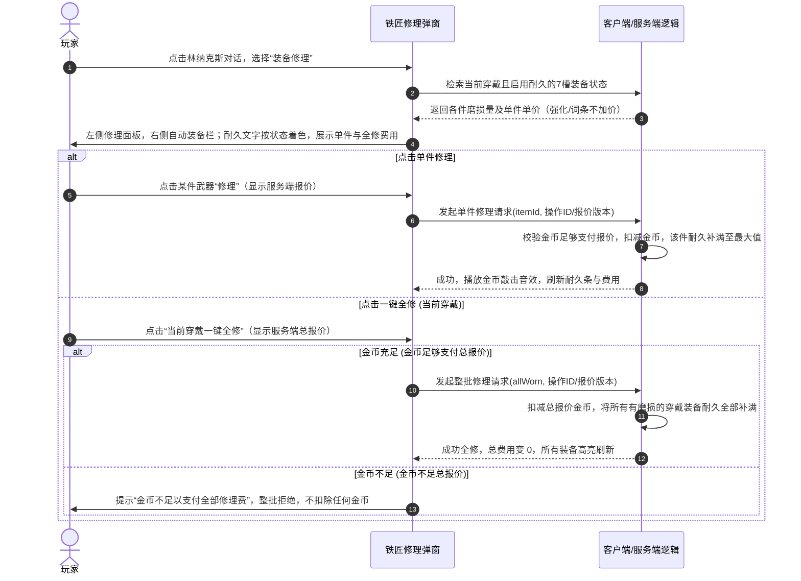

# 城镇与资产交互方案 v1（主要交互已确认）

日期：2026-10-19。关联：[D05设计票](../wayfinder/mvp-design/issues/05-interactions.md)、[模块地图](../wayfinder/mvp-design/map.md)。
状态：主要交互已确认，价格/视觉/少量范围边界待定；验收清单见[交互验收](town-interactions-acceptance-v1.md)。继承 [核心规则摘要](../wayfinder/core-rules-v2/SUMMARY.md)、[耐久与修理需求](durability-repair-proposal-v1.md) 及 [金币预算](gold-budget-proposal-v1.md)，未写入正式业务代码。

---

## 1. 城镇空间与入口（2026-10-20已确认）

横屏2.5D像素场景，基础画布480×270，设计显示960×540。城镇保留移动，禁用普攻、职业技能与饰品；背包及个人信息随时可打开。买卖、修理、强化、金库、邮件及永久待领需到对应地点交互。新邮件或待领奖励仅显示提醒，不自动打开面板。

| 地点／角色 | 功能 | 状态 |
| --- | --- | --- |
| 玛丽（独立NPC） | 装备强化 | 已确认；不与铁匠合并 |
| 林纳克斯（铁匠NPC） | 装备修理 | 已确认 |
| 商人NPC | 买卖商品 | 功能已确认，名称待定 |
| 银行 | 个人金库（角色隔离）＋账号金库（账号内角色共享） | 个人20格起、分4次解锁至100格；账号100格全部开放 |
| 拍卖行建筑 | 独立拍卖入口 | 建筑独立已确认；交易实现仍沿当前规格留待后续，不因地点确认提前开放 |
| 隔离旅店 | 玩家上线默认位置 | 已确认按当前角色独立空间；其他玩家不可见、不可进入 |
| 旅店门口邮箱 | 邮件交互入口 | 到此交互打开邮件/永久待领；HUD仅提醒，不远程打开 |
| 分布在地图不同位置的副本入口 | 步行到对应入口，选择难度后进入 | 已确认；取消集中传送门 |

靠近NPC后点击交互按钮打开面板的方式已认可。地图实际布局、建筑距离、NPC坐标及交互距离待设计。

### 副本入口与体力（2026-10-20更新）

- 走入对应副本门口的特定范围，自动触发该副本难度选择页面，无需先点击进入按钮；确认难度才开始挑战，不因打开页面扣体力。
- 选择页面不提示体力消耗。关闭选择页或从副本返回门口时不立即重弹；需先离开触发范围，再次走入才重新打开。具体范围大小待场景校准。
- 新挑战只需至少1点体力；按普通每房1点、特殊每房3点扣除，剩余不足单房费用最多扣至0。本局到0仍可完成后续房间，不再扣成负数或阻止推进；0点不能开启新挑战。入场锁定本局服务端体力快照，副本内跨固定刷新不更新快照、不恢复扣费；直到回城才加载最新服务端体力。短暂重连仍恢复同一快照，不提前加载刷新数据；固定刷新时点与同房幂等不变。

### 上线与返回位置细则

- 玩家上线默认在隔离旅店，不默认出现在上次副本门口。
- 玩家在副本中返回城镇时，回到该副本对应的城镇入口门口，不统一回旅店。
- 正常在线结束副本并回城与重新上线要区分；短暂重连恢复原挑战仍沿已有规则，不视为重新上线回旅店。
- 若挑战结束与重新上线同时发生，位置展示需协调上述规则，具体服务端事件及落点记录在实现规格明确；不改变挑战结果、收益保存、恢复窗口和回城满状态/清冷却规则。

已确认背包与个人信息可随时打开，邮件/待领需到旅店门口邮箱交互，提醒不自动弹窗；排行榜菜单位置及具体HUD布局待审。

---

## 2. 背包与穿戴交互流（Bag & Equipment）

### 城镇服务面板的通用操作（已确认）

打开买卖、修理、强化、银行或邮箱面板时，角色停止移动并暂停移动输入，避免拖动物品时误触摇杆；关闭面板后恢复正常操作。此规则不额外扩展为战斗中打开背包即暂停战斗。

关闭面板不撤销已经提交的资产请求。结果未知先查询原操作结果，不假设关闭等于取消，也不创建第二笔操作；再次打开面板时应展示已确认的最新资产状态。具体请求等待和失败提示样式留待界面设计。

### 2.1 格子规则与扩容
- **背包容量**：初始 20 格，右上角显示扩容按钮（`+20格`）。
- **扩容价格**：第 1 次 2,000 金币（20→40）、第 2 次 4,000 金币（40→60）、第 3 次 8,000 金币（60→80）、第 4 次 16,000 金币（80→100，达上限）。
- **交互边界**：
  - 点击扩容按钮弹出确认框：“消耗 X 金币解锁 20 格背包？”
  - 金币不足时弹窗提示“金币不足，需 X 金币”，扩容失败；
  - 战斗中扩容按钮置灰不可点击。

### 2.2 装备穿戴与卸下
- **布局与操作（已确认）**：左侧个人信息／装备栏，右侧角色背包。点击背包装备显示与当前对应部位穿戴装备的对比，提供“穿戴／替换”；点击已穿戴装备提供“卸下”。对比内容按实际属性、绑定和耐久状态展示，详细视觉排版后续设计。
- **同部位替换（满包换装）**：背包已满（如 20/20）时，点击背包内的同部位装备，直接与身上穿戴的装备**原格原位交换**，不要求背包有空格。
- **直接脱下装备（卸装）**：点击身上已穿戴装备选择“卸下”时，**必须背包有至少 1 个空格**；若背包已满（20/20），提示“背包已满，无法卸下装备”，操作拦截。
- **出售限制**：商人处禁止直接出售身上正穿戴的装备；必须先卸入背包，方可出售。
- **无武器限制**：允许玩家卖掉背包内所有武器，但当身上未穿戴武器或武器耐久为0时，对应副本入口弹出警示：“请先装备可用武器再进入副本！”，阻止挑战发包。

---

### 2.3 消耗品快捷位编辑（已确认）

在背包界面将主动消耗品拖到3个指定快捷位之一完成绑定，拖入其他道具替换原绑定；移除绑定不删除道具。快捷位绑定道具模板而非背包格或单个堆叠，显示可用数量与冷却，耗尽显示0且保留绑定，补充同模板后自动可用，不自动换为其他品种或更高档道具。

仅统计角色背包内可用数量，不将金库、邮件、永久待领视为可直接消耗库存。同模板沿角色绑定→账号绑定→未绑定顺序消耗。复活纹章仍只走死亡确认，主动饰品沿独立装备规则，不扩展为消耗品快捷绑定对象。具体移除绑定手势及界面位置待视觉设计。

## 3. 林纳克斯修理与玛丽强化交互

### 3.1 装备耐久与修理流程
依据 [durability-repair-proposal-v1.md](durability-repair-proposal-v1.md) 规则：

- **布局（已确认）**：与林纳克斯交互打开修理功能时，左侧显示修理面板，右侧自动打开角色装备栏／个人信息栏。
- **状态识别（已确认）**：右侧通过装备耐久度文字颜色区分状态，帮助玩家判断需要修理的装备；具体颜色与分档阈值待视觉设计，不在本轮自行定值。未启用耐久的槽位不显示为0耐久。
- **操作（已确认）**：点击右侧装备选中目标，左侧显示该件当前耐久、最大耐久及修满费用，点击“修理”执行单件修满；左侧也显示当前穿戴一键全修总费用并提供对应按钮。一键金币不足整批不执行不扣钱，单件选择不要求拖动。
- **修理范围（已确认）**：一键全修仅当前穿戴且有耐久的装备，绝不自动修背包装备；背包装备允许单独选择单件修满。右侧可切换装备栏/背包选目标；金库装备先取入背包再单件修理。

- **0 耐久特殊响应**：

  - **武器归零**：副本内不暂停、不强退；武器属性失效后伤害按剩余属性正常计算。显示不阻断操作的破损提示，玩家自行选择是否回城；继续当前挑战允许推进下一房。主动回城按既有退出规则处理，不额外承诺保留或补发奖励。城镇开启新挑战前仍拦截0耐久武器。
  - **防具/耳环归零**：挑战中不强退，但该部位提供的所有属性与套装件数失效（套装件数 -1），直到回城修复。

### 3.2 玛丽NPC：装备强化交互
- **强化布局（已确认）**：左侧强化面板，右侧切换角色装备栏／背包；点击武器或耳环选入目标，已穿戴装备也可选择。
- **信息展示（已确认）**：左侧显示当前与目标强化等级、属性变化、金币及材料消耗、失败后果和纪念品选项，不展示成功率或概率区间。具体数值沿D02/D03，尚未定值部分不由界面方案补定。
- **执行状态（已确认）**：点击强化执行；结果未确认前禁止重复提交。超时先查询原操作结果，不通过重试产生第二次强化；成功、失败及损毁按服务端结果刷新目标与资产。
- **损毁与纪念品**：
  - +13 及以上失败损毁，装备消失，界面弹窗展示“强化损毁，获得 X 个专属纪念品”；若背包已满，剩余纪念品自动发往角色邮箱（30天时效）。
  - 下次强化时，勾选“消耗纪念品”，本次强化消耗固定数量纪念品获得成功率加成（同次不可叠加多组）。成功或失败均消耗所投入的纪念品。

---

## 4. 杂货商人、金库与信箱交互

### 4.1 杂货商人 NPC

- **布局与买卖（已确认）**：左侧商店，右侧角色背包。购买选择商品与数量，展示总价后确认；出售点击右侧背包物品，左侧展示数量和收入后确认。已穿戴装备不能直接出售，须先卸下。
- **拒绝与未知结果（已确认）**：金币或目标空间不足时整次不执行；结果未确认前防止重复买卖，超时先查原操作结果。具体商品模板和价格未因交互认可而定稿。
- **商品结构**：常驻出售各档基础生命/法力药品及职业白武器；具体模板、装等与价格沿D02/D03待定，不采用旧“1级白双刀/50金币”作为正式配置。
- **防套利规则**：NPC收购价严格低于商店售价；不提供售出物品买回功能；装备出售价仅根据装等与品质决定，强化等级与随机词条不增加任何出售金币。

### 4.2 银行：个人金库与账号金库

- **面板切换（已确认）**：同一银行面板通过“个人金库／账号金库”页签切换，任意时刻只打开、显示和操作一种金库，不并排打开两类金库。切换不改变两类金库的所有权、绑定与容量规则。
- **布局与存取（已确认）**：左侧为当前页签金库，右侧为角色背包；将物品跨面板拖动完成存入或取出。堆叠物品可选择存取数量，不以点击存取替代拖动作为当前主交互。
- **容量不足（已确认）**：本次所选数量整次不执行，不扣除或转移部分物品，提示可容纳数量；玩家可调整数量后重新操作。
- **选择与请求状态（已确认）**：切换页签清除物品选择；存取结果未确认时先等待或查询原操作结果，避免重复存取。服务端确认前不将客户端拖动视为资产已转移。
- **个人金库解锁（已确认）**：锁定格显示锁标；点击展示当前阶段金币与点券价格，选择一种支付方式并确认。价格仍待制定。

- **个人金库**：每角色独立，上限100格、初始开放20格；分4次各解锁20格（20→40→60→80→100），每次由玩家选择金币或点券支付。不能通过个人金库向其他角色转移物品。允许存放本角色绑定物品、账号绑定物品及未绑定物品，存取不改变绑定归属；各阶段两种货币价格待确认，不直接套用背包价格或10000金币=1点券的兑换比作为解锁定价。
- **账号金库**：账号内角色共享，固定100格、不扩容。下述存储权限仅指账号金库。
- **访问入口**：均在银行内，不在旅店另设金库入口；个人页签仅访问当前角色金库，账号页签仅访问本账号共享金库。
- **存储权限**：
  - **允许存入**：非绑定物品、账号绑定物品（按物品绑定规则判断，不按商城或活动来源一概放行）；
  - **禁止存入**：角色绑定物品（如新手白武器、等级赠送绿武器、角色绑定纪念品及角色专属邮件道具）。点击存入角色绑定物品时，弹出红字提示：“角色绑定物品无法存入账号金库”。

### 4.3 旅店门口角色信箱

- **一键跳过（已确认）**：某附件装不下时跳过，继续尝试后项及可合堆道具；最后汇总实际领取/未领取，剩余留原邮件。下方旧“背包满后停止”表述由本条替换，不将格子满视为所有后项都无法合堆。

- **堆叠附件部分领取（已确认）**：按背包能容纳的数量领取，剩余留原邮件；装备仍整件领取。返回本次领取量与剩余量，未领完不可手删；不改绑定或重置到期时间。

- **共用面板（已确认）**：通过旅店门口邮箱打开“邮件／永久待领”双页签面板，右侧显示角色背包。两类列表均按时间倒序，邮件按发信时间、永久待领按奖励生成时间排列，领取或重试不改变原始排序时间；相同时间的稳定排序细节在实现规格明确。
- **领取反馈（已确认）**：空间不足的物品留在原处；领取结果未确认时禁止重复操作，先查询原结果。共用入口不合并两类数据和时效：邮件30天、永久待领不自动过期。
- **展示与时效**：按发信时间倒序排列，每封邮件右上角明确标注“剩余 X 天到期（到期自动清除）”。
- **领取操作**：
  - **一键领取**：尽可能将附件道具领入背包，背包满后停止，提示“背包空间不足，已领取前 X 件，剩余物品保留在邮件中”；
  - **删除规则**：带有未领取附件的邮件，删除按钮灰显置灰，禁止手动删除；只有领取完所有附件后，方可删除空邮件。

---

## 5. 永久通关待领仓库与排行榜

### 5.1 满包待领仓库（Pending Rewards）
- **入口与排序（已确认）**：通过旅店门口邮箱面板的“永久待领”页签访问，右侧显示背包；奖励按生成时间倒序排列，最新在前。展示数量与分页，不显示过期时间；每页10件仍为展示候选。
- **触发场景**：通关副本翻牌或结算获得装备/道具时，若背包无空位，自动暂存入本角色的待领仓库。
- **特性与安全**：
  - **永久保存**：绝不设置过期倒计时，绝不因数量超过上限而自动丢弃玩家奖励；
  - **分页显示**：分页（每页件数待视觉设计），右上角显示“待领数量：N”，点击“领取”按原角色原绑定规则移入背包；
  - **防外溢作弊**：待领仓库中的装备无法直接穿戴、无法出售、无法上架拍卖行，只能移入原角色背包。

### 5.2 战力评分排行榜（Leaderboard）
- **查询模式**：按需主动查询，玩家打开排行榜时按需懒加载，不要求实时推送或关闭后轮询；返回已计算榜单及数据时点，具体缓存/刷新周期待设计，每页数量待定。
- **并列同分规则**：按当前穿戴评分提供总榜、战士榜、猎人榜；同分按最近一次达到当前分数的实际时间排序；分数不变保留时间，500→600→500时重新计时，不用历史最高分或打开榜单时间。
- **纯荣誉定位**：排行榜不发放赛季排名奖励，避免数值膨胀导致玩家逼氪或恶意打榜。

---

## 6. 断网、重试与幂等防护

服务端权威计算费用并校验装备、金币和版本，客户端展示费用不作为扣费依据；修理图使用服务端报价，不在交互文档另定价格。重复操作查询原结果，不重复扣费或发放。恢复窗口10秒，已通关场景超时仅结束拾取，不改判失败。

| 操作类型 | 网络中断 / 超时表现 | 重试机制与幂等设计 |
| --- | --- | --- |
| **背包扩容** | 等待时长与提示样式待设计；超时显示结果待确认，先查询原请求而非盲目重试 | 每个扩容等级带有唯一阶段标记（如 `expand_stage: 1`），重复请求不重复扣费。 |
| **一键全修** | 扣款前需服务端确认总金额，客户端掉线不能用于推断服务端是否已扣款，结果未知时先查询原操作结果 | 批次事务更新，校验当前实际磨损量，已修满的装备自动跳过。 |
| **邮件/待领领取** | 若客户端未收到回包，先拉取最新背包与邮件状态 | 领取请求携带附件全局唯一 ID（`attachment_id`），重复请求返回原领取结果/已领取状态，绝不重复发货。 |
| **挑战中短线重连** | 屏幕中央显示“连接已断开，正在尝试恢复...”，挑战暂停 | 10 秒恢复窗口内重连成功直接原地继续挑战；超时结束未完成挑战，已持久化收益保留；已通关只结束拾取，不改判失败。短暂重连沿原挑战及体力快照，重登结束挑战后上线落在旅店。 |

## 背包/金库布局与一键整理补充（2026-10-20）

用户确认：背包与金库固定5列、上下滚动，不将100格挤入单屏；背包保留左装备右背包，银行保留左金库右背包。容量解锁、个人/账号金库页签与绑定规则不变。

用户确认背包支持一键整理；本次没有确认金库也提供整理。建议整理仅作用当前角色背包：同模板、同绑定归属及其他堆叠兼容条件全部一致的消耗品/材料先合并至20个上限，再按稳定顺序排列，空格移至末尾；装备保持独立实例，不因同模板合并。快捷栏绑定模板不变，不整理穿戴或其他容器，不出售/丢弃/自动穿戴物品。具体排序优先级与正倒序见文末最新确认。

工程要求候选：由服务端原子重排当前背包，校验容器版本、实例位置与堆叠兼容性；并发领取/换装后不能用旧布局覆盖新资产。超时查询原操作结果，不假设失败再创建重复意图；整理不改变物品数量、绑定、属性、来源或奖励归属。实现前补齐操作契约与并发验收，不因UI加按钮就视为已完成工程设计。

2026-10-20整理规则已确认：先合并同模板、同绑定归属及其他堆叠条件一致的物品（每堆最多20），再按装备→消耗品→材料排列；装备按部位固定顺序、品质高到低、装等高到低，其他同类按模板稳定排序，同排序键保持稳定次序。支持正序/倒序切换：默认正序采用上述顺序、空格置末；倒序反转该排列并将空格置首。快捷栏模板绑定不变，装备不合并，不改变数量、属性、绑定或来源；仅整理当前背包，金库整理未确认。

## 装备详情分层展示（2026-10-21已确认）

用户选择保留小浮窗，点击后再展开完整详情，不采用首次点击即固定大详情面板。首次点选装备显示简要浮窗；点击浮窗中的【完整详情】展开完整属性。小浮窗无需塞入所有长词条，也不能用截断内容冒充完整装备说明；贴近屏幕边缘时向可用方向避让，不能遮挡关键关闭入口。完整详情承载全部词条、强化、套装、绑定与适用耐久等信息，内容可滚动，不改变任何装备规则。具体尺寸、比较视图及操作栏位置仍待尺寸稿验证；未确认自动展开或长按等额外手势。
## 银行拖动数量交互（2026-10-21已确认）

堆叠物品跨背包/当前金库面板拖动后弹出数量选择，默认该来源堆叠的全部数量；可用减号、加号或输入修改，确认后提交存取。数量限定为1至来源当前可用数量，不能提交0、负数或超量。取消不提交，物品留原处。单件物品直接提交转移，不额外增加数量确认框。

容量不足仍按已定规则整笔拒绝并提示可容纳量，不擅自裁剪为部分转移；玩家修改数量后才形成新意图。选择数量期间不视为资产已转移，提交时服务端校验来源版本、绑定和目标容量。关闭面板或切换金库页签应取消尚未提交的数量选择；已经提交的请求仍沿原操作ID恢复，不能以关闭视为撤销。