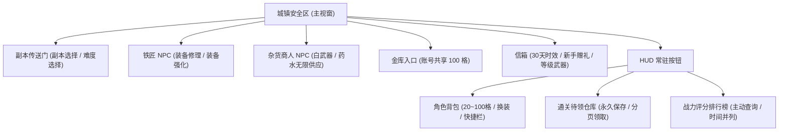
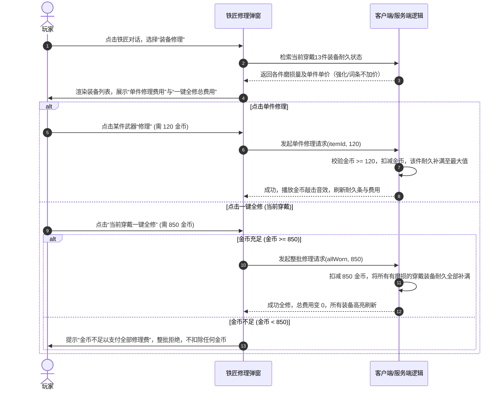

# 城镇与资产交互方案 v1（待审阅）

日期：2026-10-19。关联：[D05设计票](../wayfinder/mvp-design/issues/05-interactions.md)、[模块地图](../wayfinder/mvp-design/map.md)。
状态：首版提案已产出，待专题审阅；严格继承 [核心规则摘要](../wayfinder/core-rules-v2/SUMMARY.md)、[耐久与修理需求](durability-repair-proposal-v1.md) 及 [金币预算](gold-budget-proposal-v1.md)，未写入正式业务代码。

---

## 1. 城镇空间与主界面入口层级

游戏采用横屏 2.5D 像素风格（基础画布 480×270，适配 960×540 设计分辨率），城镇为固定横向卷轴安全区，禁止普攻、禁止施放职业技能与饰品。

---

## 2. 背包与穿戴交互流（Bag & Equipment）

### 2.1 格子规则与扩容
- **背包容量**：初始 20 格，右上角显示扩容按钮（`+20格`）。
- **扩容价格**：第 1 次 2,000 金币（20→40）、第 2 次 4,000 金币（40→60）、第 3 次 8,000 金币（60→80）、第 4 次 16,000 金币（80→100，达上限）。
- **交互边界**：
  - 点击扩容按钮弹出确认框：“消耗 X 金币解锁 20 格背包？”
  - 金币不足时弹窗提示“金币不足，需 X 金币”，扩容失败；
  - 战斗中扩容按钮置灰不可点击。

### 2.2 装备穿戴与卸下
- **同部位替换（满包换装）**：背包已满（如 20/20）时，点击背包内的同部位装备，直接与身上穿戴的装备**原格原位交换**，不要求背包有空格。
- **直接脱下装备（卸装）**：点击身上已穿戴装备选择“卸下”时，**必须背包有至少 1 个空格**；若背包已满（20/20），提示“背包已满，无法卸下装备”，操作拦截。
- **出售限制**：商人处禁止直接出售身上正穿戴的装备；必须先卸入背包，方可出售。
- **无武器限制**：允许玩家卖掉背包内所有武器，但当身上未穿戴武器时，副本传送门弹出警示：“请先装备武器再进入副本！”，阻止挑战发包。

---

## 3. 铁匠 NPC：修理与强化交互

### 3.1 装备耐久与修理流程
依据 [durability-repair-proposal-v1.md](durability-repair-proposal-v1.md) 规则：

- **0 耐久特殊响应**：
  - **武器归零**：在副本中武器耐久降为 0 时，战斗立即暂停，屏幕中央弹出强提示：“武器已完全破损！请退出副本回城修理。”，玩家点击确认后安全回城，不判作死亡，保留已拾取的战利品。
  - **防具/耳环归零**：挑战中不强退，但该部位提供的所有属性与套装件数失效（套装件数 -1），直到回城修复。

### 3.2 装备强化交互
- **强化界面**：放入目标装备（武器或耳环），右侧显示目标等级、成功率区间、金币消耗与材料消耗。
- **损毁与纪念品**：
  - +13 及以上失败损毁，装备消失，界面弹窗展示“强化损毁，获得 X 个专属纪念品”；若背包已满，剩余纪念品自动发往角色邮箱（30天时效）。
  - 下次强化时，勾选“消耗纪念品”，本次强化消耗固定数量纪念品获得成功率加成（同次不可叠加多组）。成功或失败均消耗所投入的纪念品。

---

## 4. 杂货商人、金库与信箱交互

### 4.1 杂货商人 NPC
- **商品结构**：无限量固定出售 1 级白双刀、低级生命药水（单价 50 金币）、低级法力药水（单价 50 金币）。
- **防套利规则**：回购价严格低于出售价；装备出售价仅根据装等与品质决定，强化等级与随机词条不增加任何出售金币。

### 4.2 账号金库（100 格）
- **访问入口**：城镇中央金库实体，所有角色公共访问，但只展示本账号数据。
- **存储权限**：
  - **允许存入**：非绑定物品、账号绑定物品（如点券商城商品、活动材料、账号绑定纪念品）；
  - **禁止存入**：角色绑定物品（如新手赠送的绿武器、角色专属邮件道具）。点击存入角色绑定物品时，弹出红字提示：“角色绑定物品无法存入金库”。

### 4.3 角色信箱
- **展示与时效**：按发信时间倒序排列，每封邮件右上角明确标注“剩余 X 天到期（到期自动清除）”。
- **领取操作**：
  - **一键领取**：尽可能将附件道具领入背包，背包满后停止，提示“背包空间不足，已领取前 X 件，剩余物品保留在邮件中”；
  - **删除规则**：带有未领取附件的邮件，删除按钮灰显置灰，禁止手动删除；只有领取完所有附件后，方可删除空邮件。

---

## 5. 永久通关待领仓库与排行榜

### 5.1 满包待领仓库（Pending Rewards）
- **触发场景**：通关副本翻牌或结算获得装备/道具时，若背包无空位，自动暂存入本角色的待领仓库。
- **特性与安全**：
  - **永久保存**：绝不设置过期倒计时，绝不因数量超过上限而自动丢弃玩家奖励；
  - **分页显示**：每页 10 件，右上角显示“待领数量：N”，点击“领取”按原角色原绑定规则移入背包；
  - **防外溢作弊**：待领仓库中的装备无法直接穿戴、无法出售、无法上架拍卖行，只能移入原角色背包。

### 5.2 战力评分排行榜（Leaderboard）
- **查询模式**：按需主动查询，玩家打开排行榜界面时拉取最新 TOP 100 榜单，不进行后台无意义的高频轮询。
- **并列同分规则**：装备评分相同时，**更早达到该分数的角色排在前面**。
- **纯荣誉定位**：排行榜不发放赛季排名奖励，避免数值膨胀导致玩家逼氪或恶意打榜。

---

## 6. 断网、重试与幂等防护

| 操作类型 | 网络中断 / 超时表现 | 重试机制与幂等设计 |
| --- | --- | --- |
| **背包扩容** | 界面转圈 3 秒无响应，弹出“网络连接超时，请重试” | 每个扩容等级带有唯一阶段标记（如 `expand_stage: 1`），重复请求不重复扣费。 |
| **一键全修** | 扣款前需服务端确认总金额，掉线时不执行任何扣除 | 批次事务更新，校验当前实际磨损量，已修满的装备自动跳过。 |
| **邮件/待领领取** | 若客户端未收到回包，先拉取最新背包与邮件状态 | 领取请求携带附件全局唯一 ID（`attachment_id`），已领取的项目服务端拒绝并提示“已领取”，绝不重复发货。 |
| **挑战中短线重连** | 屏幕中央显示“连接已断开，正在尝试恢复...”，挑战暂停 | 5 秒内重连成功直接原地继续挑战；超时则安全回城，保留断线前已击杀获得的金币与经验。 |
