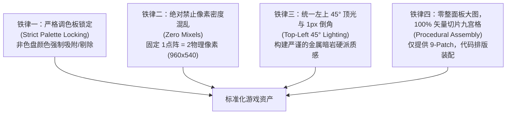
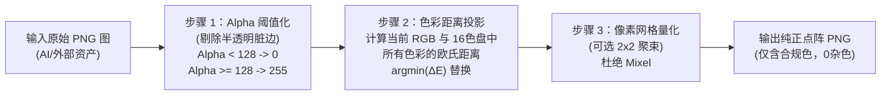

# 308世界 — UI与美术风格工程化标准化规范说明书 (v1)

更新日期：2026-11-04。关联：[UI视觉布局与交互规格说明书 v1](ui-layout-specification-v1.md)、[物品与装备像素图标规范 v1](../art/item-icons-specification-v1.md)、[双形态美术规格说明书 v1](../art/character-stances-specification-v1.md)、[设计真相源](../backend/source-of-truth.md)。

---

## 1. 规范定位与核心设计哲学

### 1.1 背景与团队约束：“零美工”工程化美术管线
在独立开发与缺乏专职美术团队（“零美工”）的现实约束下，UI与美术推进的最大痛点是：
1. **风格漂移 (Style Drift)**：不同批次、不同工具生成的素材画风差异大，拼接在同一界面产生严重的“拼凑感”；
2. **像素密度混乱 (Mixels / Pixel Inconsistency)**：不同素材点阵大小不一，部分高清、部分像素，视觉极为粗糙；
3. **色彩失控 (Palette Clashing)**：AI 绘制容易产生数以万计的杂色与半透明过渡，失去复古像素的纯粹质感；
4. **巨石图难题 (Monolithic UI Trap)**：直接输出一张完整界面的 PNG 图无法自适应多分辨率，文字难以国际化，改动成本极高。

**核心解决方案：**
将主观的美术创作转变为**客观、确定、可度量的软件工程管线**：
> **UI 100% 程序化组装 + 核心矢量母版 9-Patch 切片 + 锁定 16 色调色板 + AI 提示词公理库 + 自动对齐清洗脚本 + 3D/程序化动效补正。**

---

## 2. 视觉四大铁律 (The Four Visual Ironclad Rules)

任何 UI 面板、技能图标、装备道具、角色与怪物素材，必须无条件满足以下四大铁律：



### 铁律一：严格调色板锁定 (Strict Palette Locking)
- 所有界面背景、边框、插画、图标，严禁出现色盘外的随机杂色。
- AI 或第三方生成素材，必须经过自动化色距投影算法（$\Delta E$ 最小化）强制吸附到项目官方色盘。

### 铁律二：绝对禁止像素密度混乱 (Zero Mixels)
- **基准虚拟画布**：`480 × 270 px`；
- **渲染基准分辨率**：`960 × 540 px`（恰好 2× 整数放大，`image-rendering: pixelated`）；
- 严禁在同一画面中同时出现“1px 一个点”和“2px 一个点”的混杂显示（Mixels），所有点阵颗粒必须严格对齐到 $2\times2$ 物理像素网格。

### 铁律三：统一左上 45° 顶光与 1px 倒角高光 (Top-Left 45° Lighting)
- 所有面板外框、槽位凹槽、按钮与图标，光照方向固定为**左上角 45 度入射**；
- **顶边与左边**：使用调色板高亮色（1px 浅色反光）；
- **底边与右边**：使用调色板深色（1px 投影遮罩）；
- 统一产生硬朗、沉稳的金属冷钢与暗岩浮雕质感。

### 铁律四：零整面板位图，100% 矢量切片与程序化组装 (Procedural UI)
- 严禁让 AI 生成一整张“带有标题、按钮、背景的完整面板图片”；
- 界面必须拆解为**基础积木**：底框九宫格、内凹槽九宫格、通用三态按钮、列表项底衬、品质角标；
- 布局、文字、流光、图标由 Cocos 节点与程序逻辑动态拼接，保证 0 显存浪费与极速响应。

---

## 3. 权威色彩调色板规范 (Master Color Palette)

本色盘直接继承自 [UI视觉布局与交互规格说明书 v1](ui-layout-specification-v1.md) 并在工程层面严格固化。

### 3.1 核心 UI 与环境色阶表 (Dark Slate & Steel Palette)

| 语义层级 | 颜色名称 | HEX 值 | RGB (r, g, b) | 视觉用途与规则 |
| :--- | :--- | :--- | :--- | :--- |
| **B0** | 深渊暗岩底色 | `#10181e` | `(16, 24, 30)` | 全局最深底色、遮罩底板、槽位最深凹槽 |
| **B1** | 面板基底暗灰 | `#19252e` | `(25, 37, 46)` | 二级弹窗、背包背景、列表视口常规底色 |
| **B2** | 选中与悬停底色 | `#22323e` | `(34, 50, 62)` | 激活项底色、按下状态、悬浮高亮底衬 |
| **F0** | 基础结构边框 | `#344654` | `(52, 70, 84)` | 面板主外框、凹槽阴影边、次级按钮边框 |
| **F1** | 金属高亮外框 | `#5b7c8e` | `(91, 124, 142)` | 面板外边缘 1px 倒角反光、聚焦高光边框 |
| **L0** | 结构分割细线 | `#2b3a46` | `(43, 58, 70)` | 列表项分割线、属性段落分割虚线 |
| **T0** | 核心主文字 | `#e2ebef` | `(226, 235, 239)` | 装备名称、主标题、按钮主文案（微带青冷的暖白） |
| **T1** | 次级辅助文字 | `#8fa2af` | `(143, 162, 175)` | 属性标签、副标题、数值单位、快捷键提示 |
| **T2** | 弱化说明暗灰 | `#596e7c` | `(89, 110, 124)` | 冷却倒计时、未解锁说明、版权信息 |

### 3.2 战斗、数值与状态指示色

| 语义层级 | 颜色名称 | HEX 值 | RGB (r, g, b) | 对应游戏内系统 |
| :--- | :--- | :--- | :--- | :--- |
| **HP** | 生命鲜血红 | `#e54b4b` | `(229, 75, 75)` | 角色血条、生命药水、受击伤害数字 |
| **MP** | 法力微风蓝 | `#2b82c9` | `(43, 130, 201)` | 角色魔力槽、法力药水、魔法伤害/护盾 |
| **EXP**| 疾风成长绿 | `#69f0ae` | `(105, 240, 174)`| 经验条、经验获得提示、升级动态光芒 |
| **GLD**| 财富通用金 | `#fbc02d` | `(251, 192, 45)` | 金币图标、金币数量显示、商店标价 |
| **CRIT**| 致命暴击黄 | `#ffca28` | `(255, 202, 40)` | 暴击伤害字、强化成功爆发光效 |
| **GEM**| 苍穹晶核青 | `#00e5ff` | `(0, 229, 255)`  | 点券/充值晶石、首通特殊奖励流光 |
| **WARN**| 磨损/警告黄 | `#ffd740` | `(255, 215, 64)` | 耐久度 $\le 50\%$ 提示、网络延迟告警 |
| **DANG**| 破损/断裂红 | `#ff5252` | `(255, 82, 82)`  | 耐久度 $= 0$ 失效闪烁、血量 $<20\%$ 频闪 |

### 3.3 装备品质阶梯权威表 (Quality Tiers)

| 品质档位 | 级别名称 | 主文字/发光色 | 边框/角标底色 | 视觉特征描述 |
| :--- | :--- | :--- | :--- | :--- |
| **Tier 0** | 粗糙 (Rough) | `#b0bec5` | `#263238` | 白灰色粗铁、生锈边缘、无发光 |
| **Tier 1** | 优秀 (Fine) | `#66bb6a` | `#1b5e20` | 草绿色精钢、微弱暗绿冷辉 |
| **Tier 2** | 精良 (Rare) | `#29b6f6` | `#01579b` | 蔚蓝色秘银、清冽冰蓝光芒 |
| **Tier 3** | 稀有 (Unique) | `#ab47bc` | `#4a148c` | 暗紫色星铜、古朴神秘紫气 |
| **Tier 4** | 传说 (Legendary) | `#ffa726` | `#e65100` | 金橙色精金、熔火呼吸微光 |
| **Tier 5** | 史诗 (Epic) | `#ff1744` | `#b71c1c` | 炽红色天外陨铁、电浆跳跃弧光 |

---

## 4. SVG 矢量母版与九宫格切片架构 (SVG & 9-Patch)

### 4.1 为什么采用 SVG 作为工程母版
1. **数学精度而非手绘臆想**：SVG 采用纯文本 XML 描述坐标与几何图形，可以直接在代码仓库中做精准 Diff 与版本管理；
2. **像素网格完美对齐**：通过设定 `viewBox="0 0 16 16"`，每个矩形精确占据整数像素点，从根源杜绝半像素模糊；
3. **程序化多色系派生**：通过修改 SVG 内的 `fill` 和 `stroke` 变量，可在 1 秒内批量生成 6 种装备品质的外框，无需人工重复导出。

### 4.2 核心 9-Patch 切片清单与规范

所有切片存放于 `client/assets/resources/ui/slices/`：

```
ui/slices/
├── panel_window_frame.png     (16×16 px, 九宫格边距 5, 5, 5, 5)
├── panel_well_inner.png       (12×12 px, 九宫格边距 4, 4, 4, 4)
├── button_normal.png          (16×16 px, 九宫格边距 4, 4, 4, 4)
├── button_pressed.png         (16×16 px, 九宫格边距 4, 4, 4, 4)
├── button_disabled.png        (16×16 px, 九宫格边距 4, 4, 4, 4)
├── slot_grid_base.png         (56×56 px, 独立槽位单元)
├── bar_track_bg.png           (8×8 px, 进度条凹槽底轨)
├── bar_fill_hp.png            (8×8 px, 进度条纯色填充)
└── bar_fill_mp.png            (8×8 px, 进度条纯色填充)
```

### 4.3 核心切片 SVG 源代码母版 (可在 Node.js 中直出位图)

#### A. 主窗口暗岩九宫格面板 (`panel_window_frame.svg`)
```xml
<svg xmlns="http://www.w3.org/2000/svg" viewBox="0 0 16 16" width="16" height="16" shape-rendering="crispEdges">
  <!-- 基础填充 -->
  <rect x="0" y="0" width="16" height="16" fill="#19252e"/>
  <!-- 最外层 1px 暗岩阴影边框 -->
  <rect x="0" y="0" width="16" height="16" fill="none" stroke="#10181e" stroke-width="1"/>
  <!-- 左上 45° 倒角高光 (铁律三) -->
  <line x1="1" y1="1" x2="14" y2="1" stroke="#5b7c8e" stroke-width="1"/>
  <line x1="1" y1="1" x2="1" y2="14" stroke="#5b7c8e" stroke-width="1"/>
  <!-- 右下 45° 倒角阴影 (铁律三) -->
  <line x1="2" y1="14" x2="14" y2="14" stroke="#344654" stroke-width="1"/>
  <line x1="14" y1="2" x2="14" y2="14" stroke="#344654" stroke-width="1"/>
  <!-- 四角金属铆钉/包角装饰 (2x2 点阵) -->
  <rect x="2" y="2" width="2" height="2" fill="#5b7c8e"/>
  <rect x="12" y="2" width="2" height="2" fill="#344654"/>
  <rect x="2" y="12" width="2" height="2" fill="#344654"/>
  <rect x="12" y="12" width="2" height="2" fill="#10181e"/>
</svg>
```

#### B. 物品/属性内嵌凹槽 (`panel_well_inner.svg`)
```xml
<svg xmlns="http://www.w3.org/2000/svg" viewBox="0 0 12 12" width="12" height="12" shape-rendering="crispEdges">
  <!-- 内凹深色背景 -->
  <rect x="0" y="0" width="12" height="12" fill="#10181e"/>
  <!-- 内阴影：左上受遮挡变暗 -->
  <line x1="0" y1="0" x2="11" y2="0" stroke="#080c0f" stroke-width="1"/>
  <line x1="0" y1="0" x2="0" y2="11" stroke="#080c0f" stroke-width="1"/>
  <!-- 内反光：右下边缘产生微弱反射 (深青色) -->
  <line x1="1" y1="11" x2="11" y2="11" stroke="#2b3a46" stroke-width="1"/>
  <line x1="11" y1="1" x2="11" y2="11" stroke="#2b3a46" stroke-width="1"/>
</svg>
```

#### C. 通用操作金属按钮 (`button_normal.svg` / `button_pressed.svg`)
```xml
<!-- 正常状态 (button_normal.svg) -->
<svg xmlns="http://www.w3.org/2000/svg" viewBox="0 0 16 16" width="16" height="16" shape-rendering="crispEdges">
  <rect x="0" y="0" width="16" height="16" fill="#22323e"/>
  <rect x="0" y="0" width="16" height="16" fill="none" stroke="#10181e" stroke-width="1"/>
  <line x1="1" y1="1" x2="14" y2="1" stroke="#5b7c8e" stroke-width="1"/>
  <line x1="1" y1="1" x2="1" y2="14" stroke="#5b7c8e" stroke-width="1"/>
  <line x1="1" y1="14" x2="14" y2="14" stroke="#10181e" stroke-width="1"/>
  <line x1="14" y1="1" x2="14" y2="14" stroke="#10181e" stroke-width="1"/>
</svg>

<!-- 按下状态 (button_pressed.svg) - 高光与阴影反转，视觉凹陷 -->
<svg xmlns="http://www.w3.org/2000/svg" viewBox="0 0 16 16" width="16" height="16" shape-rendering="crispEdges">
  <rect x="0" y="0" width="16" height="16" fill="#141d24"/>
  <rect x="0" y="0" width="16" height="16" fill="none" stroke="#10181e" stroke-width="1"/>
  <line x1="1" y1="1" x2="14" y2="1" stroke="#0d1419" stroke-width="1"/>
  <line x1="1" y1="1" x2="1" y2="14" stroke="#0d1419" stroke-width="1"/>
  <line x1="1" y1="14" x2="14" y2="14" stroke="#344654" stroke-width="1"/>
  <line x1="14" y1="1" x2="14" y2="14" stroke="#344654" stroke-width="1"/>
</svg>
```

---

## 5. AI 生成资产提示词公理库 (Prompt Formulas)

当需要为游戏生成新的装备图标、材料道具或怪物立绘时，必须严格套用以下模板，严禁使用含糊的自由描述。

### 5.1 全局负面提示词公理 (Negative Prompt - 必须附带)
```text
(worst quality, low quality:1.4), (photorealistic, 3d render, octane render:1.3),
smooth, anti-aliased, blurry, soft edges, gradient background, complex noisy background,
isometric, perspective distortion, modern ui, glowing neon, pastel colors, oversaturated,
dithering noise, text, watermark, signature
```

### 5.2 图标资产提示词标准结构 (Formula for 64×64 Pixel Icons)
```text
[主体描述], pixel art icon, 16-bit RPG asset,
color palette: dark slate #10181e, steel cyan #344654 and #5b7c8e, accent with [品质主色],
crisp clean sharp pixel outlines, top-left 45-degree directional light,
pure black solid background #000000, perfectly centered, square composition, retro game sprite
```

### 5.3 常用分类生成模版

| 资产类别 | 典型示例 Prompt 片段 | 关键色彩与光影要求 |
| :--- | :--- | :--- |
| **双刀/单手剑** | `dual cold-steel daggers, crossed blades, metallic cyan guard, leather wrapped handle, sharp steel edge` | 刀刃留出 1px 白色锐利高光，剑柄使用 `#344654` 深钢色 |
| **重板甲/皮甲** | `heavy warrior plate chest armor, forged dark iron, riveted steel plates, bronze buckle strap` | 突出钢板结构接缝与金属反光，避免过于轻飘的布纹 |
| **首饰项链** | `mythril chain amulet, glowing sapphire crystal pendant in center, cold magical aura` | 宝石使用 3 阶蓝色阶（`#01579b` -> `#29b6f6` -> `#e2ebef` 心部高光） |
| **消耗品药水** | `cork-stopper glass alchemy flask, glowing ruby red health liquid #e54b4b, cross symbol embossed on bottle` | 烧瓶边缘 1px 暗色轮廓，液体中包含 2~3 个气泡点阵 |
| **精金强化锭** | `adamantite metal ingot bar, glowing amber gold streaks #ffa726, cold metallic heavy texture` | 斜 45 度摆放金属金砖造型，高对比棱角高光 |
| **怪物战斗待机** | `goblin raider, green skin, ragged leather armor, holding crude iron axe, combat ready stance, side view sprite` | 必须正交侧视 (Side view)，纯黑底，脚底基线平整对齐 |

---

## 6. 自动化调色板清洗与网格对齐工具规范 (Palette-Snap Tool)

为防止外部导入/AI 生成的素材含有色盘外杂色和半透明过渡像素（Anti-aliasing），工程配备自动化像素清洗脚本规格。

### 6.1 算法逻辑与流水线



### 6.2 调色板映射算法数学公式
对于输入像素点 $P = (R_p, G_p, B_p)$，在项目调色板集合 $C = \{C_1, C_2, \dots, C_k\}$ 中寻找最佳映射色彩 $C^*$：
$$C^* = \arg\min_{C_i \in C} \left[ 0.30 \times (R_p - R_i)^2 + 0.59 \times (G_p - G_i)^2 + 0.11 \times (B_p - B_i)^2 \right]$$
*(采用感知加权欧氏色彩距离，加权系数贴合人眼对绿、红、蓝的明度敏感度)*。

### 6.3 实用 Node.js 清洗脚本实现规范 (`scripts/art/palette-snap.js`)
脚本运行依赖零原生 C++ 编译，使用纯 JS 位图解析库或标准 Canvas：
```javascript
// scripts/art/palette-snap.js (核心色彩投影核)
const PALETTE_HEX = [
  '#10181e', '#19252e', '#22323e', '#344654', '#5b7c8e', '#2b3a46',
  '#e2ebef', '#8fa2af', '#596e7c', '#e54b4b', '#2b82c9', '#ffca28',
  '#fbc02d', '#00e5ff', '#69f0ae', '#ff5252', '#ffd740', '#4caf50',
  '#b0bec5', '#66bb6a', '#29b6f6', '#ab47bc', '#ffa726', '#ff1744'
];

function hexToRgb(hex) {
  const num = parseInt(hex.slice(1), 16);
  return [(num >> 16) & 255, (num >> 8) & 255, num & 255];
}

const PALETTE_RGB = PALETTE_HEX.map(hexToRgb);

function snapPixel(r, g, b, a) {
  if (a < 128) return [0, 0, 0, 0]; // 剔除半透明边缘
  let minDist = Infinity;
  let best = PALETTE_RGB[0];
  for (const c of PALETTE_RGB) {
    // 感知加权距离
    const dist = 0.30 * (r - c[0]) ** 2 + 0.59 * (g - c[1]) ** 2 + 0.11 * (b - c[2]) ** 2;
    if (dist < minDist) {
      minDist = dist;
      best = c;
    }
  }
  return [best[0], best[1], best[2], 255];
}
```

---

## 7. “零美工”动作与动效流水线 (Animation & Motion Without Artists)

对于独立开发者，逐帧手绘像素动作成本极高且极易变形。本项目确立两条**工业级无美工动效路径**：

### 7.1 路径 A：3D 骨骼动捕 -> Blender 像素着色器 -> 序列帧 (3D-to-Pixel)
参考经典游戏《死亡细胞》(Dead Cells) 的成功工业管线：
1. **动作来源**：使用 Adobe Mixamo 免费高质量角色骨骼动捕库（包含奔跑、受击、倒地、双刀挥砍等 2,000+ 工业级动作）；
2. **模型绑定**：使用低面数 (Low-Poly) 通用角色体型模型；
3. **着色与渲染**：
   - 导入 Blender，摄像机切换为**正交投影 (Orthographic)**；
   - 渲染分辨率限定为 $128 \times 128\text{px}$；
   - 应用无抗锯齿硬边着色（Cel Shader / Pixel Shader）；
4. **后处理**：输出序列帧后直接跑 `palette-snap.js` 调色板吸附脚本，获得帧率极度稳定、肢体比例毫不漂移的高级像素动效。

### 7.2 路径 B：开源/商业 Sprite Sheet 骨架二次重染色 (Palette-Swapping)
1. 选用经过行业验证的高品质 CC0/商业通用像素小人资产（如 LPC / Itch 像素动作包）；
2. 保留原有动作骨架与动势，仅替换色盘：
   - 将原色盘映射至 `#10181e`、`#344654`、`#5b7c8e` 与对应品质高光色；
   - 0 成本产出与 308 世界视觉 100% 契合的专属敌人/NPC。

### 7.3 纯代码“打击感与爽快感”公式 (Procedural Combat Juice)
没有华丽手绘特效时，**90% 的打击感取决于程序对时间和画面的微操**：

| 技术手段 | 触发时机与具体参数 | 视觉与手感心理效应 |
| :--- | :--- | :--- |
| **顿帧 (Hit-Stop)** | 武器攻击命中敌人的瞬间，将攻击者与受击者的动画播放暂停 **3~5 帧** (50~80ms)；暴击顿帧 **6 帧** (100ms) | 赋予刀刃切入肉体/钢铁的阻滞感与厚重感 |
| **受击闪白 (Hit Flash)** | 命中第 1 帧将受击怪物的 Sprite 材质替换为纯白 (`color(255, 255, 255)`)，持续 **60ms** 后恢复 | 极高明度反差让玩家大脑瞬间确认“有效命中” |
| **方向震屏 (Screen Shake)**| 重击/暴击命中时，将主摄像机沿攻击朝向抖动 **6~10px**，并以正弦衰减在 **120ms** 内归零 | 传递破坏性冲击波与力道 |
| **跳字动势 (Dynamic Numbers)**| 伤害数字从受击点弹出时，赋予一个向上初速度与重力加速度，暴击数字放大 1.4 倍并呈金黄色 | 增强伤害结算的正反馈与成就感 |

---

## 8. 实施阶段与交付清单 (Actionable Next Steps)

为落实本标准化方案，后续工程实施划分为三个明确阶段：

### 阶段一：UI 基础切片与矢量套件工程化落地 (UI Assets Basekit)
1. 在 `client/assets/resources/ui/slices/` 生成全套 9-Patch PNG 切片（基于本文档 SVG 代码母版导出）；
2. 在 Cocos 场景与代码中，将原有使用纯色块或临时框的代码迁移为标准 `Sprite` 九宫格拉伸组件 (`Type = SLICED`)；
3. 统一规范背包格子 (`slot_grid_base`)、人物装备底盘、关闭按钮、确认/取消按钮的统一样式。

### 阶段二：调色板自动对齐脚本建立 (Palette Tools)
1. 在 `scripts/art/` 建立 `palette-snap.js` 命令行工具；
2. 批量扫描 `docs/art/` 与 `client/assets/` 下现有未合规资产，生成合规性报告与自动修正版；
3. 锁定新资产准入测试，防止未来新增美术资产发生画风漂移。

### 阶段三：动作与程序打击感标准化 (Procedural Juice)
1. 封装 `HitEffectCoordinator`（受击顿帧、受击闪白、镜头微震、暴击飘字），在 `WarriorSpriteSheetView` 与技能协调器中全局接入；
2. 固化城镇双刀入鞘站街形态与战斗出鞘形态的动画切换。

---

## 9. 验收门禁 (Verification Gates)

| 检查项 | 验收标准 | 验证方式 |
| :--- | :--- | :--- |
| **色彩合规性** | 所有 UI 与图标图片中，非 16 色调色板的像素数占比为 $0\%$ | 自动化脚本扫描全像素点 HEX |
| **九宫格无失真** | 任何弹窗面板在拉伸至任意尺寸时，四角 4px 倒角金属无拉伸变形 | 客户端缩放测试与截图比对 |
| **像素对齐 (No Mixels)** | 游戏画面在 960x540 下，所有点阵单元必须是 $2\times2$ 整数像素 | 高倍放大截图点对点检视 |
| **手感 0 延迟** | 顿帧与打击反馈完全由内核驱动，不影响输入状态机与网络协议 | 自动化单测与 0ms 输入验证 |
