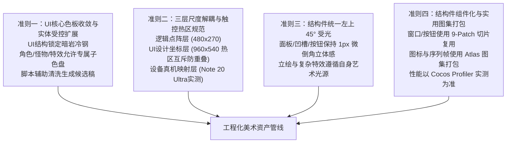
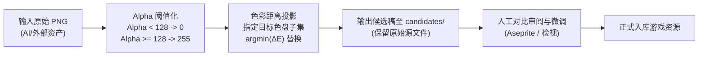
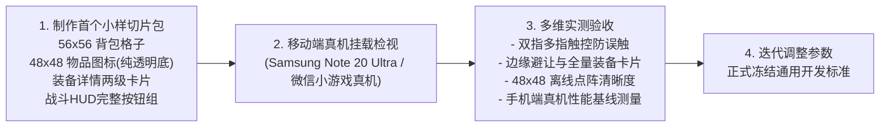

# 308世界 — UI与美术风格工程化标准化策略与试验方案 (v1)

更新日期：2026-11-04。关联：[UI视觉布局与交互规格说明书 v1](ui-layout-specification-v1.md)、[UI设计规格审阅 v1](../reviews/ui-design-review-v1.md)、[物品与装备像素图标规范 v1](../art/item-icons-specification-v1.md)、[双形态美术规格说明书 v1](../art/character-stances-specification-v1.md)、[设计真相源](../backend/source-of-truth.md)。

> [!IMPORTANT]
> **方案状态说明：候选与试验探索方案 (Candidate & Experimental Strategy)**<br>
> 本文旨在为“零专职美工”的现实约束建立一套高复用、低返工、可度量的工程化美术与UI推进路径。本文中的切片参数、色盘配置、打击感数值均为**工程初始候选方案**，并非已冻结的强制开发合同；所有参数与表现必须通过移动端真机小样（如 Samsung Galaxy Note 20 Ultra 横屏）进行触控、清晰度与性能实测后，再逐步转正冻结。

---

## 1. 方案背景与设计定位

### 1.1 现实痛点：“零美工”下的工程化破局
在独立开发与缺乏专职美术团队的约束下，UI与美术推进面临四大核心挑战：
1. **风格发散与拼凑感 (Style Drift)**：不同批次、不同工具或 AI 生成的素材画风杂乱，拼接在同一界面容易产生突兀的拼凑感；
2. **尺度与清晰度失控 (Scaling & Readability)**：手机屏幕长宽比各异（16:9 到 21:9）、DPR 多样，强行追求“全局固定整数像素”脱离真机实际；
3. **杂色泛滥与对比度丢失 (Color Inconsistency)**：外部/AI 生成图带有大量抗锯齿半透明脏边与多余过渡色，不仅模糊，而且影响核心信息辨识；
4. **巨石图与维护黑洞 (Monolithic UI Trap)**：直接绘制整张大面板图片导致多分辨率适配困难、无法复用、内存显存浪费严重。

### 1.2 破局原则：工程化降本与组件复用
将主观的美术创作转变为**客观、模块化、可度量的软件工程管线**：
> **UI 结构件 9-Patch 高度复用 + UI 核心暗岩色板收敛 + 角色/特效受控扩展色盘 + AI 提示词标准化 + 自动清洗辅助候选 + 移动端小样真机实测。**

---

## 2. 四大工程设计导向准则 (Four Engineering Guidelines)

本文将早期的绝对化规则调整为务实、可迭代的工程导向准则：



### 准则一：UI 核心色板收敛与实体受控扩展 (UI Core Palette & Controlled Extensions)
- **UI 结构件（窗口、底衬、边框、分割线、通用文字）**：严格收敛于暗岩冷钢调色板，确保框架一体化与沉浸感；
- **角色、怪物与技能特效**：不强制粗暴映射到 UI 暗岩色，允许根据种族与主题定义**受控扩展子色板**（如牛头怪兽血红与皮革棕、哥布林苔绿、冰霜晶蓝）。单实体建议控制在 8~16 色点阵色以内，保障材质感与辨识度；
- **自动化清洗脚本定位**：定位为**辅助生成清洗候选稿的过滤工具 (Candidate Preprocessing)**。清洗结果必须经过人工检视与审美确认，严禁未经审图自动覆盖源文件。

### 准则二：三层尺度解耦与触控热区规范 (Three-Tier Scaling & Touch Hitbox Specification)
不同手机屏幕分辨率、DPR 与安全区无法保证“全屏全局物理整数倍放大”。因此将像素尺度与触控明确解耦为三层：
1. **战斗点阵逻辑层 (Virtual Logic Pixels)**：`480 × 270 px` 虚拟画布，定义角色碰撞盒、位移物理量与战斗点阵动画网格；
2. **UI 设计参考坐标层 (UI Design Coordinates - 960 × 540)**：
   - 本工程所有 UI 视觉尺寸与触控热区规格，**基准数值统一基于 960 × 540 设计坐标 (Design Units)**；
   - **视觉尺寸 vs 触控热区**：
     - 普攻按钮：视觉尺寸 $80\times80\text{px}$，触控热区 $\ge 80\times80\text{px}$；
     - 四技能按钮：视觉尺寸 $54\times54\text{px}$（含外环底框 $72\times72\text{px}$），触控热区 $\ge 72\times72\text{px}$；
     - 主动饰品按钮：视觉尺寸 $44\times44\text{px}$，触控热区 $\ge 48\times48\text{px}$；
     - 3 格药品槽：视觉尺寸 $46\times46\text{px}$，触控热区 $\ge 48\times48\text{px}$；
     - 列表单项与通用操作按钮：视觉高度 $\ge 44\text{px}$，触控热区 $\ge 48\times48\text{px}$；
   - **热区互斥防重叠红线 (Non-Overlapping Hitboxes)**：在 960×540 坐标系下，普攻（右下角）、四技能（左上方扇形弧）、主动饰品（技能组上方）、3 药格（技能组左侧）与左侧虚拟摇杆之间，**各热区边缘必须保持至少 8px 的有效几何间距，绝对禁止物理碰撞区重叠**，从根源杜绝多指盲操误触；
3. **设备物理视口与真机适配层 (Device Physical Display & Safe Area)**：
   - 以 Samsung Galaxy Note 20 Ultra 横屏（3088×1440，长宽比约 2.14:1）等主流全面屏为实机验证样本；
   - Cocos Canvas 通过 `Fit Height`（或动态宽度）及微信胶囊安全区换算，将 960×540 设计坐标映射至真实设备物理像素；
   - 在真实屏幕上验证实际物理触控尺寸是否达到人体工学舒适标准（拇指接触面 $\approx 7\sim9\text{mm}$）。
- **层内一致性原则 (No Intra-Layer Mixels)**：UI 内部保持一致的 UI 点阵尺度；战斗场景内保持一致的场景点阵尺度。显示层边界允许硬件双线性平滑适配，不搞教条主义。

### 准则三：统一左上 45° 结构受光与微倒角 (Top-Left 45° Lighting for Structures)
- 面板外框、凹槽、按钮等基础结构件，统一采用**左上 45 度入射光**：
  - **顶边与左边**：使用 1px 浅色反光；
  - **底边与右边**：使用 1px 投影遮罩；
- 形成硬朗、清晰的微浮雕金属暗岩质感；角色立绘与动态特效遵循自身艺术光源，不生搬硬套。

### 准则四：结构件组件化复用与实用图集打包 (Structural Componentization & Pragmatic Atlas)
- **9-Patch 切片复用**：面板边框、通用按钮、凹槽边框、状态底轨等纯结构件使用九宫格切片，实现自由拉伸；
- **图集 (Sprite Atlas) 打包**：图标集合（如 48×48 物品图标集）、技能图标、角色立绘、复杂特效按模块打成图集；
- **性能与开销实测**：显存占用、Draw Calls 合批与 Overdraw 以 Cocos Profiler 真机实测为准，不作“零显存浪费”等绝对化断言。

---

## 3. 色彩调色板基准 (Master Color Palette)

本色盘以 [UI视觉布局与交互规格说明书 v1](ui-layout-specification-v1.md) 为基础，理清色阶语义与色值对照。

### 3.1 UI 核心结构与文字色阶 (Dark Slate & Steel Core)

| 语义层级 | 颜色名称 | HEX 值 | RGB (r, g, b) | 视觉用途与规则 |
| :--- | :--- | :--- | :--- | :--- |
| **B0** | 深渊暗岩底色 | `#10181e` | `(16, 24, 30)` | 全局最深底色、全屏弹窗遮罩、槽位内嵌凹陷底 |
| **B1** | 面板基底暗灰 | `#19252e` | `(25, 37, 46)` | 二级弹窗底板、背包背景、列表视口常规底色 |
| **B2** | 选中与悬停底色 | `#22323e` | `(34, 50, 62)` | 激活项底色、按下状态、悬浮高亮底衬 |
| **F0** | 基础结构边框 | `#344654` | `(52, 70, 84)` | 面板主外框、凹槽阴影边、次级按钮边框 |
| **F1** | 金属高亮外框 | `#5b7c8e` | `(91, 124, 142)` | 面板外边缘 1px 倒角反光、聚焦高光边框 |
| **L0** | 结构分割细线 | `#2b3a46` | `(43, 58, 70)` | 列表项分割线、属性段落分割虚线 |
| **T0** | 核心主文字 | `#e2ebef` | `(226, 235, 239)` | 装备名称、主标题、按钮主文案（微带青冷的暖白） |
| **T1** | 次级辅助文字 | `#8fa2af` | `(143, 162, 175)` | 属性标签、副标题、数值单位、快捷键提示 |
| **T2** | 弱化说明暗灰 | `#596e7c` | `(89, 110, 124)` | 冷却倒计时、未解锁说明、版本信息 |
| **S_DEEP** | 极深凹角阴影 | `#080c0f` | `(8, 12, 15)` | 切片内阴影倒角修饰色 (如凹槽顶边内遮光) |

### 3.2 战斗、数值与状态指示色

| 语义层级 | 颜色名称 | HEX 值 | RGB (r, g, b) | 对应游戏内系统 |
| :--- | :--- | :--- | :--- | :--- |
| **HP** | 生命鲜血红 | `#e54b4b` | `(229, 75, 75)` | 角色血条、生命药水、受击伤害数字 |
| **MP** | 法力微风蓝 | `#2b82c9` | `(43, 130, 201)` | 角色魔力槽、法力药水、魔法伤害/护盾 |
| **EXP**| 疾风成长绿 | `#69f0ae` | `(105, 240, 174)`| 经验条、经验获得提示、升级动态光芒 |
| **GLD**| 财富通用金 | `#fbc02d` | `(251, 192, 45)` | 金币图标、金币数量显示、商店标价 |
| **CRIT**| 致命暴击黄 | `#ffca28` | `(255, 202, 40)` | 暴击伤害字、强化成功爆发光效 |
| **GEM**| 苍穹晶核青 | `#00e5ff` | `(0, 229, 255)`  | 点券/充值晶石、首通特殊奖励流光 |
| **WARN**| 磨损/警告黄 | `#ffd740` | `(255, 215, 64)` | 耐久度 $\le 50\%$ 提示、网络延迟告警 |
| **DANG**| 破损/断裂红 | `#ff5252` | `(255, 82, 82)`  | 耐久度 $= 0$ 失效闪烁、血量 $<20\%$ 频闪 |

### 3.3 装备品质阶梯权威表 (Quality Tiers)

| 品质档位 | 级别名称 | 主文字/发光色 | 边框/角标底色 | 视觉特征描述 |
| :--- | :--- | :--- | :--- | :--- |
| **Tier 0** | 粗糙 (Rough) | `#b0bec5` | `#263238` | 白灰色粗铁、生锈边缘、无发光 |
| **Tier 1** | 优秀 (Fine) | `#66bb6a` | `#1b5e20` | 草绿色精钢、微弱暗绿冷辉 |
| **Tier 2** | 精良 (Rare) | `#29b6f6` | `#01579b` | 蔚蓝色秘银、清冽冰蓝光芒 |
| **Tier 3** | 稀有 (Unique) | `#ab47bc` | `#4a148c` | 暗紫色星铜、古朴神秘紫气 |
| **Tier 4** | 传说 (Legendary) | `#ffa726` | `#e65100` | 金橙色精金、熔火呼吸微光 |
| **Tier 5** | 史诗 (Epic) | `#ff1744` | `#b71c1c` | 炽红色天外陨铁、电浆跳跃弧光 |

---

## 4. 图标与切片工程规格对齐 (Icons & 9-Patch Alignment)

### 4.1 物品与装备图标尺寸分级与透明底解耦 (对齐 [图标规范 v1](../art/item-icons-specification-v1.md))
消除原规范中不同尺寸混用的歧义，明确分级定义与职责分离：
1. **设计原始母版**：`256 × 256 px`（高精设计母版，用于图鉴画册与高清检视）；
2. **大卡片/详情展示**：`64 × 64 px`（离线独立导出，用于装备详情弹出大卡片、结算高亮）；
3. **标准网格运行时尺寸**：**48 × 48 px**（离线独立导出，适配背包/金库 `56 × 56 px` 格子，居中留出 4px 内边距）；
4. **纸娃娃紧凑槽位**：`34 × 34 px`（离线独立导出）；
5. **严禁运行时非整数倍缩放**：48×48、64×64 与 34×34 均为离线独立导出切片，严禁在运行时用 64×64 强制按非整数比（如 0.75×）缩放，避免最近邻采样导致点阵线条粗细不均；
6. **透明底纯净切片原则 (Transparent Subject Decoupling)**：所有图标素材必须为**纯透明背景 PNG (Alpha=0)**，仅绘制武器、铠甲、宝石、药水瓶本身，**严禁在图标文件内固化暗岩底衬或品质外框**；
   - 底衬（`Layer 0`）：由 UI 组件通过 `panel_well_inner` 9-Patch 切片统一提供；
   - 品质外框（`Layer 2`）：由 UI 组件根据物品当前品质动态挂载 6 阶品质外框 Sprite；
   - 优势：彻底消除“一格两层底板、两层外框”的视觉冲突与重复渲染，同一透明底图标可在背包、大卡片、纸娃娃、奖励弹窗中无缝通用；
7. **堆叠数量标识**：右下角常驻黑色半透明底衬数量标牌（如 `x5`、`x20`，单堆上限严格遵守系统规约 `MAX_STACK = 20`，装备类不可堆叠不显示）。

### 4.2 核心 9-Patch 切片清单与目录规划

切片预定存放于 `client/assets/resources/ui/slices/`：

```
ui/slices/
├── panel_window_frame.png     (16×16 px, 九宫格边距 5, 5, 5, 5)
├── panel_well_inner.png       (12×12 px, 九宫格边距 4, 4, 4, 4)
├── button_normal.png          (16×16 px, 九宫格边距 4, 4, 4, 4)
├── button_pressed.png         (16×16 px, 九宫格边距 4, 4, 4, 4)
├── button_disabled.png        (16×16 px, 九宫格边距 4, 4, 4, 4)
├── slot_grid_base.png         (56×56 px, 独立槽位单元)
├── bar_track_bg.png           (8×8 px, 进度条凹槽底轨)
├── bar_fill_hp.png            (8×8 px, 进度条纯色填充)
└── bar_fill_mp.png            (8×8 px, 进度条纯色填充)
```

### 4.3 核心切片 SVG 源代码母版 (候选数学模型)

#### A. 主窗口暗岩九宫格面板 (`panel_window_frame.svg`)
```xml
<svg xmlns="http://www.w3.org/2000/svg" viewBox="0 0 16 16" width="16" height="16" shape-rendering="crispEdges">
  <rect x="0" y="0" width="16" height="16" fill="#19252e"/>
  <rect x="0" y="0" width="16" height="16" fill="none" stroke="#10181e" stroke-width="1"/>
  <line x1="1" y1="1" x2="14" y2="1" stroke="#5b7c8e" stroke-width="1"/>
  <line x1="1" y1="1" x2="14" y2="1" stroke="#5b7c8e" stroke-width="1"/>
  <line x1="2" y1="14" x2="14" y2="14" stroke="#344654" stroke-width="1"/>
  <line x1="14" y1="2" x2="14" y2="14" stroke="#344654" stroke-width="1"/>
  <rect x="2" y="2" width="2" height="2" fill="#5b7c8e"/>
  <rect x="12" y="2" width="2" height="2" fill="#344654"/>
  <rect x="2" y="12" width="2" height="2" fill="#344654"/>
  <rect x="12" y="12" width="2" height="2" fill="#10181e"/>
</svg>
```

#### B. 物品/属性内嵌凹槽 (`panel_well_inner.svg`)
```xml
<svg xmlns="http://www.w3.org/2000/svg" viewBox="0 0 12 12" width="12" height="12" shape-rendering="crispEdges">
  <rect x="0" y="0" width="12" height="12" fill="#10181e"/>
  <line x1="0" y1="0" x2="11" y2="0" stroke="#080c0f" stroke-width="1"/>
  <line x1="0" y1="0" x2="0" y2="11" stroke="#080c0f" stroke-width="1"/>
  <line x1="1" y1="11" x2="11" y2="11" stroke="#2b3a46" stroke-width="1"/>
  <line x1="11" y1="1" x2="11" y2="11" stroke="#2b3a46" stroke-width="1"/>
</svg>
```

#### C. 通用操作金属按钮 (`button_normal.svg` / `button_pressed.svg`)
```xml
<!-- 正常状态 (button_normal.svg) -->
<svg xmlns="http://www.w3.org/2000/svg" viewBox="0 0 16 16" width="16" height="16" shape-rendering="crispEdges">
  <rect x="0" y="0" width="16" height="16" fill="#22323e"/>
  <rect x="0" y="0" width="16" height="16" fill="none" stroke="#10181e" stroke-width="1"/>
  <line x1="1" y1="1" x2="14" y2="1" stroke="#5b7c8e" stroke-width="1"/>
  <line x1="1" y1="1" x2="14" y2="1" stroke="#5b7c8e" stroke-width="1"/>
  <line x1="1" y1="14" x2="14" y2="14" stroke="#10181e" stroke-width="1"/>
  <line x1="14" y1="1" x2="14" y2="14" stroke="#10181e" stroke-width="1"/>
</svg>

<!-- 按下状态 (button_pressed.svg) -->
<svg xmlns="http://www.w3.org/2000/svg" viewBox="0 0 16 16" width="16" height="16" shape-rendering="crispEdges">
  <rect x="0" y="0" width="16" height="16" fill="#141d24"/>
  <rect x="0" y="0" width="16" height="16" fill="none" stroke="#10181e" stroke-width="1"/>
  <line x1="1" y1="1" x2="14" y2="1" stroke="#080c0f" stroke-width="1"/>
  <line x1="1" y1="1" x2="14" y2="1" stroke="#080c0f" stroke-width="1"/>
  <line x1="1" y1="14" x2="14" y2="14" stroke="#344654" stroke-width="1"/>
  <line x1="14" y1="1" x2="14" y2="14" stroke="#344654" stroke-width="1"/>
</svg>
```

---

## 5. AI 生成资产提示词公理库 (Prompt Formulas)

AI 产物定位为**初稿与创意输入**，产出后必须经过尺寸归一化与人工审校。

### 5.1 全局负面提示词公理 (Negative Prompt - 必须附带)
```text
(worst quality, low quality:1.4), (photorealistic, 3d render, octane render:1.3),
smooth, anti-aliased, blurry, soft edges, gradient background, complex noisy background,
isometric, perspective distortion, modern ui, glowing neon, pastel colors, oversaturated,
dithering noise, text, watermark, signature
```

### 5.2 图标资产提示词标准结构 (Formula for 64×64 Pixel Icons)
```text
[主体描述], pixel art icon, 16-bit RPG asset,
color palette: dark slate #10181e, steel cyan #344654 and #5b7c8e, accent with [品质主色],
crisp clean sharp pixel outlines, top-left 45-degree directional light,
pure black solid background #000000, perfectly centered, square composition, retro game sprite
```

### 5.3 常用分类生成模版

| 资产类别 | 典型示例 Prompt 片段 | 关键色彩与光影要求 |
| :--- | :--- | :--- |
| **双刀/单手剑** | `dual cold-steel daggers, crossed blades, metallic cyan guard, leather wrapped handle, sharp steel edge` | 刀刃留出 1px 白色锐利高光，剑柄使用 `#344654` 深钢色 |
| **重板甲/皮甲** | `heavy warrior plate chest armor, forged dark iron, riveted steel plates, bronze buckle strap` | 突出钢板结构接缝与金属反光，避免过于轻飘的布纹 |
| **首饰项链** | `mythril chain amulet, glowing sapphire crystal pendant in center, cold magical aura` | 宝石使用 3 阶蓝色阶（`#01579b` -> `#29b6f6` -> `#e2ebef` 心部高光） |
| **消耗品药水** | `cork-stopper glass alchemy flask, glowing ruby red health liquid #e54b4b, cross symbol embossed on bottle` | 烧瓶边缘 1px 暗色轮廓，液体中包含 2~3 个气泡点阵 |
| **精金强化锭** | `adamantite metal ingot bar, glowing amber gold streaks #ffa726, cold metallic heavy texture` | 斜 45 度摆放金属金砖造型，高对比棱角高光 |
| **怪物战斗待机** | `goblin raider, green skin, ragged leather armor, holding crude iron axe, combat ready stance, side view sprite` | 必须正交侧视 (Side view)，纯黑底，脚底基线平整对齐 |

---

## 6. 自动化调色板清洗与网格对齐工具设计 (Palette-Snap Tool Design)

### 6.1 工具定位与工作流
- **非强制自动化覆盖**：清洗脚本定位为**辅助预处理工具**，输出到 `candidates/` 候选目录；
- **保留人工审图**：开发者对比原图与候选图，确认轮廓与质感无损后才入库；
- **自适应色盘输入**：支持指定目标色盘（如 UI 色盘、怪物子色盘、技能特效子色盘），而非硬套单一固定色盘。



### 6.2 实用 Node.js 清洗脚本规格 (`scripts/art/palette-snap.js`)
```javascript
// scripts/art/palette-snap.js (感知加权色彩吸附核)
function snapPixel(r, g, b, a, targetPalette) {
  if (a < 128) return [0, 0, 0, 0]; // 剔除半透明噪点边缘
  let minDist = Infinity;
  let best = targetPalette[0];
  for (const c of targetPalette) {
    // 人眼感知加权距离
    const dist = 0.30 * (r - c[0]) ** 2 + 0.59 * (g - c[1]) ** 2 + 0.11 * (b - c[2]) ** 2;
    if (dist < minDist) {
      minDist = dist;
      best = c;
    }
  }
  return [best[0], best[1], best[2], 255];
}
```

---

## 7. 动作与动效试验方案 (Animation & Procedural Juice - Experimental)

### 7.1 资产生产管线探索
1. **3D 动捕转 2D 像素 (Mixamo $\to$ Blender)**：
   - 适用于骨骼比例必须极度稳定的基础动作（奔跑、倒地、通用受击）；
   - 需人工核查 3D 动作包商用授权；
   - 导出的序列帧需人工修正关键帧动势（Keyframe Posing），避免“转模机械感”；
2. **开源/商业素材二次重染色 (Palette-Swapping)**：
   - 必须逐项核查素材商用授权与署名条款；
   - 仅调整色相与明暗对比度，融入游戏环境。

### 7.2 纯代码打击感候选参数与战斗规则保护 (Procedural Combat Juice)
没有手绘复杂特效时，通过时间与屏幕微操提升打击感。

> [!IMPORTANT]
> **核心战斗规则保护红线 (Client Presentation Only)**<br>
> 顿帧与打击反馈**仅为客户端纯本地表现层渲染暂停**（`WarriorSpriteSheetView` 与受击怪物的 Sprite 动画帧推进暂停、粒子特效暂停），**绝对严禁改变战斗状态机时间戳、模拟活动时钟 (timeline / transitionClock)、服务端权威伤害节奏与网络同步心跳**，避免手感调整改变联机校验或伤害频次。

| 机制 | 候选基准参数 | 适用场景与连击衰减规则 (Multi-Hit Attenuation) |
| :--- | :--- | :--- |
| **顿帧 (Hit-Stop)** | 单段重击/终结打击：**3~5 帧** (50~80ms)<br>暴击打击：**5~6 帧** (80~100ms) | **多段连击衰减与打断边界**：<br>1. **战士四段普攻**：仅第 4 段终结击生效全额顿帧；第 1~3 段仅允许 1 帧微停（~16ms）或仅闪白不顿帧；<br>2. **连击打断/未接后段**：若普攻未打出第 4 段或技能在终结前被怪物击飞/打断，前序段只保留自身的 1 帧微停，立即顺滑切入被打断或后摇恢复；<br>3. **多目标命中不叠加**：单次挥砍即便同时命中 5 只怪，顿帧时长仅计算 1 次（如 60ms），严禁乘算为 300ms；<br>4. **单段重技能**：拔刀斩等单段爆发技能享有独立全额重击顿帧。 |
| **受击闪白 (Hit Flash)** | 单次命中材质纯白持续 **60ms** | 瞬时高明度确认有效命中。受击怪物连续受击时不重复触发，内置至少 150ms 冷却保护。 |
| **方向微震屏 (Screen Shake)** | 暴击/重型技能沿打击方向位移 **6~8px**，**120ms** 内正弦衰减归零 | 仅限首领技能、暴击或大崩等重打击。普通轻击不震屏。 |
| **跳字动势 (Dynamic Numbers)** | 伤害字上抛与重力下落，暴击放大 1.3 倍金黄 | 限制同屏最大飞字数量（$\le 10$），同源伤害做合流显示，避免遮挡血条。 |

### 7.3 无障碍与舒适度开关 (Accessibility & Ergonomics)
在游戏设置中必须提供：
- **屏幕震动开关**：支持“强 / 弱 / 关闭”三档设置，防眩晕与防生理不适；
- **闪烁弱化开关**：支持将“受击闪白”替换为“轻微发亮描边”，照顾光敏性敏感玩家。

---

## 8. 实机小样验证计划 (Prototype Slice Kit Action Plan)

为避免脱离实机的纸面推演，下一步直接推进“小样套件制作与实机验证”，暂不全量铺开：



### 8.1 小样测试内容清单
1. **背包与槽位切片小样**：
   - 提取 `panel_well_inner`、`panel_window_frame`、`slot_grid_base`；
   - 挂载 3 种不同品质的 48×48 纯透明底物品图标（武器、防具、药水），验证与 UI 底板/品质框的分层对齐；
2. **装备详情两级弹窗与极值文本小样**：
   - **两级弹窗交互**：初次点击装备先弹出紧凑小浮窗 (Hover/Tap Preview Tooltip)，再次点击或长按平滑展开完整详情大卡片；
   - **全量合法信息覆盖**：不仅测试“最多 6 条词条”，必须覆盖完整装备合法信息包络（超长装备名称、全套基础属性、强化加成、套装激活词条、耐久度指示与磨损警示、损毁/谱系说明）；
   - **屏幕边缘自适应避让 (Edge Boundary Clamping)**：浮窗带有屏幕四向边缘检测（靠右侧点击自动向左弹出、靠底边点击自动向上弹出，严禁溢出屏幕视口）；
   - **字体排版与对比度**：检验深青/暗岩底色上，`#e2ebef`（主白）与 `#8fa2af`（副灰）在真机屏幕上的对比度与字号可读性；
3. **战斗 HUD 完整按钮组与多指实操小样**：
   - 放置普攻（$80\times80$）、四技能（$72\times72$ 扇形弧）、主动饰品（$48\times48$）、3 药格（$48\times48$）与左侧虚拟摇杆；
   - **多指触控操作 (Multi-Touch)**：在 Note 20 Ultra 横屏上实测“左手拇指摇杆走位 + 右手拇指连续释放普攻/技能”时的防误触表现与触控响应。

---

## 9. 验收门禁与性能测量条件 (Verification Gates & Profiling Context)

| 检查项 | 候选验收指标 | 测量条件与验证方式 |
| :--- | :--- | :--- |
| **核心UI一致性** | 所有结构性窗口与按钮使用统一 9-Patch 切片与暗岩色系，无重复双底板/双边框 | 界面拼装走查与比对 |
| **实机多指防误触** | 普攻 $\ge 80$、技能 $\ge 72$、药格/饰品 $\ge 48$（设计坐标），各热区边缘间隔 $\ge 8\text{px}$ 无重叠 | 三星 Note 20 Ultra 横屏双指连续触控走查 |
| **边缘自适应与全覆盖** | 极值长文本、6+ 词条与套装信息在各屏幕角落点击均完整展现，边缘自适应内翻 | 极值文本数据注入与四角点击走查 |
| **手感与战斗规则保护** | 普攻四段连击仅末段顿帧；顿帧纯属表现层，状态机时钟与判定 0 延迟 | 本地单测验证 + 真机录屏逐帧检视 |
| **移动端性能基线 (候选)** | 1. 城镇全功能 HUD（含 56 格背包展开）：Draw Calls 峰值 $\le 50$<br>2. 战斗峰值（8 怪同屏+技能特效）：帧率稳定 $\ge 58\text{ fps}$，单帧耗时 $\le 16.6\text{ms}$，内存 $\le 250\text{MB}$ | 微信小游戏真机运行，使用 Cocos Profiler 记录帧率、合批与掉帧场景 |
