# 308世界 — UI 高清静态效果图检视画册 (960×540 基准)

更新日期：2026-10-20。关联规范：[UI视觉布局与交互规格说明书 v1](../ui-layout-specification-v1.md)、[D05界面与验收清单](../town-interactions-acceptance-v1.md)。
分辨率：严格遵循 **960 × 540 px** 横屏小游戏基准。

---

## 1. 核心角色与物品界面

### 01. 个人信息与装备检视界面 (C 键 / DNF M 键)
- **文件**：[01-character-profile-c-key.png](01-character-profile-c-key.png)
- **功能特性**：
  - 严格 13 装备槽（防具 5 件、首饰 3 件、特殊装备 3 件、武器 1 件、主动饰品 1 件，**明确无头部槽位**）。
  - 中央展示 2.5D 高精角色全身立绘与武器槽位（强化黄色角标 `+10`，耐久进度条）。
  - 悬停/点击装备弹出高保真【装备细节卡片 Tooltip】（穿在身上的装备显示【已绑定】，耐久直接显示纯比值 `85/100`，不显示任何展望性强化预告）。
  - 右侧展开攻击强度 AP 分项计算公式（基础武器+主属性力量换算+强化AP+副属性攻强词条）、护甲物理减伤率 $\text{DR}\%$、急速与精通。

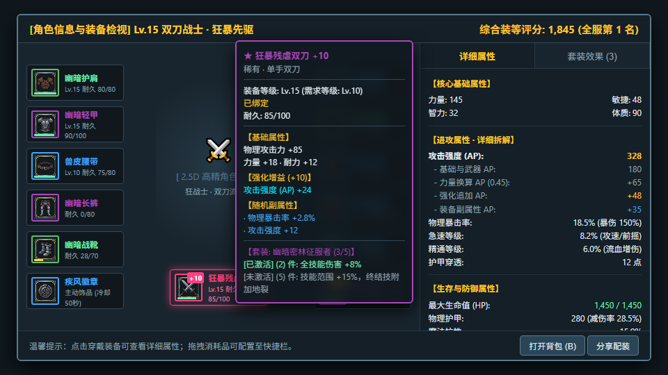

---

### 02. 个人信息与装备检视界面 (套装效果汇总页签)
- **文件**：[02-character-profile-set-bonuses.png](02-character-profile-set-bonuses.png)
- **功能特性**：
  - 切至【套装效果】页签，直观汇总当前穿戴激活的所有套装（防具套 3/5、首饰套 3/3、特殊装备套 2/3）。
  - 联动规则：当穿戴的某件装备耐久归零（如幽暗长裤耐久 0/80），该件自动移出套装计件，界面实时刷新并灰显失效的套装效果。

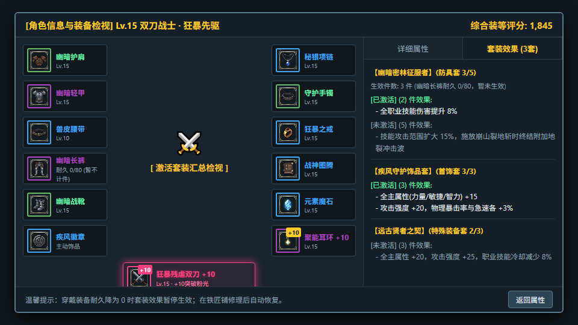

---

### 03. 角色背包与快速换装界面 (B 键)
- **文件**：[03-inventory-quickswap-b-key.png](03-inventory-quickswap-b-key.png)
- **功能特性**：
  - 左侧 13 槽纸娃娃，右侧 20/20 格背包物品。
  - 背包装备与道具清晰呈现绑定规则：未绑定装备显示【装备绑定】（穿戴时二次弹窗确认）；已穿戴或拾取绑定装备显示【已绑定】；材料道具显示【账号绑定】或不显示绑定状态（常规自由流通材料）。
  - 底部支持 3 个消耗品快捷位从背包长按拖拽绑定。
  - **验收点 UI01 防呆**：满包穿戴自动原格原位无缝对调；满包直接卸装触发安全拦截（需空格）。

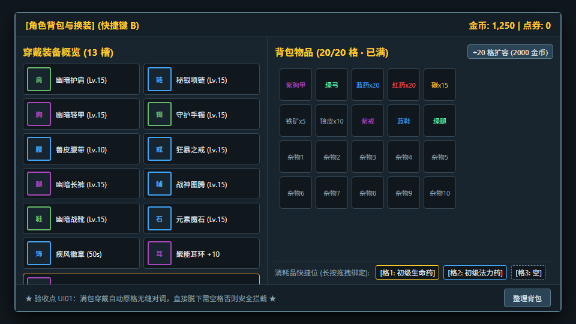

---

## 2. 城镇 NPC 与公共服务界面

### 04. 铁匠林纳克斯·装备修理界面
- **文件**：[04-blacksmith-repair-ui.png](04-blacksmith-repair-ui.png)
- **功能特性**：
  - 左侧单件修理与当前穿戴一键全修费用核算。
  - 右侧提供【● 当前穿戴 (7件)】与【○ 背包磨损 (2件)】切页，仅对启用耐久的槽位显示三色纯数值比例（绿色 $>50\%$、黄色 $\le50\%$、红色 $=0$ 损坏失效，严禁显示冗余文字标签）。
  - 支持在背包磨损页单独选择单件修复；一键全修严格仅修复当前穿戴装备，绝不连带修理背包磨损。
  - **验收点 UI08 防呆**：金币不足全额修理费时整批拒绝执行，不扣除 1 分钱；满耐久免单置灰。

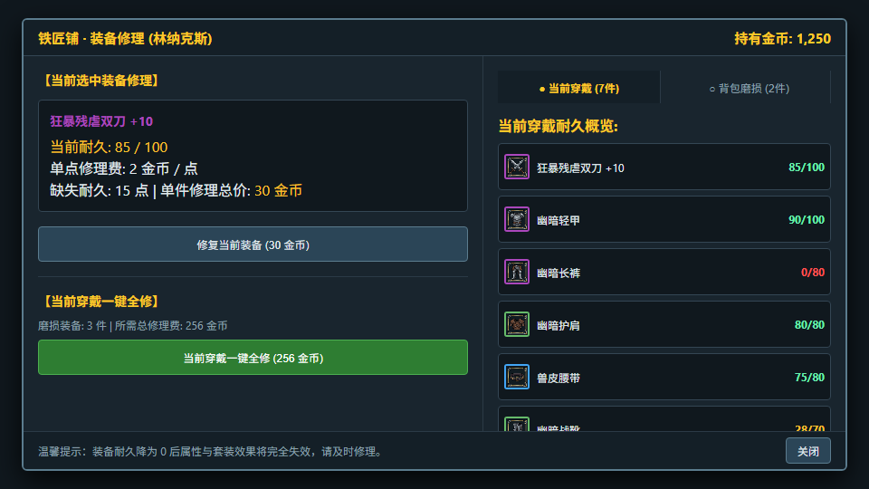

---

### 05. 铁匠玛丽·装备强化界面
- **文件**：[05-blacksmith-enhancement-ui.png](05-blacksmith-enhancement-ui.png)
- **功能特性**：
  - 严格仅允许武器与耳环入炉强化；消耗材料统一为游戏专属【精金】（与【秘银】对仗，30档武器目标+11基准消耗 20,000 金币与精金 x10）。
  - **武器强化光芒特效阶梯 (2026-10-21 新增)**：
    - **+1 ~ +10**：越接近 +10 越接近 **澄澈蓝光 (`#00e5ff` / `#42a5f5`)**；
    - **+10 ~ +13**：突破质变产生专属光芒，越高越接近 **耀眼粉光 (`#ff4081` / `#f06292`)**；
    - **+13 ~ +15**：神兵威压，越接近 **炽烈橙光 (`#ff9100` / `#ffa726`)**；
    - **+15 ~ +20**：极限神迹，越接近 **神秘紫光 (`#ab47bc` / `#7c4dff`)**。
  - 界面直观呈现 +10 $\rightarrow$ +11 专属耀眼粉光粒子呼吸效果。
  - **验收点 UI09 防呆**：严格不显示任何概率数字与进度条；目标 $\le 10$ 不降级，$+11/+12$ 失败降至 $+10$，$+13$ 起失败损毁返还角色绑定纪念品。

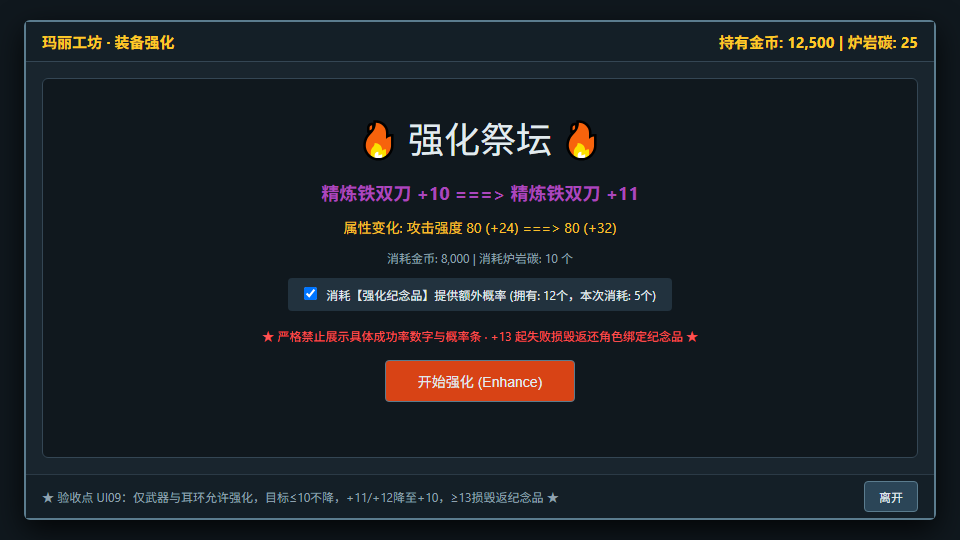

---

### 06. 微风杂货铺·商人常驻买卖界面
- **文件**：[06-merchant-shop-ui.png](06-merchant-shop-ui.png)
- **功能特性**：
  - 左侧商人货架常驻无限供应基础白武器与生命/法力恢复药水。
  - 右侧出售回收区：**穿戴中的装备禁止直接出售（需先卸入背包）**。
  - 价格由装等品质固定，强化与词条不加价，不提供历史回购，买卖不套利。

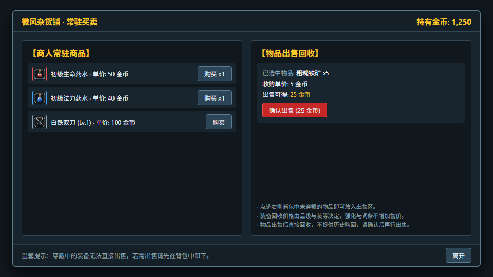

---

### 07. 王国储蓄银行金库界面
- **文件**：[07-bank-vault-ui.png](07-bank-vault-ui.png)
- **功能特性**：
  - **“左库右包” 架构**：左侧金库 5 列网格与右侧角色背包 5 列网格并排联动，各自拥有独立滚动条与操作边界。
  - **堆叠数量转移浮层**：转移堆叠道具（如精金、药水）时自动弹出轻量弹窗，支持微调与一键全选整叠。
  - 双页签隔离：【个人金库】（角色隔离，初始 20 格最多扩至 100 格，可存角色绑定） vs 【账号金库】（全账号共享，100 格全部开放）。
  - **验收点 UI04 防呆**：在账号金库页签存入角色绑定物品时触发硬拦截提示。

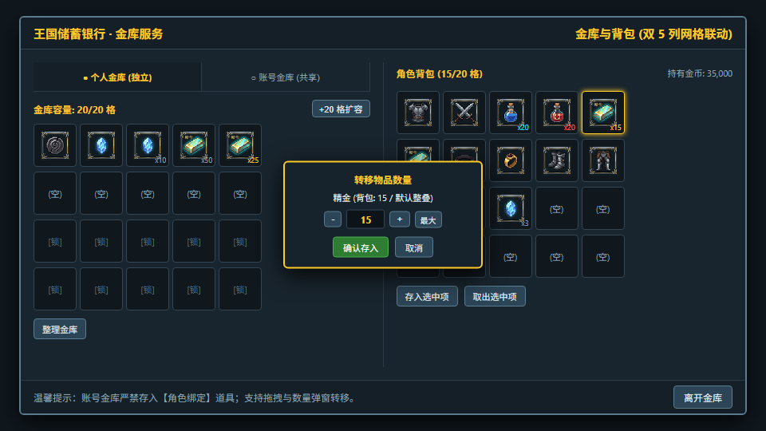

---

### 08. 信件与奖励收发所 (邮箱与通关待领)
- **文件**：[08-mailbox-and-pending-rewards.png](08-mailbox-and-pending-rewards.png)
- **功能特性**：
  - 双页签：【系统信箱】（30天有效期，有未领附件禁止手动删除，支持一键尽可能领取） vs 【通关待领仓库】（背包满溢出的通关结算装备永久保存，绝不自动过期）。

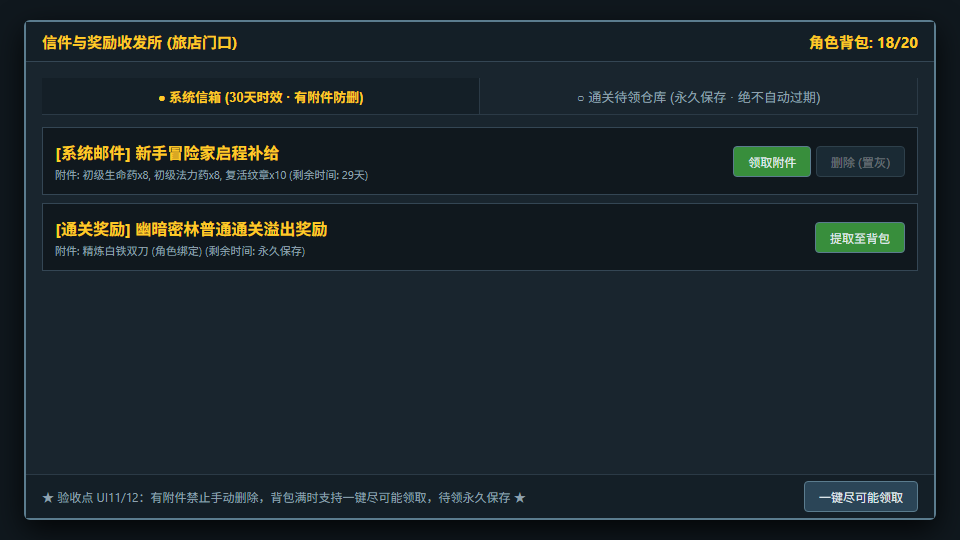

---

### 09. 全服冒险家战力排行榜 (单机战力榜单展示)
- **文件**：[09-leaderboard-inspect-mode.png](09-leaderboard-inspect-mode.png)
- **功能特性**：
  - 展示 TOP 战力评分榜单，同分严格按达到该分数的时间戳仲裁。
  - 榜单定位为单机全服标杆展示，玩家交互检视与社交功能已做接口隔离，划入联机版后续储备。

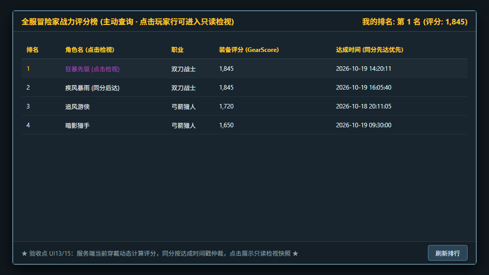

---

## 3. HUD 与场景入口界面

### 10. 城镇安全区常驻 HUD
- **文件**：[10-town-safety-hud.png](10-town-safety-hud.png)
- **功能特性**：
  - 左上角头像状态栏（点击打开个人信息 C 键）、右上角资产与红点提示、左下角虚拟移动摇杆、右下角功能按钮组（背包、角色、排行）。
  - 城镇内安全区**严格禁用普攻与技能施放**。

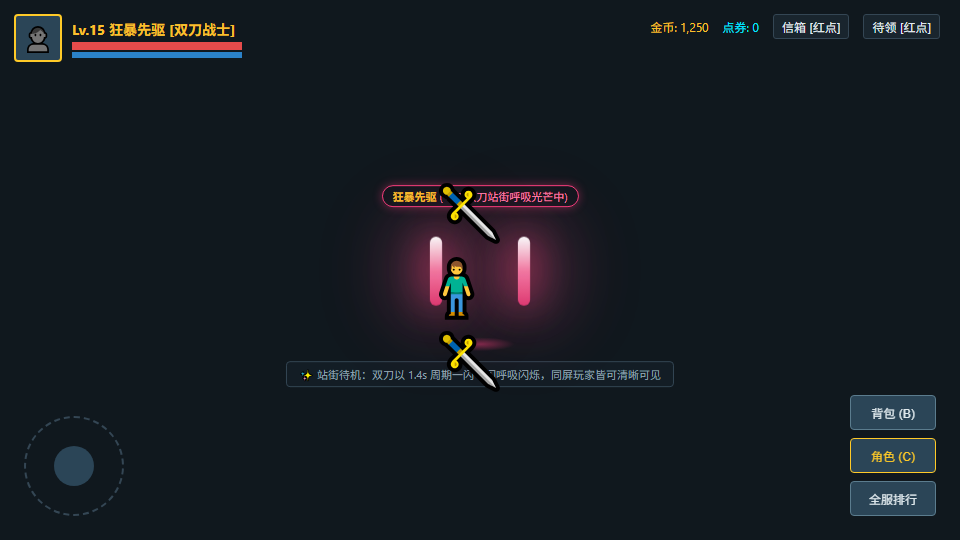

---

### 11. 副本战斗态 HUD
- **文件**：[11-dungeon-combat-hud.png](11-dungeon-combat-hud.png)
- **功能特性**：
  - 顶部首领状态条与退出副本按键（取消普通手动暂停）。
  - 左下角常驻固定虚拟移动摇杆（半径 55px，负责 2.5D X/Y 轴走位）。
  - 右下角大普攻按键 (84px) 环绕弧形四技能按键 (统一 64~72px 触控圈)。
  - 四技能组上方偏右设置**独立主动饰品按键** (52px，带专属独立 CD)。
  - 技能组左侧设置 3 个至少 48×48px 的消耗品快捷栏（带剩余数字与独立 10s 冷却遮罩）。

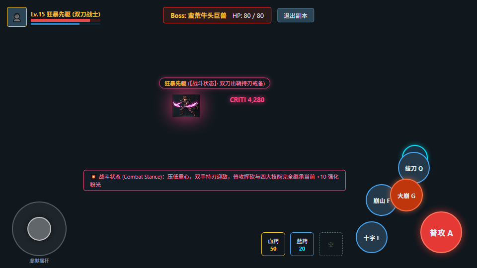

---

### 12. 副本难度选择界面 (Dungeon Portal Modal)
- **文件**：[12-dungeon-difficulty-portal.png](12-dungeon-difficulty-portal.png)
- **功能特性**：
  - 走入副本门口特定范围自动触发弹出（关闭离开再进入才重新触发）。
  - 移除非必要体力消耗文本，清晰展示掉落倾向与首通奖励。
  - **验收点 LOC04 防呆**：无武器、武器 0 耐久进本硬拦截。

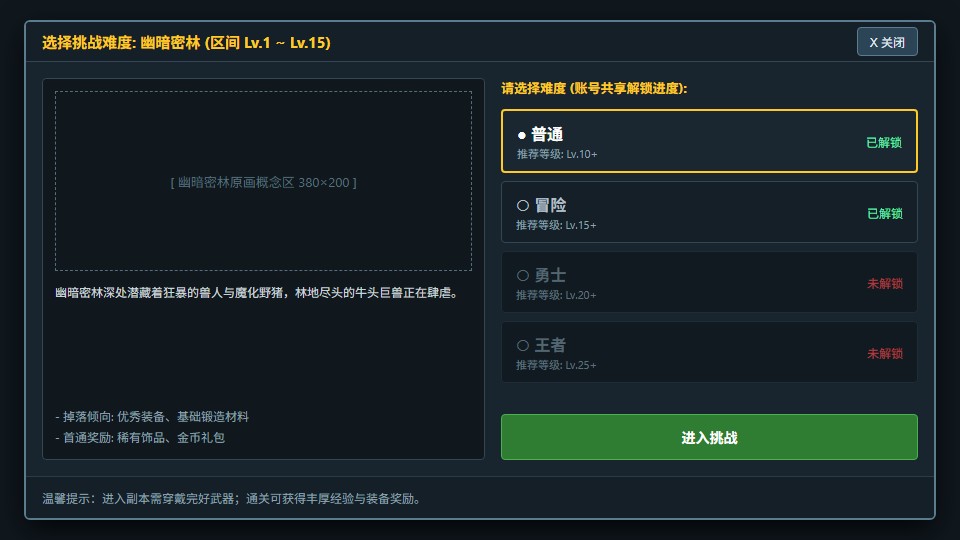

---

## 4. 武器强化视觉外观与光效规范

### 13. 武器强化阶梯光效外观总览 (四阶外观对照图)
- **文件**：[13-weapon-enhancement-glow-tiers.png](13-weapon-enhancement-glow-tiers.png)
- **视觉特性**：
  - **Tier 1 (+1 ~ +10) 澄澈蓝光 (`#00e5ff` / `#42a5f5`)**：
    - 刀刃轮廓附着幽蓝微光粒子，越接近 +10 蓝光越浓郁纯正，伴随冰蓝星芒颗粒跳跃。
    - 属于基础积累阶段，+10 阶段不碎不降。
  - **Tier 2 (+10 ~ +13) 突破质变粉光 (`#ff4081` / `#f06292`)**：
    - +10 质变触发专属耀眼炽粉流光，剑刃散发高亮粉色光晕与樱粉色星辰辉芒。
    - 属于普通追求终点与进阶起点（+10、+12为关键节点），失败退回 +10。
  - **Tier 3 (+13 ~ +15) 炽烈烈焰橙光 (`#ff9100` / `#ffa726`)**：
    - 极稀有神兵威压，整柄双刀被金橙烈焰光晕与上升的熔火火星紧密缠绕，散发高热灼烧感。
    - 属于极高风险追求，失败装备损毁，返还对应数量的角色绑定纪念品。
  - **Tier 4 (+15 ~ +20) 神秘虚空紫光 (`#ab47bc` / `#7c4dff`)**：
    - 极限神迹的象征，深邃星云紫雾缠绕刀刃，伴随暗紫色电弧脉冲与微光粒子环绕，全服瞩目。
    - 强化难度极高，全服极稀有巅峰炫耀标志。

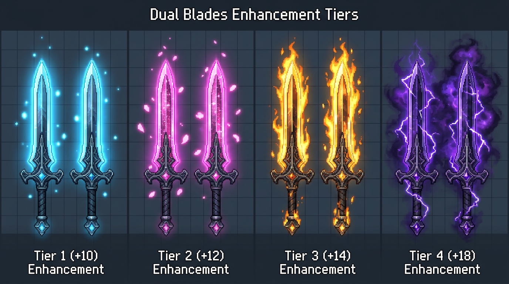

- **动态呼吸与站街/实战全场景表现 (2026-10-21 新增)**：
  - **DNF 风格一闪一闪呼吸律动**：光晕遵循 $1.4\text{s}$ 平滑正弦周期，谷值微敛、峰值暴涨 $180\%$ 扩散光辉，每隔 $2.8\text{s}$ 触发冷光沿刃脊穿梭扫掠；
  - **城镇安全区站街展示**：角色在城镇待机、慢跑走位，背负或手持的双刀全程常驻该动态光效，同屏玩家皆可清晰辨识，充当全服核心成就炫耀载体；
  - **副本实战与技能轨迹**：普攻挥斩刀光残影与四大技能（十字斩、崩山击、拔刀斩、大崩）完全继承当前强化的流光色彩，带来强烈的打击反馈。

## 2026-10-21当前评审增量

本轮最新14图逐张规则复核见[纠偏合同](../ui-review-authoritative-delta-v1.md)。现有PNG/HTML有已登记偏差，属于视觉参考；档位、堆叠、套装、HUD热区与首通奖励不能按图覆盖主规格/纠偏合同。正式评审采用该合同与状态覆盖，不沿用历史“验收点”声明为通过。
