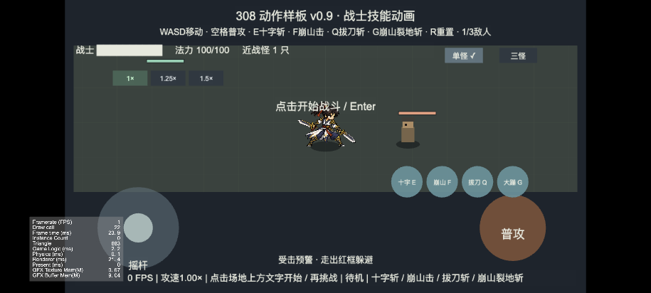

# 最新原型 H5 集成验收 v1

日期：2026-10-16。基线：`20d69a7`，加本轮 `Prototype.ts` 生命/法力与底部状态文字边界修复。来源：本会话按既定流程继续。状态：构建、模型、TypeScript、真实 Cocos 浏览器集成与横屏触控模拟通过；Note20 Ultra 本轮复测、微信构建与10分钟性能验收待执行。此前用户已验收流血与手动再挑战，不撤销该结论。

## 本轮发现与修复

原生命/法力 Label 默认以 x=-330 居中，宽920，实际文字左侧超出画面。改为 x=-130、宽660、左对齐并限制在框内；底部状态 Label 同样限制在920宽的单行框内。未改变伤害、技能时间、移动或触控热区。

同步 README、客户端说明、动作原型规格和路线图：清除已过期的“技能仍为单段”“流血无DOT”“死亡2.2秒自动重开”“仍待制作四技能粗动画”当前状态说明；保留独立历史评审记录，最新规格以三段普攻、2/3/1/4段技能与手动再挑战为准。

## 验证证据

| 项目 | 结果 / 边界 |
| --- | --- |
| 回归模型 | `check-model.cjs` 全部通过，覆盖攻速/取消、位移、2/3/1/4段、流血、倒地、反馈、胜败重开等 |
| TypeScript | Creator 3.8.8 随附 tsc，`--project client --noEmit` 通过 |
| Web Mobile | 独立目录 `client/build/web-mobile-acceptance` 构建完成，实际浏览器运行加载场景 |
| 资源加载 | 普攻24槽、身体9姿势、四技能各12槽，共6份图集正常加载 |
| 四技能集成 | 键盘实际施放，30HP被动靶近距离分别记录十字2次、小崩3次、拔刀1次、大崩4次；总直接伤害分别1/2/2/3。小崩终段及大崩显示倒地 |
| DOT | 大崩四段后靶怪27HP，首次周期事件0.2，生命26.8；DOT与直接命中独立记录 |
| 结果保留 | 通过可控致死夹具进入胜利，超过2.5秒仍停留胜利；Enter再挑战为战斗，血100、蓝100、held=false、旧效果0 |
| 战败与重置 | 通过可控受击夹具触发战败，R回到准备并恢复100生命 |
| 横屏布局 | 915×412浏览器视口，生命文字与底部状态限制在画面内，见下方截图 |
| 多点触控模拟 | 浏览器启用5触点，真实触摸开始战斗；左摇杆右推与右普攻同时有效，x移动3.40、held=true、一次命中。touchCancel后held=false、stick=null、攻击触点0、两轴0，当前段结束后待机 |

集成技能测试只将目标换为30HP、被动AI以稳定观察全部段数；伤害、技能时钟、命中判定、资源显示仍使用构建内的实际代码。胜败测试使用可控生命变化以覆盖UI状态流转，不声称由此完成了实战平衡验收。触控模拟在页面初始化前开启触点支持；桌面鼠标设备不具备相同能力，不能混用初始化后的模拟结果。



本轮调试构建共45个文件，未压缩磁盘总大小15,290,861字节（14.58MiB），含引擎及资源；不是微信主包大小、网络压缩传输量或启动时长。未预设新的包体门槛。

## 复现入口

```sh
node client/tools/check-model.cjs /Applications/Cocos/Creator/3.8.8/CocosCreator.app/Contents
node /Applications/Cocos/Creator/3.8.8/CocosCreator.app/Contents/Resources/app.asar.unpacked/node_modules/typescript/bin/tsc --project client --noEmit
/Applications/Cocos/Creator/3.8.8/CocosCreator.app/Contents/MacOS/CocosCreator --project "$PWD/client" --build 'platform=web-mobile;buildPath=project://build;outputName=web-mobile-acceptance;debug=true'
node client/tools/serve.cjs web-mobile-acceptance 127.0.0.1 8770
```

本次已运行局域网服务 `http://192.168.1.21:8770/`，手机与电脑同一Wi-Fi可访问；这是当前电脑地址，换网络后按实际IPv4重新启动服务。生成的build目录为忽略产物，不作为源码提交。

## 接下来的人工出口

1. Note20 Ultra横屏打开本轮H5，单怪/三怪各连续几轮，检查技能差异、落地点、流血跳字与操作遮挡；摇杆加普攻/技能、松手及切后台回前台后无卡键。确认生命和法力现在完整可见。
2. 配置本项目真实微信小游戏AppID，再构建/导入微信开发者工具并在Note20 Ultra实机运行。当前仓库未找到可用的该项目AppID，已向用户询问；没有创建账号、虚构ID或变更云资源。
3. 微信真机三怪战斗10分钟，记录FPS/帧时间、持续掉帧、发热及触控异常，目标60FPS。桌面截图中的FPS和触控模拟不能替代该结论。
4. 目标设备手感与性能出口确认后，再进入在线基础闭环：真实登录→创建角色→一次挑战→领取奖励→更换装备→重进恢复；服务端资产与幂等依照既有架构细化，不提前将本地结果作为永久资产权威。
