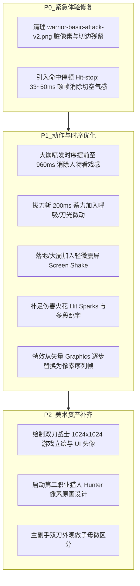

# 308世界 — 视觉、动作与特效审查意见（Review v1）

> 归档日期：2026-10-16
> 审查对象：原画概念、角色设计、双刀普攻v2、战士四技能草稿v1、运行特效与打击反馈
> 对应资源与代码基线：`warrior-basic-attack-v2.png`、`warrior-*-v1/v2.png`、`Prototype.ts`、`CombatModel.ts`、`EnemyModel.ts`

> 归档说明：来自其他会话的评审意见，保留原文作为快照；其中“立即行动”和参数建议不代表已批准的实现任务。以当前规格和用户后续选择为准。逐项状态与复核边界见[评审索引](README.md)。本轮只归档，不按本文调整动作或美术。

---

## 1. 原画与立绘（Concept Art & Portraits）

| 项目 | 当前现状 | 缺陷与体验问题 | 建议调整方案 | 优先级 |
| :--- | :--- | :--- | :--- | :--- |
| **UI 高精立绘** | 仅有 44~58 像素等效的像素人概念图 (`warrior-pixel-concept-v1.png`) | 缺少角色选择界面、结算展示、对话弹窗所需的半身像立绘与高精头像，门面质感不足 | 制作一套 1024×1024 级原创双刀战士半身立绘，并裁切导出 128×128 UI 头像与微信分享图 | P2 |
| **第二职业（猎人）** | 资产完全空白（0 原画、0 姿态设计） | MVP 规格明确包含“战士 + 猎人”，后续难以无缝承接原型测试 | 尽早确立猎人像素概念稿：敏捷轻甲体态、长弓造型与侧身站姿基线 | P2 |
| **换装与图层解耦** | 服装、发带、金甲与肉身烘焙在单张图元内 | MVP 规划 13 装备槽与两套紫装，整套烘焙贴图后续无法支持换装外观变化 | 后续生产级素材需制定分层规范（素体层、服装层、武器挂载层），避免重做全套动画 | P2 |

---

## 2. 角色设计与图元细节（Character & Weapons）

| 项目 | 当前现状 | 缺陷与体验问题 | 建议调整方案 | 优先级 |
| :--- | :--- | :--- | :--- | :--- |
| **图集脏像素与切边残影** | `warrior-basic-attack-v2.png` 包含切边残留 | 第 1 行第 5 帧右侧、第 2 行第 1 帧左侧有蓝色刀芒断片；第 3 行第 4~6 帧身前脚底有断裂悬浮噪点；真机最近邻放大时像闪烁的“苍蝇点” | 清理源图 Alpha 通道孤立噪点，优化 `pack-attack-atlas.py` 裁切边界，杜绝杂质进入游戏 | **P0** |
| **主副手双刀辨识度** | 双手持有造型、色彩完全对称的两把宽刃大刀 | 快速交错挥砍（普攻 A/十字斩）时，两把刀的轨迹容易糊成一团，难以分辨哪把在斩、哪把在架 | 建立主副手微差异：副刀略微缩短 15%（子母双刀感），或在刀镡/护手流苏赋予区分色（如主刀红绦、副刀金环） | P2 |
| **专用动作状态缺失** | 移动、急停、受击均直接回退到“公共双刀守势” | 移动时双脚在地面像平移滑行（Sliding），受击时只有闪白没有后仰受挫动作，战斗表现发僵 | 补足至少 4 帧慢跑（Run）、1 帧急停（Brake）与 2 帧受击硬直（Hurt）专用帧 | P1 |

---

## 3. 技能动作分镜与流畅度（Animations & Pacing）

### 3.1 普攻循环（三段 780ms）
- **反手上挑第 2 帧体积突变（Squash 跳变过大）**：
  - 现象：第 2 行第 2 帧（下蹲挑刀蓄势）身形突然缩水约 15%，到第 3 帧又瞬间拔高拉长。
  - 影响：1× 正常速度下连打时，角色腰部与躯干有明显“抽动/闪烁”感。
  - 改进：重绘该帧下蹲重心，保持下身宽度与头部体积的一致性，过渡更平缓。

### 3.2 十字斩（Cross Slash - 560ms）
- **出刀先后感欠缺**：
  - 现象：横斩（120ms）到竖斩（240ms）切换极快，在手机 60FPS 屏幕上容易被一眼看成“直接弹出 X 字”，缺少剪刀般的咬合节奏。
  - 改进：横斩末尾增加 30ms 极微弱留势，再爆发下挥竖斩；让“先横后竖”的剪影清晰可读。
- **发射十字弹道脱节**：
  - 现象：角色 340ms 回收身体，发射十字此时从身前凭空产生往前飘，缺少释放能量源。
  - 改进：在两刀交汇碰撞点增加 2 帧火花凝聚动画，引出发射物。

### 3.3 崩山击（Mountain Crash - 880ms）
- **起跳滞空前移像“被线水平拖拽”**：
  - 现象：代码以 34 单位平滑匀速累加位移，但角色在 340ms 滞空顶点姿势静止，缺乏抛物线运动的动力学感觉。
  - 改进：前移速度改为“起跳爆发前移 -> 滞空微缓 -> 落地加速砸向地面”的非线性缓动。
- **落地冲击力道偏轻**：
  - 现象：落地瞬间（580ms）直接进入下劈低势，没有深蹲吸震帧，显得轻飘。
  - 改进：落地碰撞时增加 1 帧更深的屈膝顿挫感。

### 3.4 拔刀斩（Draw Slash v2 - 760ms）
- **副刀瞬隐瞬现**：
  - 现象：0~140ms 副刀瞬间消失，760ms 动作结束副刀瞬间冒出。
  - 改进：起手给一个左手将副刀虚掩于身后的微动作；收招时顺势带出副刀，避免突兀瞬移。
- **200ms 蓄力完全绝对定格（易被误读为掉帧）**：
  - 现象：140~340ms 停留在第 3 帧完全不动，真机体验容易让玩家以为卡死。
  - 改进：保留 200ms 节奏，但加入微弱呼吸动势（发带/衣角微飘动 1 像素，或刀刃闪过一道微弱蓄能光泽）。

### 3.5 崩山裂地斩（Earth Break - 1320ms 动作 / 2400ms 残留）
- **人已收招起身，地面才大爆发（时序断层严重）**：
  - 现象：880ms 拍地，1180ms 角色已经开始抬身准备回正，但**地面爆发要等到 1280ms 才开始竖向喷发**。人物站稳了地面岩浆才炸开，感觉像在“看戏”。
  - 改进：将地面初次喷发从 1280ms 提前到 960~1000ms（拍地后震动 80~120ms 立即爆发），人物在强力喷发冲击的后座力中慢慢收刀起身。
- **特效过高过度遮挡角色与预警**：
  - 现象：1500ms 喷发峰值是高耸的红色柱状区域，倒地怪物的血条、流血心跳和地面危险红圈被完全遮盖。
  - 改进：喷发中心区域降低半透明度，或在人物/怪与预警层之上开启局部半透镂空（Ghost Silhouette）。

---

## 4. 特效与打击反馈（Combat Feel & VFX）

| 模块 | 当前现状 | 缺陷与体验问题 | 建议调整方案 | 优先级 |
| :--- | :--- | :--- | :--- | :--- |
| **特效风格割裂** | 剑气条带、地裂圆弧、拔刀光弧由 Cocos `Graphics` 纯矢量代码绘制 | 精致的像素角色与光滑的矢量几何线条同屏，塑料感强，破坏复古像素沉浸感 | 将所有刀芒、剑气条带、地裂火光转为**逐帧像素光效序列帧（Pixel VFX）** | **P1** |
| **缺少命中顿帧（Hit-stop）** | 击中怪物只有闪白与推开，动作速度恒定 | 挥砍感觉像“切空气”，没有刀刃切入肉体的阻力阻滞感（卡肉感） | 引入命中停滞（Hit-stop）：普通命中停顿 33ms（2帧），崩山击/大崩砸地停顿 50~60ms，双方动作微冻结 | **P0** |
| **微震屏（Screen Shake）缺失** | 落地与大招地面炸开无摄像机震动 | 崩山击和大崩拍地缺乏重武器该有的震荡冲击力 | 在大崩拍地（880ms）和小崩落地（580ms）加入 4~8 像素、衰减约 150ms 的轻微屏幕震颤 | **P1** |
| **火花爆点与跳字缺失** | 2/3/1/4 多段伤害已接入逻辑，但画面只有血条短截 | 无法直观感知“十字斩砍了两段”或“崩山裂地斩持续炸了四下” | 每次伤害结算点生成小型像素受击火花（Hit Sparks）与跳出的伤害飘字 | **P1** |
| **流血脉冲形态生硬** | 在敌人矩形躯干上盖红色透明色块模拟脉冲 | 色块过于方正简陋，不自然 | 改为怪物轮廓暗红色呼吸光晕（边缘泛红）或微小血气向上飘散粒子 | P2 |
| **死亡白影阴影硬切** | 生命归零进入 180ms 泛白 + 320ms 淡出，但脚底阴影在结束瞬间直接消失 | 死亡退场最后瞬间有“闪烁裁切”感 | 脚底阴影与血条淡出绑定同个 `deathOpacity` 曲线平滑隐去 | P1 |

---

## 5. 改进路线图与实施优先级（Action Matrix）

### 落地执行指南
1. **立即行动（本轮代码/图集可闭环）**：
   - 清理图集噪点；
   - 在 `Prototype.ts` / `CombatModel.ts` 引入 `hitStopTimer`（命中瞬间短暂停滞逻辑刷新 30ms）；
   - 微调 `WarriorSkillAnimation.ts` 中大崩的爆发时序 `[0.88, 1.00, 1.20, 1.40]`。
2. **第二阶段（视觉表现升级）**：
   - 用 Aseprite/AI 制作像素版刀光与地裂粒子替换矢量线；
   - 增加受击火星与跳字。
3. **第三阶段（角色与系统扩充）**：
   - 猎人职业立项与战士立绘出图。
